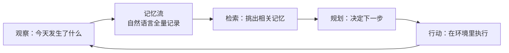
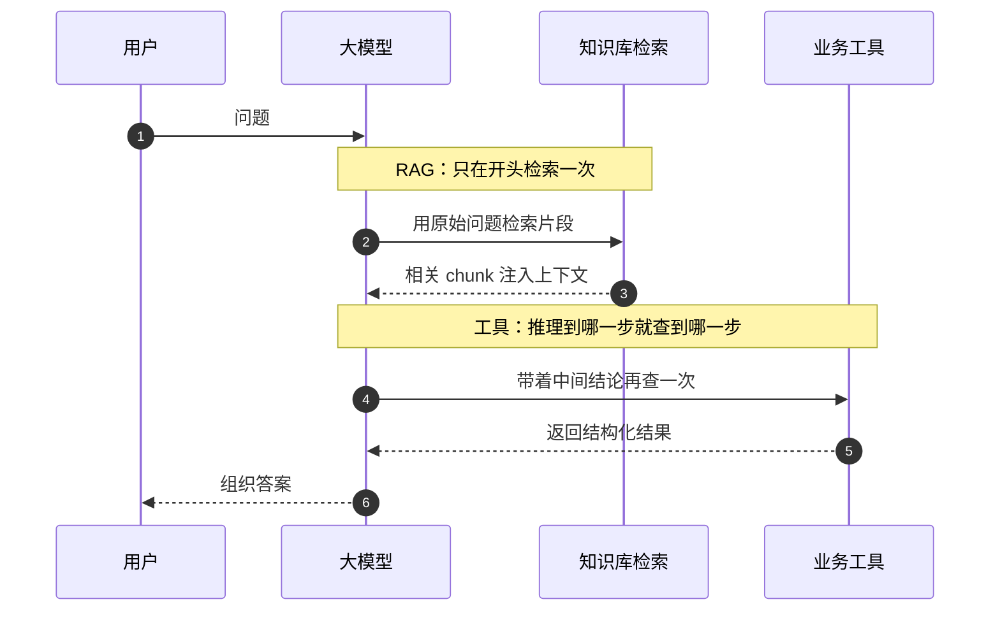
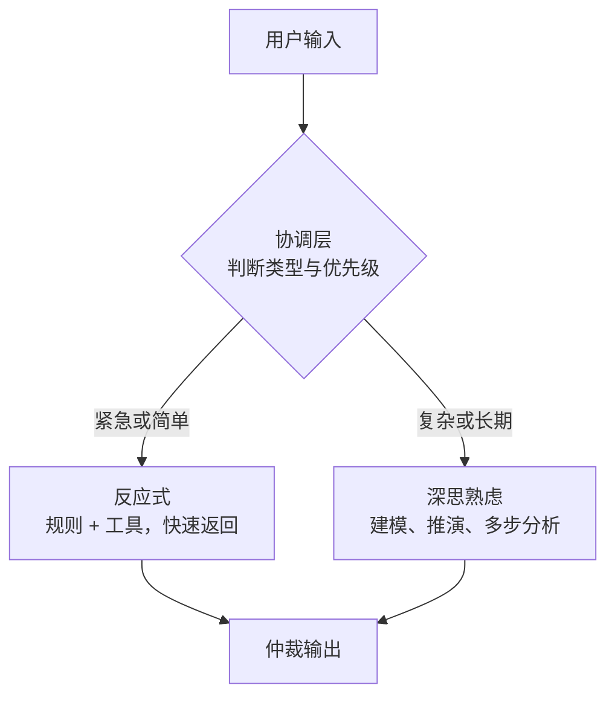
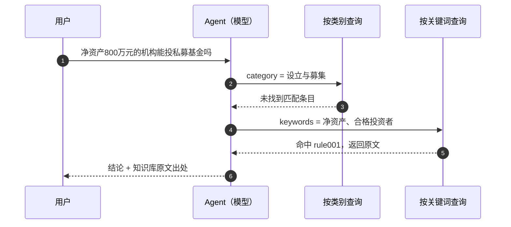
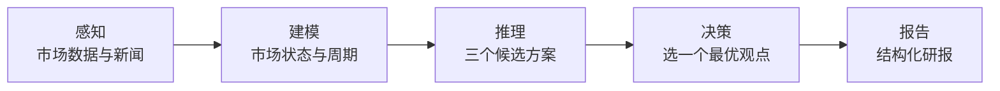
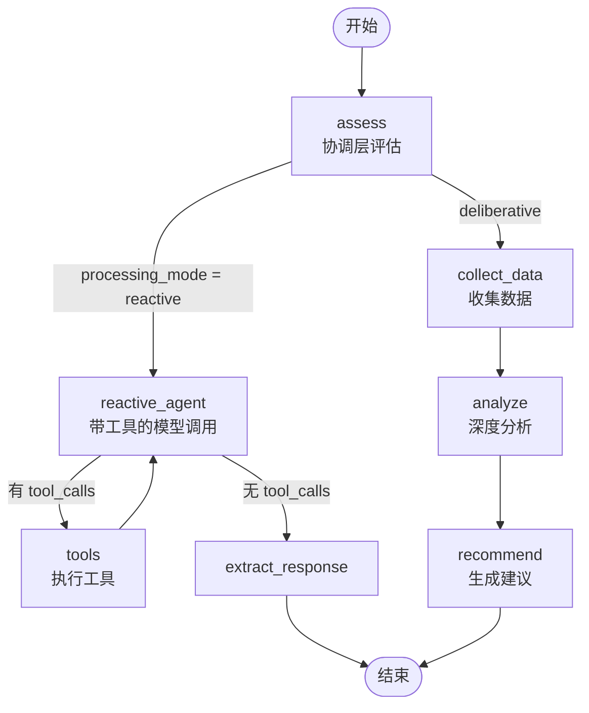

<!-- more -->

模型能读懂「今天上证指数表现如何」，也能把一份财报拆成三段摘要。但把「帮我看看新能源汽车这个行业该怎么投」这样的目标丢给它，它做不完。缺的不是理解力，是它不会自己决定先查什么、查几次、什么时候停。课件的开场把这件事说得很直接：给 Agent 一个目标，它就能完成剩下的全部工作。

这一章要补的就是「剩下的全部工作」。先界定 Agent 到底是什么，和 RAG、和固定工作流的分界在哪；再把自主规划拆成三种架构——反应式、深思熟虑、混合，看清每种架构在什么条件下成立；然后用三个跑通的案例把架构落到代码上，私募基金问答助手用 LangChain 走反应式，智能投研助手用 LangGraph 走五阶段推演，投顾助手用条件边把两种模式缝在一起；最后回到工程判断：什么样的任务值得上 Agent，什么样的任务老老实实写工作流更省事。

三个案例共用一套底座。课堂上给出的式子是 `Agent = LLM（大脑）+ RAG（知识库）+ Tool（工具）`。模型都是通义千问，知识库都是几十行字典，工具都是普通 Python 函数，唯一的变量是编排方式。把编排拿掉，剩下的东西上一章已经会了；把编排加回来，就是这一章的差距。

## 1. Agent 是什么：一个循环，三种能力

### 1.1 从自动化到自主化

2023 年 Google 和 Stanford 的团队做了一件有意思的事：他们造了一个叫 Smallville 的小镇，把 25 个由大模型驱动的角色放进去，让它们自己生活。论文叫 _Generative Agents: Interactive Simulacra of Human Behavior_，做出来的东西更像社会学实验，而不是工程 demo。

每个角色都能做四件事：跟别人和环境交流；记住自己做过和观察到的事情；反思这些观察；制定每天的计划。角色用自然语言设定，包括职业和与他人的关系，比如「John Lin 是一名药店店主，他乐于助人，一直在寻找让客户更容易获得药物的方法，妻子是大学教授」。每走一步，Agent 输出一句自然语言描述当前动作，这句话再被翻译成沙盒里的具体动作——走到某张床前、占用某个炉子、去杂货店找另一个人。

更值得注意的是信息怎么传播。Sam 在杂货店告诉 Tom 他在竞选镇长，Tom 后来跟 John 讨论 Sam 赢的机会，几天后 Sam 的竞选成了镇上的热门话题，有人支持他，有人犹豫不决。这些都没有被写进任何一条规则，是从「记住 + 反思 + 计划」里长出来的。

支撑这四件事的模块叫记忆流（Memory Stream）：一个用自然语言记录 Agent 全部经验的数据库。有行为就记录，需要决策时从记忆流里检索相关的几条，用来规划下一步。之所以用自然语言而不是结构化字段，理由很实在——只有这样，检索出来的东西能直接喂给大模型做推理。



这个环就是后面所有架构的原型。反应式是它最简的形态，深思熟虑在「规划」这一步里插入了推演，混合式则是让两条环路共存、由仲裁决定走哪条。Generative Agents 的论文地址在课件里给了，[arxiv.org/pdf/2304.03442v1](https://arxiv.org/pdf/2304.03442v1.pdf)，在线 demo 也还挂着。

### 1.2 三件套：规划、记忆、工具

把上面那个环拆开看，Agent 相对普通 LLM 应用多出来的能力只有三样。

| 能力                 | 工程上对应什么                               | 缺了会怎样                             |
| -------------------- | -------------------------------------------- | -------------------------------------- |
| 规划（Planning）     | 把目标拆成可管理的子目标，决定调用顺序       | 多步任务做一半就停，或者反复重来       |
| 记忆（Memory）       | 短期＝`messages` 列表；长期＝外部存储 + 检索 | 每轮都从零开始，用户得重复交代背景     |
| 工具使用（Tool use） | 函数、API、数据库、别的 Agent                | 只能凭参数里的知识答题，答不了实时问题 |

这三样里最容易被误判的是「记忆」。很多被叫做 Agent 的项目，长期记忆其实就是 RAG，短期记忆就是一段对话历史。把这两个东西叫对了，架构就不会乱：RAG 解决「知道什么」，工具解决「能做什么」，规划解决「先做哪一步」。三件事的失败模式完全不同，混在一起排查就会浪费时间。

课件在这一节还补了一句判断：Agent 通常被实现为「LLM 通过工具调用、在环境反馈下循环执行动作」的系统。Anthropic 的说法更直白——实现很简单，就是一个循环。所以 Agent 的成败往往不在模型，而在工具集设计得够不够清晰、文档够不够全。

### 1.3 Agent、RAG、工作流：三个概念的分界

课堂上第一个问题就是「Agent 和 RAG 的区别是啥」。回答只有一句话，但值得展开：RAG 是知识库，Agent 是人；人是会自己决定要不要翻书的。

真正的差别在于「检索发生在什么时候、由谁决定」。

- 原生 RAG（native RAG）是一次性的：拿用户的原始问题去知识库检索若干 chunk，塞进 system prompt，然后一次生成。流程固定，不需要工具，也不需要模型做决策。
- 知识检索工具是把「查」这件事包成函数交给模型：查不查、查哪个、查几次、用什么关键词查，都由模型在推理过程中决定。



这个区别在需要「链式查」的任务上会变成硬伤。课堂举的例子是：查「员工号 10001 的年龄」。知识库里同时有姓名、年龄、工号三列，但用户只给了工号。原生 RAG 拿「员工号 10001 的年龄」去检索，可能捞回一条只写了姓名的记录，模型只能猜。而工具可以先查「工号 10001 是谁」，得到「CY」，再用新的 query 查「CY 的年龄」——中间这一步是 RAG 结构上做不到的，因为它没有「再查一次」的位置。

所以判断标准可以写成一句话：**流程是否固定。** 固定就在开头查一次，用 RAG；不固定、要边想边查，就把检索做成工具，交给 Agent。

## 2. 什么时候该上 Agent

### 2.1 开放性问题才值得

课件给了一个很干脆的适用边界：Agent 适合**开放性问题**——很难或无法预测需要几步、路径无法硬编码的那类任务。因为 LLM 可能跑很多轮，你必须对它的决策能力有基本信任。

自主性带来两个代价，都要提前认账。一是**成本**，多轮调用意味着 token 线性增长；二是**错误累积**，每一步的小偏差会在后续步骤里放大。课件的建议是：在沙盒环境里充分测试，并且设好护栏（guardrail）——限制它能碰的数据、能调的工具、能花的钱。

反过来说，「决策树能画清楚」的任务就不该上 Agent。一个审批流、一个报表生成、一个固定格式的抽取任务，写成工作流既便宜又稳定，错误还容易定位。真正适合 Agent 的是编程这类任务：复杂度高、价值大、而且输出可验证（跑一遍单元测试就知道对不对）。这也是为什么第一个真正跑通商业闭环的 Agent 品类是 Coding Agent。

### 2.2 三条判断线

把课件的判断标准压成一张表，做方案评审时可以直接照着问。

| 判断线     | 走工作流                      | 走 Agent                                   |
| ---------- | ----------------------------- | ------------------------------------------ |
| 任务复杂度 | 步骤可枚举，决策树画得出来    | 步骤数不确定，路径依赖中间结果             |
| 任务价值   | 单次价值低，靠调用量摊薄成本  | 单次价值高，能承担多轮 token 成本          |
| 错误成本   | 出错后果严重且难以回滚        | 出错可验证、可重试，或有人工复核           |
| 关键能力   | 规则和模板覆盖 90% 以上的情况 | 核心子任务（生成、调试、归因）模型确实能做 |
| 交互形态   | 后台批处理，无人在场          | 有人在场，或多轮对话中逐步收敛             |

这张表的用法不是打分求和，而是找否决项：错误成本高又没法验证的任务，即使其他项都符合，也不该让它自主跑。课件在讲 Best Practice 时给了同样的结论——从最简单的提示开始，只有当简单方案解决不了时才加多步智能体。

顺带一提，Agent 和工作流不是二选一。课件里智能制造的例子说得很清楚：Agent 负责监控设备、预测维护、优化排产，工作流负责采购、排序、质检、物流，两者接在一起才是一条完整的产线。把 Agent 当成工作流里的一个节点，往往比让 Agent 承包一切更靠谱。

### 2.3 三条设计原则

课件把构建 Agent 的经验收成了三条，这三条在后面的代码里会反复出现。

**保持简洁。** 避免不必要的复杂度，先把核心功能跑通。课件给了一个很实用的观察：不同功能的 Agent 可以共享同一套代码框架，只改工具和提示词——三个案例的代码结构高度相似，就是这个道理。

**优先透明。** 明确展示规划步骤，让用户知道它现在在做什么、为什么这么做。混合案例里的 `[DEBUG]` 日志就是最低成本的透明：`[DEBUG] 进入节点: assess_query`、`[DEBUG] 分支判断: processing_mode=reactive`。没有这几行，用户只会看到一个转圈。

**把工具和文档当一等公民。** 工具集就是 Agent 的手，文档和测试决定这双手好不好用。课件原话是「打造 Function/MCP：打造工具，以及说明文档和测试」。

## 3. 三种架构：直觉、推演、仲裁

### 3.1 反应式：快，但只看眼前

反应式（Reactive）是最简单的一种：模型分析当前情况，决定下一个动作，在环境里执行，拿到观察结果，再重新评估。没有长期计划，没有内部建模，一个循环接一个循环，直到任务结束。

它的三个环节可以照抄课程定义：感知（获取环境输入）、决策（模型或规则系统立即生成动作）、执行（执行并观察结果，循环往复）。

优势很明确：快，没有复杂推理，适合毫秒级响应；简单可靠，行为由明确规则驱动，容易设计和验证。

局限同样明确：缺乏适应性，遇到没预见的场景就卡住；短视，只优化当前这一步，容易陷入局部循环（课件举的例子是机器人原地绕圈）。

课件用了一个很贴切的类比：膝跳反射。快、直接、不用过脑子，但你没法靠膝跳反射打完一场球。

### 3.2 深思熟虑：慢，但推演过

深思熟虑（Deliberative）多了一步「内部建模」。流程是：感知环境 → 更新内部世界状态 → 生成候选计划并模拟结果 → 选择最优方案执行。

关键差别在「模拟」。反应式是走一步看一步，深思熟虑是先在心里把几条路都走一遍，评估完再动。因此它能处理多步复杂任务，能优化长期目标而不是即时反馈，也能适应动态变化的环境。

代价是延迟和成本。每多一个阶段就是一次完整的模型调用，五个阶段就是五次；如果某个阶段还要生成多个候选方案，token 会再翻一倍。课件给的类比是下棋高手：每步棋都经过推演，而不是凭直觉反应。

典型的应用场景是路径规划、物流调度、投资决策——共同点是「试错成本高，所以宁可先想清楚」。

### 3.3 混合：两种都要，就得有人裁判

混合架构（Hybrid）承认一个现实：真实业务里既有「现在几点了」这种必须秒回的问题，也有「我的组合该怎么调整」这种必须想清楚的问题。用一套架构硬扛，要么慢得要死，要么答得敷衍。

它的做法是分层加仲裁：

- 底层是反应式，处理即时任务，毫秒级；
- 中层是协调层，评估任务类型和优先级，决定走哪条路（这一层是可选的）；
- 顶层是深思熟虑，做长期规划和多步分析。

仲裁机制通常是一个分类器，紧急的走反应式，常规的走深思熟虑。课件的典型例子是自动驾驶：突发障碍立即刹车，正常行驶规划最优路线。



### 3.4 三种架构的取舍

| 维度         | 反应式         | 深思熟虑             | 混合               |
| ------------ | -------------- | -------------------- | ------------------ |
| 决策依据     | 当前环境       | 内部模型 + 模拟      | 由协调层决定       |
| 响应速度     | 最快，单轮     | 最慢，3～5 轮        | 视分支而定         |
| 能处理的任务 | 单步、规则清晰 | 多步、需要权衡       | 两类都覆盖         |
| 主要失败模式 | 短视、循环     | 慢、成本高、过度分析 | 仲裁判错，走错分支 |
| 典型案例     | 问答检索、避障 | 投研、路径规划       | 投顾、自动驾驶     |

一句判断：**反应式决定能不能用，深思熟虑决定答得好不好，混合决定两者都要时怎么不打架。**

还有两点课堂上被专门问过，值得记下来。一是深度思考型也可以循环调用工具，不是「一次推演到底」；二是模式可以嵌套——混合里的反应式分支本身又是一个完整的工具调用循环。架构图上的分层是逻辑分层，不是代码隔离。

## 4. CASE 1：私募基金问答助手（反应式）

### 4.1 数据与工具：三种检索口径

案例要回答的是私募基金运作指引相关的问题。知识库是一个列表，每条规则四个字段：`id`、`category`、`question`、`answer`。

```python
FUND_RULES_DB = [
    {
        "id": "rule001",
        "category": "设立与募集",
        "question": "私募基金的合格投资者标准是什么？",
        "answer": "合格投资者是指具备相应风险识别能力和风险承担能力，投资于单只私募基金"
                  "的金额不低于100万元且符合下列条件之一的单位和个人：……"
    },
    # ……
]
```

结构本身很朴素，关键是它决定了工具怎么切。同一个知识库，可以从三个方向进入：按关键词、按类别、按完整问题。于是有了三个 `@tool`。

```python
@tool
def search_rules_by_keywords(keywords: str) -> str:
    """通过关键词搜索相关私募基金规则。输入应为相关关键词，多个关键词用逗号或空格分隔。"""
    keywords = keywords.strip().lower()
    keyword_list = re.split(r'[,，\s]+', keywords)

    matched_rules = []
    for rule in FUND_RULES_DB:
        rule_text = (rule["category"] + " " + rule["question"]).lower()
        match_count = sum(1 for kw in keyword_list if kw in rule_text)
        if match_count > 0:
            matched_rules.append((rule, match_count))

    matched_rules.sort(key=lambda x: x[1], reverse=True)
    ...
```

这段代码有两个细节值得停一下。

第一，`@tool` 装饰器做的事比看起来多。函数名直接变成工具名（`search_rules_by_keywords`），**函数下面的 docstring 变成工具描述**（tool description），函数签名变成参数 schema。所以那句「输入应为相关关键词，多个关键词用逗号或空格分隔」不是注释，是给模型看的说明书。课堂上有人问「既然 tools 已经作为参数传进去了，system prompt 里还要不要写工具描述」，答案是不用——注册已经完成，重复写不会错，但也没用。

第二，工具内部的匹配逻辑很粗糙：把关键词拆分，看在 `category + question` 里命中几个，再按命中数排序。真正上线当然要用向量检索，但这里刻意用字符串匹配，是为了让「工具失败」这件事可复现——你随时可以构造一个查不到的问题，看模型接下来怎么办。

### 4.2 为什么把知识库做成工具

这是整个案例里最值得抄的设计决策。

课件演示的第一个问题是「私募基金的合格投资者标准是什么」，直给，`answer_question` 一次命中。第二个问题才是精华：「如果我是一个净资产 800 万元的机构，我能投资私募基金吗？」

这个问题里没有任何一个字段名和知识库对得上——知识库里写的是「净资产不低于 1000 万元的单位」，用户问的是「800 万元」。如果把知识库直接拼进 prompt（原生 RAG 做法），检索很可能捞不到这条，模型就开始自由发挥。

而做成工具之后，模型自己走出了两步：先按类别查「设立与募集」，没找到；再换关键词查「净资产、合格投资者」，命中 `rule001`。



这条轨迹就是「自主规划」的最小证据：没有人在代码里写「先试类别再试关键词」，是模型自己换的检索策略。课件把这一步专门截了图，因为它是反应式架构里唯一真正体现「自主」的地方——其余部分（选工具、填参数、组织答案）都是标准循环。

代价也要说清楚：一次问答可能要 1～3 轮工具调用，每轮都是一次完整的模型推理。问题越模糊，试错轮数越多，延迟和成本跟着涨。

### 4.3 知识边界：宁可说不知道

第四个设计要点是边界。课件专门用一页讲「知识边界处理」，落到代码里就是 system prompt 里的三句话。

```python
system_prompt = """你是一个私募基金问答助手，专门回答关于私募基金规则和运作的问题。

注意：
1. 如果知识库中没有相关信息，请明确告知用户"对不起，在我的知识库中没有关于[具体主题]的详细信息"
2. 如果你基于自己的知识提供补充信息，请用"根据我的经验"或"一般来说"等前缀明确标识
3. 回答要专业、简洁、准确"""
```

这三句话解决的是同一个问题：**让用户知道哪句话有出处，哪句话是模型的推测。** 金融、医疗、法务这类场景里，一个「听起来对但没有依据」的答案，比「不知道」危险得多。

课堂上有人当场追问：问「什么是 ETF」，模型答「对不起，在我的知识库中没有关于 ETF 的详细信息」——「这个大模型回答不了么？」它当然答得了。但这一版的设计选择是不答，因为知识库里没有，而这条回答没有出处。要答也可以，走第二句：用「一般来说」开头，把出处标出来。

这就是边界设计的取舍：**可核查优先于显得聪明。** 如果业务上更在意覆盖率，把第一句改松、把第二句加强即可，改的是提示词，不是架构。

### 4.4 反应式的边界

这个案例跑通了，但它能做的事有天花板。

一是没有全局计划。三个工具是并行候选，不是流水线，所以它处理不了「先查规则、再算金额、最后出结论」这类有依赖的任务。

二是策略全靠提示词。想让它「先查类别再查关键词」，只能在提示词里写引导，写不好就变成每轮乱试。

三是对多步任务会打转。反应式的循环没有「我已经查过这个了」的记忆，同一个工具可能被反复调用。

要突破这三条，就得换成有显式阶段和显式状态的架构——也就是下一个案例。

## 5. CASE 2：智能投研助手（深思熟虑）

### 5.1 五个阶段

案例的目标是「给一个研究主题，产出一份投资研究报告」。课件把它拆成五步，这个拆法本身就是深思熟虑架构的定义。



五个阶段各自的产出都是结构化的：感知阶段输出市场概况、关键指标、近期新闻、行业趋势；建模阶段输出市场状态、经济周期、风险因素、机会领域、市场情绪；推理阶段输出三个带置信度的候选方案（含假设、方法、预期结果、优缺点）；决策阶段输出投资论点、支持证据、风险评估、建议、时间框架；报告阶段输出全文。

对比一下就清楚了：反应式案例里，这些「阶段」根本不存在，模型在一次对话里同时做理解和检索。深思熟虑把它们显式拆开，每一段都能单独检查、单独替换、单独重跑。

### 5.2 状态：一块显式的黑板

LangGraph 版本的第一件事不是写提示词，是定义状态。

```python
class ResearchAgentState(TypedDict):
    # 输入
    research_topic: str
    industry_focus: str
    time_horizon: str
    # 处理状态
    perception_data: Optional[Dict[str, Any]]
    world_model: Optional[Dict[str, Any]]
    reasoning_plans: Optional[List[Dict[str, Any]]]
    selected_plan: Optional[Dict[str, Any]]
    # 输出
    final_report: Optional[str]
    # 控制流
    current_phase: Literal["perception", "modeling", "reasoning", "decision", "report"]
    error: Optional[str]
```

这个类的作用相当于一块黑板：每个节点都能读，也能往上写。课堂上有同学问「什么是状态机、state 是什么意思」，答案就落在这里——**state 是 Agent 运行过程中产生的数据，被显式保存下来，供后续节点使用。**

`current_phase` 和 `error` 两个字段是给控制流用的，不是给业务用的。前者记录「现在到哪一步了」，后者记录「哪一步出了什么问题」。把控制流字段混在业务字段里当然不够优雅，但它让图的路由函数只读这两个字段就能决定下一步，省掉了很多隐式约定。

### 5.3 结构化输出：用 Pydantic 卡住边界

五个阶段的产出都用 Pydantic 模型定义。课件里给了四个。

```python
class PerceptionOutput(BaseModel):
    """感知阶段输出的市场数据和信息"""
    market_overview: str = Field(..., description="市场概况和最新动态")
    key_indicators: Dict[str, str] = Field(..., description="关键经济和市场指标")
    recent_news: List[str] = Field(..., description="近期重要新闻")
    industry_trends: Dict[str, str] = Field(..., description="行业趋势分析")

class ReasoningPlan(BaseModel):
    """推理阶段生成的候选分析方案"""
    plan_id: str = Field(..., description="方案ID")
    hypothesis: str = Field(..., description="投资假设")
    confidence_level: float = Field(..., description="置信度(0-1)")
    pros: List[str] = Field(..., description="方案优势")
    cons: List[str] = Field(..., description="方案劣势")
```

两个理由值得说明。

一是**类型即契约**。下游节点直接 `state["world_model"]["risk_factors"]`，如果上游给了一个字符串而不是列表，遍历时就会按字符走，报出来的错莫名其妙。Pydantic 在边界上就把这类错误拦住，报错位置精确到字段。

二是 `Field(description=...)` 会被序列化进 JSON Schema，随提示词一起交给模型。所以 description 不是给同事看的注释，是**写给模型的字段说明**。「置信度(0-1)」这种描述如果不写，模型很可能给你 85 而不是 0.85，后面排序就全乱了。

有意思的是，代码里定义了这四个模型，实际执行时用的却是 `JsonOutputParser()`，并没有走 `PydanticOutputParser`。也就是说，模型是「照着 JSON 结构输出」的，而不是被 schema 强校验的。这是一个典型的教学妥协：Pydantic 在这里起的是「文档」和「类型提示」作用。要真的强校验，换成 `PydanticOutputParser(pydantic_object=PerceptionOutput)` 更稳，代价是提示词里会多塞一段 schema，且模型不遵循时直接抛错而不是降级。

### 5.4 单个节点的固定五步

五个节点的内部结构几乎一模一样。以推理节点为例，这段代码值得逐段看。

```python
def reasoning(state: ResearchAgentState) -> ResearchAgentState:
    print("3. 推理阶段：生成候选分析方案...")
    try:
        # 1. 检查前置条件
        if not state.get("world_model"):
            return {**state, "error": "推理阶段缺少世界模型",
                    "current_phase": "modeling"}
        # 2. 准备提示与输入
        prompt = ChatPromptTemplate.from_template(REASONING_PROMPT)
        input_data = {
            "research_topic": state["research_topic"],
            "world_model": json.dumps(state["world_model"], ensure_ascii=False, indent=2),
        }
        # 3. 调用 LLM 并解析
        chain = prompt | llm | JsonOutputParser()
        result = chain.invoke(input_data)
        # 4. 更新状态
        return {**state, "reasoning_plans": result, "current_phase": "decision"}
    except Exception as e:
        # 5. 出错回退
        return {**state, "error": f"推理阶段出错: {str(e)}",
                "current_phase": "reasoning"}
```

第一处，`return {**state, ...}` 里的展开不能省。TypedDict 状态在图里是整体替换的——节点返回什么，状态就变成什么。只返回 `{"reasoning_plans": ...}` 会让 `perception_data`、`world_model` 一起消失，下一个节点立刻报「缺少前置数据」。除非显式声明了 reducer（比如 `messages` 用的 `add_messages`），否则别指望自动合并。

第二处，`json.dumps(..., ensure_ascii=False, indent=2)`。这两个参数是给模型看的：`ensure_ascii=False` 保住中文，不然字段值全变成 `\u5e02\u573a`；`indent=2` 保住结构，不然一大坨 JSON 会让模型漏读中间几项。

第三处，`chain = prompt | llm | JsonOutputParser()` 这一行是 LCEL 的写法，等价于「格式化提示 → 调模型 → 解析 JSON」。它的好处是流式、批处理、重试这些能力可以直接挂在这条链上，不用改节点代码。

第四处，也是最容易被忽略的：**这个「回退」其实不会真的回退。** 节点把 `current_phase` 设成了 `"modeling"`，但图的边是用 `add_edge("modeling", "reasoning")` 硬连的，没有任何条件边去读 `current_phase`。所以出错时任务直接终止，`error` 留在状态里，`final_report` 是 `None`。这是教学代码的常见简化：状态字段先摆好，真正让它生效需要 `add_conditional_edges`。这一点下面还会再提。

### 5.5 把五个节点连成图

每个节点写完，组装图的部分反而最短。

```python
def create_research_agent_workflow() -> StateGraph:
    workflow = StateGraph(ResearchAgentState)

    workflow.add_node("perception", perception)
    workflow.add_node("modeling", modeling)
    workflow.add_node("reasoning", reasoning)
    workflow.add_node("decision", decision)
    workflow.add_node("report", report_generation)

    workflow.set_entry_point("perception")
    workflow.add_edge("perception", "modeling")
    workflow.add_edge("modeling", "reasoning")
    workflow.add_edge("reasoning", "decision")
    workflow.add_edge("decision", "report")
    workflow.add_edge("report", END)

    return workflow.compile()
```

九行代码，一条直线。有人会问：既然是直线，为什么不写成一个函数里连着调五次？

三个理由。其一，可观测——LangGraph 每次进入节点都有记录，跑完可以画出流程，`agent.get_graph().draw_mermaid()` 一行就能拿到 Mermaid 图（课堂上那张节点图就是这么来的）。其二，可替换——想把「建模」换成一个检索真实数据的节点，只改一行 `add_node`，其余不动。其三，可扩展——明天要在「推理」和「决策」之间加一个「风险评估」，或者让决策不通过时退回推理，加两条边就行，不用重构函数调用栈。

换句话说，这套图的价值不在当前这条直线，而在于**未来长成非直线时不用重写**。

### 5.6 同一流程的两个壳：LangGraph 与 Qwen-Agent

同一个案例目录里还有一个 `deliberative_research_qwen_agent.py`，一千多行，做的事情和 LangGraph 版完全一样，但用的是 Qwen-Agent 的写法：每个阶段是一个 `BaseTool` 子类，用 `@register_tool` 注册，最后交给 `Assistant(function_list=[...])`，再套一个 `WebUI` 打开浏览器界面。

```python
@register_tool('market_perception')
class MarketPerceptionTool(BaseTool):
    """感知阶段：收集市场数据和信息"""
    description = '感知阶段：收集市场数据和信息，包括市场概况、关键指标、重要新闻、行业趋势等'
    parameters = [{
        'name': 'research_topic',
        'type': 'string',
        'description': '研究主题，如"新能源汽车行业投资机会"',
        'required': True
    }, {
        'name': 'industry_focus',
        'type': 'string',
        'description': '行业焦点，如"电动汽车制造、电池技术"',
        'required': True
    }]

    def call(self, params: str, **kwargs) -> str:
        args = json.loads(params)
        session_id = get_session_id(kwargs)   # 每个会话独立存储
        ...
        return json.dumps(result, ensure_ascii=False)
```

两个版本的差别不在业务逻辑，在**谁来编排**。

| 维度       | LangGraph 版             | Qwen-Agent 版                   |
| ---------- | ------------------------ | ------------------------------- |
| 流程定义   | `StateGraph` + 节点 + 边 | 工具列表 + 模型自己决定调用顺序 |
| 状态存放   | 显式 TypedDict           | 工具内部 + 会话上下文           |
| 流程确定性 | 固定五步，顺序不可变     | 模型可能跳过或合并阶段          |
| 上手成本   | 要理解状态、节点、边     | 写五个工具即可                  |
| 适合的场景 | 流程必须可审计、可回退   | 演示、原型、要多模态和 WebUI    |

这份对比其实回答了课堂上那个问题：「case2 可以把五步合并成一个提示词，像 skills 那样写在 prompt 里吗？」可以，而且能跑出结果。但中间过程就消失了——你不知道它是先建模再推理，还是直接跳到结论；也没法在第三步停下来改点东西再继续。**推理次数跟着复杂度走，可观测性跟着推理次数走**，两者是一笔交易。

### 5.7 跑起来是什么样

课件演示的输入是「新能源汽车行业投资机会 / 电动汽车制造、电池技术 / 中期」，输出是一份完整的 Markdown 研报，最后落盘成 `research_report_20250509_230702.txt`。报告开头是这样的（以下内容来自课件演示，非本次实际运行）：

> 本报告聚焦于中端电动汽车市场及下一代电池技术的投资机会，结合市场数据、行业趋势和风险评估，提出以成本优化和规模化生产为核心的投资策略。

值得留意的是报告里那些数字——「全球电动汽车销量同比增长率 2022 年达到 42%」「锂电池成本降至 $107/kWh」「预计年化回报率可达 15%-20%」。**这些数字不是查来的，是模型生成的。** 整条流水线里没有任何一个节点连了行情 API 或者财报库，所谓「感知阶段」只是让模型回忆它训练时见过的市场描述。

这是深思熟虑架构最容易被误读的地方：**它让流程变严谨了，但没让事实变可靠。** 要让这些数字可信，必须把感知节点换成真实的检索工具或数据库查询——架构给了位置，数据得自己接。这也解释了为什么课件在感知阶段的提示词里写的是「根据你的专业知识和经验，提供尽可能详细和准确的信息」：它诚实地承认了这一版没有外部数据源。

## 6. CASE 3：投顾 AI 助手（混合）

### 6.1 三层与仲裁

第三个案例把前两种架构缝在一起。场景是财富管理投顾：客户既会问「今天上证指数怎么样」，也会问「经济可能要衰退了，我的组合该怎么调」。

课件给的三层职责很清楚：

- 底层（反应式）处理简单直接的问题——行情、账户、基础概念，毫秒级，直接调数据和预设回答；
- 中层（协调层）评估任务类型和优先级，动态选择模式，分配资源；
- 顶层（深思熟虑）处理复杂分析——组合调整、长期规划、风险评估，多步骤深度思考。



这张图是整个案例的核心，比任何一段代码都重要：它同时包含了一条快路径（两个节点）、一条慢路径（三个节点），以及一个循环（`reactive_agent → tools → reactive_agent`）。

### 6.2 协调层：一次 LLM 调用就是一个分类器

协调层没有用规则，而是一次模型调用。提示词要求返回三个字段：`query_type`（emergency / informational / analytical）、`processing_mode`（reactive / deliberative）、`reasoning`（判断理由）。

```python
def assess_query(state: WealthAdvisorState) -> Dict[str, Any]:
    prompt = ChatPromptTemplate.from_template(ASSESSMENT_PROMPT)
    chain = prompt | llm | JsonOutputParser()
    result = chain.invoke({"user_query": state["user_query"]})

    processing_mode = result.get("processing_mode", "reactive")
    if processing_mode not in ["reactive", "deliberative"]:
        processing_mode = "reactive"

    query_type = result.get("query_type", "emergency")
    if query_type not in ["emergency", "informational", "analytical"]:
        query_type = "emergency"

    return {"query_type": query_type, "processing_mode": processing_mode}
```

后面那两段 `if not in [...]` 是这十行里最值钱的部分。模型的输出是不可信的，它完全可能返回 `"REACTIVE"`（大小写不一致）、`"reactive_mode"`（自创枚举）、甚至中文「反应式」。没有兜底，条件边的映射表就找不到 key，图会直接报错。兜底到 `reactive` 是安全选择：宁可快而略浅，也不要卡住。

用模型做分类器的好处是能处理没见过的说法。「我最近有点慌，手上的东西要不要动一动」这种句子，规则匹配几乎不可能命中，模型能判断出这是分析型需求。代价是多一次调用，以及分类本身可能出错——所以混合架构的失败模式里，「仲裁判错」排第一位。

### 6.3 反应式分支：工具循环怎么写

反应式分支用的是 LangGraph 预置的 `ToolNode`，配合 `bind_tools`。这是整个课程里工具调用最标准的一段。

```python
@tool
def query_shanghai_index() -> str:
    """查询上证指数实时行情，获取当前点位、涨跌和涨跌幅信息"""
    name = "上证指数"
    price = "3125.62"
    change = "6.32"
    pct = "0.20"
    return f"{name} 当前点位: {price}，涨跌: {change}，涨跌幅: {pct}%"

tools = [query_shanghai_index, query_portfolio_allocation, query_market_news]
llm_with_tools = llm.bind_tools(tools)
tool_node = ToolNode(tools)
```

`bind_tools` 做的是「把工具清单告诉模型」：把每个工具的名字、描述、参数 schema 塞进请求，模型据此决定要不要生成 `tool_calls`。注意它不会执行任何东西——真正执行的是 `ToolNode`。这个分工要在脑子里分开：**模型负责申请，`ToolNode` 负责执行，图负责在两者之间来回。**

循环什么时候停，写在路由函数里：

```python
def should_continue_tools(state: WealthAdvisorState) -> str:
    messages = state.get("messages", [])
    if not messages:
        return "end"
    last_message = messages[-1]
    if hasattr(last_message, "tool_calls") and last_message.tool_calls:
        return "tools"   # 还需要执行工具
    return "end"          # 没有调用申请，收尾
```

这段逻辑只有五行，却是所有工具调用 Agent 的命门。漏掉 `hasattr` 判断，遇到普通 AIMessage 就 `AttributeError`；漏掉 `tool_calls` 非空判断，空列表也会被当成「要调工具」，图就死循环了。`tools` 节点的输出会以 `ToolMessage` 的形式追加进 `messages`，然后回到 `reactive_agent` 再问一次模型——这就是那个环。

这里能看出「短期记忆」在工程上的具体形态：`messages` 列表。它用 `Annotated[List[BaseMessage], add_messages]` 声明，`add_messages` 这个 reducer 保证新消息是**追加**而不是覆盖。没有它，第二轮就看不到第一轮的工具结果。

### 6.4 深思熟虑分支：三个节点

慢路径反而简单，三个节点串行：`collect_data` 决定要收集哪些数据（并生成模拟数据），`analyze` 做组合分析，`recommend` 生成给客户看的建议。

```python
workflow.add_edge("collect_data", "analyze")
workflow.add_edge("analyze", "recommend")
workflow.add_edge("recommend", END)
```

和投研助手比，这里少了两步：没有独立的「推理候选方案」，也没有把决策单独拆出来。原因是场景不同——投研要「选一个最优观点」，投顾要「给一套可执行的建议」，后者不需要在客户面前展示多个备选方案。**架构跟着交付物走，不是越细越好。**

### 6.5 条件边：让两条路真正分岔

组装图时，两条路径靠 `add_conditional_edges` 分岔。

```python
workflow.add_conditional_edges(
    "assess",
    lambda x: "reactive_agent" if x.get("processing_mode") == "reactive" else "collect_data",
    {"reactive_agent": "reactive_agent", "collect_data": "collect_data"},
)

workflow.add_conditional_edges(
    "reactive_agent",
    should_continue_tools,
    {"tools": "tools", "end": "extract_response"},
)
```

三个参数分别是：从哪个节点出发、用哪个函数判断、返回值到目标节点的映射。第三个参数看着冗余（key 和 value 一样），但它是必须的——路由函数只要返回键，映射表负责翻译成节点名。少了这张表，返回值必须和节点名严格一致，改个名字就得改函数。

这里正好回应前面留下的那个问题：投研助手的 `current_phase` 回退为什么不生效？因为它的边全是 `add_edge`，没有条件边去读 `current_phase`。**状态字段只有被路由函数读取时才有控制力。** 在投顾助手这张图里，`processing_mode` 就真的在起作用，因为它被 `add_conditional_edges` 用了。

### 6.6 两个场景的时间账

课件跑了两个场景，用时差距是最好的说服材料。

| 场景     | 查询                                                           | 判定                      | 路径                                        | 用时      |
| -------- | -------------------------------------------------------------- | ------------------------- | ------------------------------------------- | --------- |
| 行情查询 | 今天上证指数的表现如何？                                       | emergency / reactive      | assess → reactive_agent → 收尾              | 11.34 秒  |
| 组合调整 | 根据当前市场情况，我应该如何调整投资组合以应对可能的经济衰退？ | analytical / deliberative | assess → collect_data → analyze → recommend | 112.00 秒 |

十倍差距。这个数字决定了混合架构存在的经济理由：如果所有请求都走深思熟虑，一次行情查询也要近两分钟；如果都走反应式，「怎么调整组合」只会得到一段泛泛而谈的废话。

课件的 debug 日志还留了一条很有用的证据：

```text
[DEBUG] LLM评估输出: {'query_type': 'emergency', 'processing_mode': 'reactive',
  'reasoning': '用户的查询是关于当天上证指数的表现，这是一个需要实时市场数据的紧急查询……'}
[DEBUG] 分支判断: processing_mode=reactive, query_type=emergency
[DEBUG] 进入节点: reactive_agent
```

`reasoning` 字段没有任何程序在读，但它是排查时最有用的东西——判错的时候，你能立刻看出模型是「理解错了」还是「枚举写错了」。

## 7. LangGraph 的七个动作

### 7.1 从状态到执行

课件最后用一页总结了 LangGraph 的使用步骤，七步，顺序不能乱。

| 步骤 | 做什么       | 对应 API                             |
| ---- | ------------ | ------------------------------------ |
| 1    | 定义状态结构 | `TypedDict`                          |
| 2    | 创建图       | `StateGraph(State)`                  |
| 3    | 定义节点函数 | 普通函数，收 state 返回 state        |
| 4    | 添加节点     | `add_node(name, fn)`                 |
| 5    | 设入口       | `set_entry_point(name)`              |
| 6    | 连边         | `add_edge` / `add_conditional_edges` |
| 7    | 编译并执行   | `compile()` 然后 `invoke(state)`     |

`StateGraph` 提供的能力就五项：状态管理、节点定义、条件路由、固定路由、入口点。看起来少，但它把「流程」这件事变成了数据——图能被打印、能被序列化、能被检查。这是它和「一个函数里连调五次」最本质的区别。

### 7.2 状态合并：reducer 决定一切

新手最容易踩的坑，是以为节点返回值会自动合并进状态。

两种情况要分清：普通字段是**整体替换**，节点返回 `{"error": "..."}`，其他字段就没了（这就是为什么三个案例里到处是 `{**state, ...}`）；声明了 reducer 的字段是**合并**，比如 `Annotated[List[BaseMessage], add_messages]`，新消息追加到旧列表后面。

判断方法很简单：看状态定义里有没有 `Annotated[..., reducer]`。没有 reducer 的字段，返回时必须自己展开旧值。

### 7.3 工具的三个位置

工具调用这件事，在 LangGraph 里分三个位置，各管一段。

| 位置 | 代码形态                | 作用                          | 写错的表现                   |
| ---- | ----------------------- | ----------------------------- | ---------------------------- |
| 定义 | `@tool` 装饰的函数      | 函数名→工具名，docstring→描述 | 模型不知道有这个工具         |
| 声明 | `llm.bind_tools(tools)` | 把工具清单交给模型            | 模型从不生成 tool_calls      |
| 执行 | `ToolNode(tools)`       | 解析 tool_calls 并真正执行    | 报「工具不存在」或参数类型错 |

课堂上有一个细节问题：`@tool` 下面的 docstring 自动成了 description，那 system prompt 里还要不要写？技术上不需要，本案例的 `system_prompt` 里仍然列了三个工具——那是给模型加一层「用哪个工具」的提示，不是注册。两者作用不同，不冲突。

### 7.4 ChatTongyi 与 Tongyi 不能混用

三个案例用了两个不同的模型封装，这个差别很关键。

投研助手用的是 `Tongyi`（`langchain_community.llms`），它是文本补全模型，没有 `bind_tools` 方法，所以它只能「一次性生成结构化数据」，做不了工具调用。这也是它为什么全程用 `JsonOutputParser`——不需要工具，只需要一段 JSON。

投顾助手用的是 `ChatTongyi`（`langchain_community.chat_models`），它是对话模型，支持 `bind_tools` 和 `tool_calls`，才撑得起反应式分支的工具循环。

选错的症状很具体：调 `llm.bind_tools(tools)` 时抛 `AttributeError: 'Tongyi' object has no attribute 'bind_tools'`。遇到这个错，先看 import 的是哪个包，再看需不需要工具调用——只需要结构化输出的话，用 `Tongyi` 反而更省。

## 8. 把 Agent 放进生产

### 8.1 三个核心思想

课件最后三页讲了三条，都比代码重要。

**第一，不要为所有任务构建 Agent。** 判断标准是复杂性（决策树能画清就写工作流）、价值（高 token 成本要有高回报撑着）、关键能力（核心子任务模型确实做得好）、错误成本（高风险要限权或人工介入）。代码生成是理想场景：复杂、价值大、输出可验证（跑单测）。

**第二，保持简洁。** Agent 的核心组件只有三个：环境（它的操作系统）、工具集（行动接口和反馈）、系统提示（目标、约束、预期行为）。先把这三样调对，再谈优化成本延迟。

**第三，像 Agent 一样思考。** 模型每次决策只看得到有限上下文（十到二十 k token），它看不到你的数据库、看不到你屏幕上的报错。所以要模拟它的视角去查设计缺陷——直接问模型「这条指令清楚吗」，或者翻轨迹日志看它到底看到了什么、漏了什么。

### 8.2 课堂上被问最多的六个问题

课堂笔记里有大量问答，挑六个能直接改变设计决策的。

**Agent 和 RAG 什么关系？** 一个式子：`Agent = LLM + RAG + Tool`。RAG 提供知识，工具提供动作，LLM 提供判断。三者可以都在，也可以只用一个。

**大模型不是掌握所有知识吗，为什么还要 web search？** 两个原因：知识有截止日期，模型不知道昨天发生了什么；而且它不知道的时候会编。检索工具解决的是「可核查」，不只是「更新」。

**工具只能从写好的里面选吗？** 在 LangChain/LangGraph 里基本是。但新一代框架（DeepAgents、Hermes、OpenClaw 这一类）内置了「打造工具的工具」，Agent 可以自己写一个脚本再调用它。这是能力边界上的一次跃迁，代价是安全边界更难划。

**为什么 LangGraph 要节点和边？** 因为它把编排做成了显式的数据结构。流程能画出来、能中断、能从中间恢复、能单步调试。一个函数里 `llm.invoke` 五次也能跑，但出问题时你只有一堆 print。

**复杂任务什么时候一次调用就够，什么时候要多次？** 看中间过程要不要被人看见、被人干预。一次调用快，但中间的结论不可观测；多次调用慢，但每一步都能停、能改、能重跑。混合案例里 11 秒和 112 秒的差距，就是为「可观测」付的钱。

**低代码还是高代码？** Coze、Dify 是「Agent + 现成工具」，适合标准场景，上线快，但流程被平台框住；LangChain/LangGraph 什么都能做，但每一层都要自己搭。课堂上有人问「低代码是不是限制很死」，回答是「低代码 = Agent + 现成的工具」，工具不趁手时就没辙了。

### 8.3 选型表

| 你的情况                 | 选什么                                | 理由                           |
| ------------------------ | ------------------------------------- | ------------------------------ |
| 流程固定、规则清晰       | 工作流（LangChain Chain 或纯代码）    | 稳定、便宜、易测               |
| 单步问答 + 私域知识      | RAG                                   | 一次检索就够，不需要决策       |
| 需要边查边想、工具不固定 | 反应式 Agent（LangChain / LangGraph） | 循环 + 工具，最少的编排成本    |
| 需要多步推演、产出长文档 | 深思熟虑 Agent（LangGraph）           | 显式阶段 + 结构化状态          |
| 快慢请求混在一起         | 混合 Agent                            | 仲裁层按类型分流，省掉大半延迟 |
| 要快速演示、接多模态     | Qwen-Agent / Coze / Dify              | 开箱即用，代码量小             |

### 8.4 三个真实的坑

**坑一：把「回退」写在状态里，却没接线。** 投研助手的节点出错时把 `current_phase` 设回上一阶段，看起来像会自动重试，实际上边是硬连的，图只会终止。要么加 `add_conditional_edges` 让路由读 `current_phase`，要么老实承认这是「记录错误后退出」。日志里写着「已回退」但实际没有，比不写更误导。

**坑二：工具描述写得像注释。** `"""查询数据"""` 和 `"""按类别查询私募基金规则，类别只有『设立与募集』『监管规定』两个取值"""`，对模型来说是两种完全不同的信息量。描述里写清楚取值范围、单位、格式，能省掉一轮试错。投顾案例里 `query_portfolio_allocation` 的 docstring 专门写了 `Args: asset_type: 资产类型，如"股票"、"债券"`，这不是啰嗦，是防止模型传「股票类」进去。

**坑三：以为深思熟虑就等于可靠。** 五阶段流水线让过程严谨了，但每一阶段的事实来源还是模型参数里的记忆。研报里那些「2022 年增长 42%」「$107/kWh」没有任何一个来自实时数据，只是看起来像数据。要让它可靠，得把感知节点换成真实检索——**架构负责流程，数据得自己接。**

还有一个成本上的坑：混合架构里，一次复杂请求至少四次模型调用（assess + collect + analyze + recommend），112 秒里绝大部分时间在等模型。交互产品里这个延迟不可接受，常见解法是先返回一句「正在分析，大约需要两分钟」，把长任务放到异步，或者把「收集数据」和「分析」合并成一次调用换速度。

### 8.5 收尾：从「会说话」到「会做事」

回到开头。模型能读懂「新能源汽车该不该投」，但它不会自己去查数据、不会自己决定先建模还是先推理、不会在数据不够时说「等一下，我得再查一次」。

这一章给的三样东西，正好对应这三步。

**给它循环**——反应式的感知、决策、执行，用 `create_agent` 加三个 `@tool` 就能跑起来。案例里那个「800 万净资产」的问题，模型自己先查类别、再查关键词，没有人告诉它要这么试。

**给它阶段**——深思熟虑把「想清楚」这一步显式拆成五段，每段有输入、有输出、有结构化模型。`StateGraph` 把五段连成一条可打印、可替换、可中断的线。

**给它仲裁**——混合架构承认快和好不能同时满足，于是用一次分类调用决定走哪条路。11 秒和 112 秒的差距不是缺陷，是设计。

下一步可以动手的三件事：把私募基金案例的 `FUND_RULES_DB` 换成真实文档 + 向量检索，看知识边界那句话还成不成立；给投研助手的感知节点接一个真实数据源（行情 API 或网页检索），对比研报里的数字变化；或者把投顾助手的 `assess_query` 换成规则 + 模型的两级判断，量一下准确率和延迟的取舍。

写 Agent 最省事的路径永远是「先写一条直线的工作流，跑通了再拆」。真正难的不是让它会调工具，而是判断哪一步值得交给它自己决定——这个判断，代码帮不了你。
