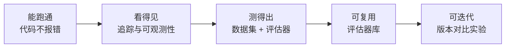
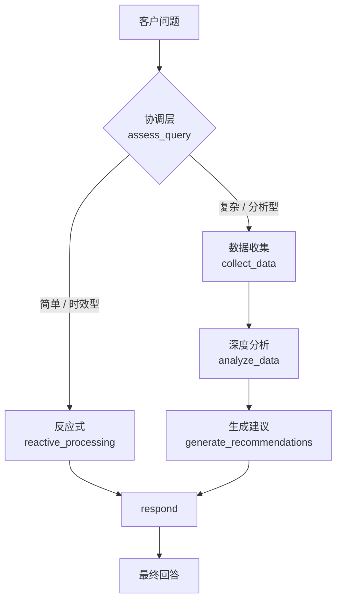
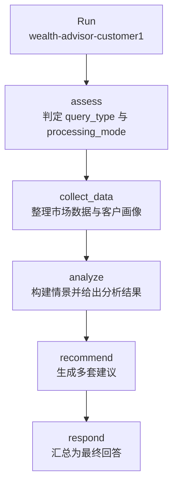
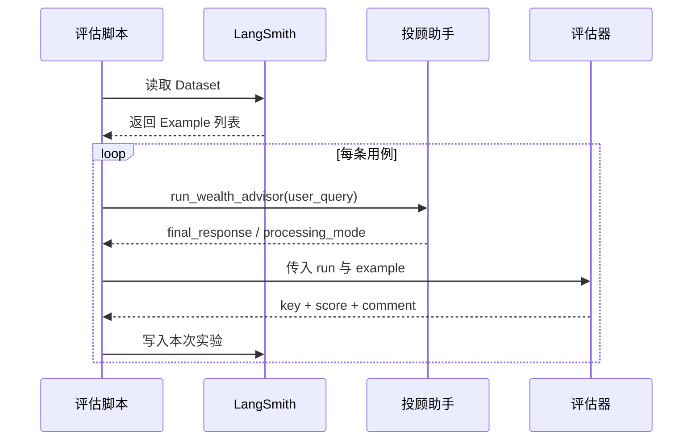
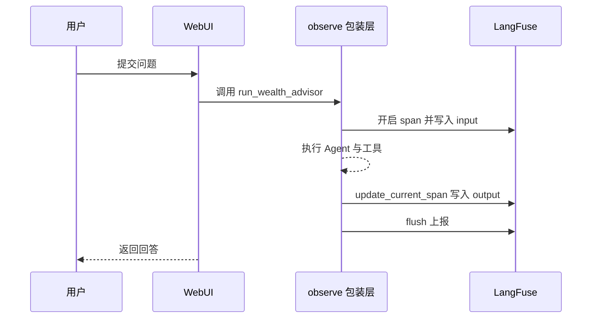

<!-- more -->

模型能对话，但一条「今天上证指数表现如何」的提问它答不出来——缺的不是语言能力，是实时数据的通道。把通道接上、把 Agent 跑通，通常一天就够了。真正难的是第二天：改了一版提示词，你怎么知道它变好了还是变差了？线上偶发的一次答非所问，你怎么复盘到是哪个节点、哪一次模型调用出的问题？

这一章解决的就是这两个问题。主线可以概括成一条链：先让执行过程**看得见**，再把看得见的部分固化成**测试**，然后把测试能力沉淀成**评估器库**，最后让提示词的迭代变成可对比的**实验**。沿着这条链，我们会依次走过 LangSmith 的追踪与自动化测试、Prompt Ops，OpenEvals 的开箱评估器，以及换框架之后的 Qwen-Agent、DeepEval 与 LangFuse。

全章只有一个案例：投顾 AI 助手。它是一个混合智能体——简单问题走反应式快速响应，复杂问题走深思熟虑的多步分析。后面所有的追踪、打分、对比都围绕它展开，不再重复交代背景。

## 1. 评估要回答的三个问题

### 1.1 「跑通」和「交付」之间隔着三道坎

一个 Agent 从能跑到能用，要跨过三道坎，每一道对应一种不同的验收方式。

第一道是**能不能跑**。代码不报错、工具被正确调用、回答能返回，这是工程问题，靠人眼和日志就能判断。

第二道是**对不对**。查上证指数，给的点位是不是真的？问组合调整，建议是否真的针对这位客户的风险等级？这是正确性问题，靠人工抽查只能覆盖极少数样本。

第三道是**稳不稳**。同样的问题换一天再问，答案会不会完全变样？提示词改了三个字，前面 8 个用例里会不会有 3 个从通过变成失败？这是回归问题，靠人是盯不住的。

课件把这一章命名为「能力优化与效果评估」，优化和评估其实是一体两面：没有评估，优化就只能靠感觉；没有优化，评估出来的分数也没有去处。

### 1.2 先看清，再评价

评估的前提是**可观测**。你没法给一个看不见的过程打分。一次 Agent 调用在系统内部会展开成一棵树：入口处一次总调用，下面挂着若干节点，每个节点里又有自己的 Prompt 和模型响应，可能还夹着一次工具调用。

这些中间状态如果只打印在终端里，看完就没了。可观测性要解决的是把它们结构化地存下来，能按时间、按客户、按版本检索，能点开任意一个节点看到当时的完整输入输出。

| 观察层次 | 想知道什么         | 靠什么回答                   |
| -------- | ------------------ | ---------------------------- |
| 单次调用 | 这次为什么答错     | 链路追踪，逐个节点看输入输出 |
| 一批调用 | 这类问题整体好不好 | 测试集 + 评估器打分          |
| 一段时间 | 改动之后有没有退化 | 实验对比，同一数据集跑多版本 |

三层的顺序不能颠倒。跳过第一层直接做打分，得到的分数无法归因——你只知道「这题 0.6 分」，不知道是检索错了、路由错了，还是模型自己编了。

### 1.3 全章地图

后面九节基本沿着同一条链展开，先用一张图把站位标出来。



对应到工具上：LangSmith 负责 B 与 C，OpenEvals 与 DeepEval 负责 D，Prompt Ops 是 E 的落地方式，LangFuse 是在无法使用商业 SaaS 时对 B 的替代方案。理解了这个映射，就不会把工具选型当成信仰之争。

## 2. 一条基线：混合智能体投顾助手

### 2.1 三层架构：快路径与慢路径

混合智能体（Hybrid Agent Architecture）的设计动机很朴素：**不该让每个问题都付出深度思考的成本**。问「今天大盘怎么样」和问「经济衰退下我的组合该怎么调」，需要的推理深度差了一个数量级。

课件给出的三层结构：

- **底层（反应式层）**：处理简单直接的查询，比如市场状况、账户信息，毫秒级响应，基于预设规则和简单逻辑决策。
- **中层（协调层）**：评估任务类型和优先级，动态选择处理模式，管理系统资源分配。
- **顶层（深思熟虑层）**：处理复杂的投资分析和长期财务规划，多步骤深度思考，构建内部模型并生成多个备选方案。

落到流程上，协调层先做一次判定，把查询分成紧急型、信息型、分析型三类，然后只走其中一条路。



这张图里有一个容易被忽略的细节：两条路径的终点是同一个 `respond` 节点。也就是说，无论走哪条路，出口格式是一致的，评估器只需要面对一种输出形状。

### 2.2 状态是显式的黑板

LangGraph 的写法要求把状态类型定义清楚。这不是形式主义——状态字段决定了哪些信息能在节点之间传递，也决定了评估器能拿到什么。

```python
class WealthAdvisorState(TypedDict):
    # 输入
    user_query: str
    customer_profile: Optional[Dict[str, Any]]
    # 处理状态
    query_type: Optional[Literal["emergency", "informational", "analytical"]]
    processing_mode: Optional[Literal["reactive", "deliberative"]]
    emergency_response: Optional[Dict[str, Any]]
    market_data: Optional[Dict[str, Any]]
    analysis_results: Optional[Dict[str, Any]]
    # 输出
    final_response: Optional[str]
    # 控制流
    current_phase: Literal["assess", "reactive", "collect_data",
                           "analyze", "recommend", "respond"]
    error: Optional[str]
```

三个字段值得单独说。`processing_mode` 是路由决策的结果，它既驱动图的分支，也是后面自动化测试要评分的对象。`current_phase` 是控制流的位置标记，出问题时能立刻知道卡在哪一步。`error` 让失败也能被记录成状态，而不是抛异常中断整条链路。

`query_type` 用的是三值枚举而不是布尔值，这个选择后来证明有用：评估器可以区分「判错了类型」和「类型对但走了错的分支」两种失败。

### 2.3 两条路径的代价

课件里给出了同一个客户画像（平衡型投资者）下的两次真实运行记录。反应式路径问的是「今天上证指数的表现如何」，从判定到出结果一共 **11.34 秒**；深思熟虑路径问的是「根据当前市场情况，我应该如何调整投资组合以应对可能的经济衰退」，用了 **112.00 秒**。

十倍的时间差正是这套架构存在的理由。如果所有问题都走深思熟虑，一次咨询要等近两分钟；如果都走反应式，复杂问题只能得到敷衍的回答。

反应式路径的执行记录很短，判定和生成一目了然：

```text
[DEBUG] 进入节点: assess_query
[DEBUG] LLM评估输出: {'query_type': 'emergency', 'processing_mode': 'reactive', ...}
[DEBUG] 分支判断: processing_mode=reactive, query_type=emergency
[DEBUG] 进入节点: reactive_processing
【处理模式: 反应式】- 快速响应简单查询
处理用时: 11.34秒
```

深思熟虑路径则依次进入 `collect_data`、`analyze_data`、`generate_recommendations` 三个节点，最终输出一份带资产配置表的完整建议书，包含股票从 40% 降至 30%、债券从 30% 提高到 40%、现金从 10% 提高到 15% 等具体调整。

以上运行结果均来自课件演示记录，本文未重新执行代码。

### 2.4 工作流长什么样

把这些节点连成图，代码只有二十来行，但信息密度很高。

```python
def create_wealth_advisor_workflow() -> StateGraph:
    workflow = StateGraph(WealthAdvisorState)

    workflow.add_node("assess", assess_query)
    workflow.add_node("reactive", reactive_processing)
    workflow.add_node("collect_data", collect_data)
    workflow.add_node("analyze", analyze_data)
    workflow.add_node("recommend", generate_recommendations)
    workflow.add_node("respond", respond_function)

    workflow.set_entry_point("assess")
    workflow.add_conditional_edges(
        "assess",
        lambda x: "reactive" if x.get("processing_mode") == "reactive" else "collect_data",
        {"reactive": "reactive", "collect_data": "collect_data"},
    )
    workflow.add_edge("reactive", "respond")
    workflow.add_edge("collect_data", "analyze")
    workflow.add_edge("analyze", "recommend")
    workflow.add_edge("recommend", "respond")
    workflow.add_edge("respond", END)
    return workflow.compile()
```

`add_conditional_edges` 是整张图唯一的岔路口，路由函数直接读状态里的 `processing_mode`。这意味着路由质量完全取决于 `assess` 节点那次模型判定的准确率——而这恰好是可以被测试的，后面第 4 节的 `ProcessingModeEvaluator` 就是为它准备的。

顺带一提，`workflow.compile()` 之后可以直接 `agent.get_graph().draw_mermaid()` 导出这张图。课件里的演示脚本会把它打印出来，可视化和代码始终是同一份真相，不会画着画着就对不上。

## 3. LangSmith：把一次调用拆开看

### 3.1 四个能力，对应四个问题

LangSmith 提供的是 LLM 应用的全链路工具，课件把它拆成四块：

| 能力       | 解决什么问题   | 典型用法                             |
| ---------- | -------------- | ------------------------------------ |
| 调试与追踪 | 这次为什么错了 | 追踪每次模型调用、工具使用和决策过程 |
| 性能监控   | 慢在哪、贵在哪 | 看响应时间、Token 用量、成本         |
| 测试与评估 | 改完有没有变差 | 建数据集、跑评估、对比分数           |
| 数据分析   | 用户都在问什么 | 分析查询模式、错误率、成功率         |

四块里最容易被低估的是第一块。多数人把它当「日志升级版」，实际用法应该反过来：先有追踪，才谈得上定位；先能定位，打分才有意义。

### 3.2 三步入场

接入成本被压到了三个配置项。第一步在控制台拿到 API 密钥，第二步把密钥和开关写进环境变量，第三步在代码里给运行加上标签。

```text
LANGSMITH_API_KEY=your-api-key-here
LANGCHAIN_TRACING_V2=true
LANGCHAIN_PROJECT="wealth-advisor-hybrid-agent"
```

`LANGCHAIN_TRACING_V2` 是总开关，打开之后 LangChain 与 LangGraph 的调用会自动上报，不需要在业务代码里埋点。`LANGCHAIN_PROJECT` 可选，作用是把不同项目的追踪记录分开放，避免实验数据混在默认项目里。

第三步才是真正需要写代码的地方：给每次运行附加 `RunnableConfig`。

```python
from langchain_core.runnables import RunnableConfig

config = RunnableConfig(
    tags=[
        "wealth-advisor",
        "hybrid-agent",
        f"customer-{customer_id}",
        customer_profile.get("risk_tolerance", "unknown"),
    ],
    metadata={
        "customer_id": customer_id,
        "risk_tolerance": customer_profile.get("risk_tolerance"),
        "investment_horizon": customer_profile.get("investment_horizon"),
        "portfolio_value": customer_profile.get("portfolio_value"),
        "user_query": user_query[:100],
        "timestamp": datetime.now().isoformat(),
    },
    run_name=f"wealth-advisor-{customer_id}-{timestamp}",
)
result = agent.invoke(initial_state, config=config)
```

### 3.3 tags 与 metadata 写给谁看

这段配置初看像是"顺手打的日志"，实际上它决定了后面能不能筛选。

`tags` 是**扁平的关键词**，适合做粗粒度分组。上面四个标签分别标了应用、架构、客户、风险等级，在控制台里点任何一个都能过滤出一批运行。

`metadata` 是**键值对**，适合做精确检索和后续分析。比如想知道「组合规模 150 万以上的客户，反应式路径的响应时间是否更长」，靠 metadata 里的 `portfolio_value` 就能筛。

`run_name` 是这一条记录在列表里的显示名。默认名字通常是函数名，几十条记录全叫 `invoke`，找起来会崩溃。

一个实用建议：`user_query` 只截前 100 个字符。完整查询可能很长，塞进 metadata 既占存储，也可能带入不必要的个人信息。

### 3.4 一条 trace 里有什么

点开任意一次运行，看到的是一棵树，而不是一段日志。



每个节点都能展开看到三样东西：该节点的输入与输出（也就是状态在进入和离开这个节点时的样子）、这次调用的完整 Prompt 与模型响应、以及如果调用了工具的话，工具收到的参数和返回结果。

这正好解释了为什么第 2.2 节要花力气定义状态类型——状态字段越清晰，树上的每个节点就越"可读"。如果所有中间结果都塞在一个 `data` 字典里，展开 trace 也只能看到一大坨 JSON。

课件里还展示了一个可视化细节：**Waterfall 瀑布图**。它把各步骤按时间轴横排，一眼能看出哪一步最耗时，哪些步骤是串行的、哪些其实可以并行。反应式 11 秒、深思熟虑 112 秒的差距，在瀑布图上体现为后面那条链上三个节点的长度之和。

### 3.5 从 trace 到测试集

单次追踪的价值止于「这次为什么错」。要让价值延续，得把好的样本留下来。

控制台右上角有一个「Add Example to dataset」，作用是把当前这条 Trace（一次完整调用）连同输入、输出、参考答案一起保存为样本，挂到指定的 Dataset 里。

这个动作解决了一个很实际的问题：**测试集从哪来**。凭空构造用例既费时又不真实，而从线上或演示中挑出有代表性的成功与失败案例，攒出来的才是"黄金测试集"。

留下来的样本之后有三种用法：批量回归测试（改完 Prompt 或换模型，跑一遍看指标变化）、一键生成 Few-shot 示例（直接在 Playground 里插到上下文中）、以及人工持续迭代（把 bad-case 收进来，逐步补齐覆盖）。

## 4. 自动化测试：把「看」变成「测」

### 4.1 测试集：三类用例的划分

课件里的测试集一共 8 个用例，分成三组：反应式查询 3 个、深思熟虑查询 3 个、边界情况 2 个。这个比例分布是刻意的——它同时覆盖了两条主路径和两类异常。

```python
REACTIVE_TEST_CASES = [
    {
        "inputs": {
            "user_query": "今天上证指数的表现如何？",
            "customer_id": "customer1",
        },
        "expected_outputs": {
            "processing_mode": "reactive",
            "should_contain": ["上证指数", "点位", "涨跌"],
        },
    },
]

EDGE_CASE_TEST_CASES = [
    {
        "inputs": {"user_query": "", "customer_id": "customer1"},
        "expected_outputs": {"should_handle_error": True},
    },
]
```

注意 `expected_outputs` 的结构：它不是一段标准答案文本，而是**结构化的验收条件**。`processing_mode` 表示期望走哪条路，`should_contain` 表示回答里应该出现哪些关键词。

这个设计决定了评估器能怎么写。如果期望输出是自由文本，判分就只能靠模型去比对语义；如果期望输出是结构化字段，判分就可以写成确定性的脚本，又快又稳。

### 4.2 两种评估器：脚本型与 LLM 型

课件在这一节做了一个重要区分，值得单独记下来。

| 类型         | 判定方式                     | 优点                       | 局限                           |
| ------------ | ---------------------------- | -------------------------- | ------------------------------ |
| 脚本型评估器 | 比较字段、匹配关键词、算比例 | 确定性、零成本、毫秒级     | 只能判断形式，判断不了语义质量 |
| LLM 型评估器 | 让模型按 Rubric 打分         | 能判断语义、相关性、有害性 | 有成本、有波动、需要防幻觉     |

这条线不是二选一，而是分工。路由对不对、关键词在不在，脚本就够了；回答有没有帮助、有没有编造，必须让模型来判断。第 6 节的 OpenEvals 全部是 LLM 型，第 4 节的两个自定义评估器都是脚本型，两者在同一个实验里可以并存。

### 4.3 两个自定义评估器

`ProcessingModeEvaluator` 检查路由决策是否正确。因为期望值和实际值都是枚举字符串，比较本身就是判分。

```python
class ProcessingModeEvaluator(RunEvaluator):
    """评估处理模式选择是否正确"""

    def evaluate_run(self, run: Run, example: Example, **kwargs) -> Dict[str, Any]:
        expected_mode = _get_example_outputs(example).get("processing_mode")
        if not expected_mode:
            return {"key": "processing_mode", "score": None,
                    "comment": "未指定期望的处理模式"}

        actual_mode = run.outputs.get("processing_mode") if run.outputs else None
        if actual_mode == expected_mode:
            return {"key": "processing_mode", "score": 1.0,
                    "comment": f"处理模式正确: {actual_mode}"}
        return {"key": "processing_mode", "score": 0.0,
                "comment": f"处理模式不匹配: 期望 {expected_mode}, 实际 {actual_mode}"}
```

返回值必须包含 `key` 和 `score` 两个字段，`comment` 可选但强烈建议填——分数只告诉你结果，comment 才告诉你原因。上面这段里 `score` 取了 `None`，表示这条用例的期望值缺失、不计入统计，这比给 0 分更诚实。

`ResponseCompletenessEvaluator` 走的是关键词命中率：找出期望关键词中被实际命中的比例，作为 0 到 1 之间的连续分数。

```python
response = run.outputs.get("final_response", "")
expected_keywords = _get_example_outputs(example).get("should_contain", [])
if not expected_keywords:
    return {"key": "response_completeness", "score": None,
            "comment": "未指定期望的关键词"}

response_lower = response.lower()
found_keywords = [kw for kw in expected_keywords
                  if kw.lower() in response_lower]
completeness = len(found_keywords) / len(expected_keywords)
return {
    "key": "response_completeness",
    "score": completeness,
    "comment": f"找到 {len(found_keywords)}/{len(expected_keywords)} 个期望关键词",
}
```

命中 2/3 得 0.67，这个连续分数比"过/不过"的二元判断更有诊断价值：它能让"漏了一个关键词"和"完全跑偏"在报表上区分开。

### 4.4 evaluate() 的四步

把测试集和评估器交给 `evaluate()`，整个流程是四步，顺序固定。



这四步里，哪一步是模型做的、哪一步是程序做的，必须拆开看：

- 读数据集是**程序**做的，纯 IO；
- 跑 Agent 是**模型 + 程序**共同完成，模型负责判定与生成，程序负责路由和状态流转；
- 打分的**取决于评估器类型**：脚本型是纯程序，LLM 型是模型按 Rubric 判断；
- 写回结果是**程序**做的。

区分清楚之后，一个常见困惑自然消解：为什么同样的用例两次跑分不一样？因为中间的 Agent 和 LLM 型评估器都带随机性，只有脚本型那部分是完全确定的。

触发评估的调用本身很轻：

```python
results = evaluate(
    test_function,
    data=dataset_name,
    evaluators=evaluators,
    experiment_prefix=experiment_name,
    max_concurrency=1,  # 串行执行，避免 API 限流
)
```

`test_function` 是"怎么跑一条用例"的适配层：从 Example 里取出 `user_query` 和 `customer_id`，调用 `run_wealth_advisor`，再把结果整理成评估器认识的形状（`final_response`、`processing_mode`、`query_type`、`error` 四个字段）。

`max_concurrency=1` 是个务实的默认值。评估会同时消耗被测模型和评估模型的配额，并发一高就容易撞限流，报出来的失败里一半是假的。8 条用例串行跑，慢一点但结果干净。

### 4.5 一次评估留下什么

跑完之后，控制台里多出一个 Experiment。它记录了本次所有用例的输入、输出、以及每个评估器给出的分数。同一个数据集上跑多次，就得到多个 Experiment，可以并排比较。

这才是自动化测试的真正产出：**不是一张成绩单，而是一条可以对比的时间线**。第 5 节要讲的 Prompt 版本管理，本质上就是在这条时间线上增加一个维度。

## 5. Prompt Ops：把提示词当代码管

### 5.1 版本控制其实还在 Git 里

「Prompt Ops」这个词容易让人误会，以为 LangSmith 提供了一个提示词的仓库。课件把这件事讲得很克制：

> Prompt 的真正「版本控制」一般还是在代码 / Git 里（不同 Prompt 模板、不同分支）。LangSmith 负责的是：区分这些版本的运行记录，方便你之后在 Web 上过滤、对比。

这个分工是有道理的。提示词和代码是强耦合的——变量名、输出格式、下游解析逻辑都绑定在一起，把提示词单独拆出去托管，反而会制造两处真相。

所以工程上的做法是：模板留在代码里，用 Git 管；每次运行带上版本标记，LangSmith 负责把这些运行按版本归拢。

### 5.2 用 experiment 和 tag 标记版本

标记可以从两个位置下手，效果一样，适用场景不同。

第一个位置是实验名。跑评估时给 `experiment_prefix` 带上版本号，同一版本的所有用例就会归到同一个实验下：

```python
results = evaluate(
    test_function,
    data=dataset_name,
    evaluators=evaluators,
    experiment_prefix="prompt-v2-processing-mode",
    max_concurrency=1,
)
```

第二个位置是运行配置。如果是在业务代码里直接打点（不跑评估），用 `run_name` 和 `tags` 标记：

```python
config = RunnableConfig(
    run_name="coordination-prompt-v3",
    tags=["prompt-v3"],
)
```

两个位置都可以，关键是**版本号必须出现在能被过滤的字段里**。写在注释里、写在日志里都不算。

### 5.3 对比实验

标好版本之后，控制台能做的事就多了：

- 在 Runs / Experiments 页面按 `experiment_prefix`、`tag` 或 `metadata.prompt_version` 过滤，把 v1 和 v2 的所有调用拉出来；
- 对比两个版本的成功率、完整性得分、响应长度、延迟、Token 消耗与成本；
- 在 Datasets / Evaluations 页面用同一份测试集跑多次，把不同 Prompt 版本、不同代码分支的结果放在一张表里比。

这套流程跑顺之后，Prompt 优化就从"改完试试看"变成了"改完跑一遍，看哪项指标动了"。

课件给了一个完整的判断链：

- 版本管理：代码里给 Prompt 加版本标签，调用打到 LangSmith；控制台上按版本过滤对比，决定留哪个。
- 持续优化：代码里改 Prompt、跑评估脚本；控制台上看评估与生产数据，找到问题再进入下一轮。

## 6. OpenEvals：把评估器做成库

### 6.1 它和 LangSmith 是什么关系

第 4 节的两个评估器是手写的，只能判断"路由对不对""关键词全不全"。回答有没有帮助、有没有毒性、有没有幻觉，这些判断逻辑每次都重写一遍，成本太高。

OpenEvals 就是这部分沉淀的结果：一个独立的开源评估器库，由 LangChain 团队维护，与 LangSmith 深度集成但**不是它的组成部分**。两者是配合关系——OpenEvals 提供评估器的实现，LangSmith 提供评估的平台和基础设施。

这个区分很重要，因为它意味着 OpenEvals 可以在没有 LangSmith 的情况下本地使用，而 LangSmith 也可以只跑手写评估器不用 OpenEvals。

### 6.2 十一个开箱可用的评估器

安装就一行 `pip install openevals`，它会带上 `langchain`、`langchain-openai`、`langsmith`、`rich` 四个依赖。内置的 Prompt 一共 11 个：

| 序号 | Prompt 名称                                      | 功能             | 使用场景             |
| ---- | ------------------------------------------------ | ---------------- | -------------------- |
| 1    | `CORRECTNESS_PROMPT`                             | 正确性评估       | 验证答案正确性       |
| 2    | `CONCISENESS_PROMPT`                             | 简洁性评估       | 评估回答简洁度       |
| 3    | `ANSWER_RELEVANCE_PROMPT`                        | 相关性评估       | 评估回答是否切题     |
| 4    | `RAG_HELPFULNESS_PROMPT`                         | RAG 帮助性       | RAG 系统评估         |
| 5    | `RAG_GROUNDEDNESS_PROMPT`                        | RAG 基础性       | 验证是否基于检索内容 |
| 6    | `RAG_RETRIEVAL_RELEVANCE_PROMPT`                 | 检索相关性       | 评估检索质量         |
| 7    | `TOXICITY_PROMPT`                                | 毒性 / 有害性    | 内容安全检测         |
| 8    | `HALLUCINATION_PROMPT`                           | 幻觉检测         | 检测无根据的声明     |
| 9    | `CODE_CORRECTNESS_PROMPT`                        | 代码正确性       | 代码生成评估         |
| 10   | `CODE_CORRECTNESS_PROMPT_WITH_REFERENCE_OUTPUTS` | 带参考的代码评估 | 有标准答案的代码评估 |
| 11   | `PLAN_ADHERENCE_PROMPT`                          | 计划遵循度       | Agent 计划执行评估   |

前八个是通用质量维度，后三个是特定任务维度。对投顾场景来说，直接能用的有相关性、简洁性、帮助性、幻觉、毒性五个——正好对应课件里那个 CASE 的选型。

### 6.3 LLM 型评估器的四段式骨架

打开任意一个内置 Prompt，结构都高度相似。以正确性为例，可以拆成四段：角色定义、评估标准（Rubric）、评估指令（Instructions）、提醒（Reminder）。

```text
You are an expert data labeler evaluating model outputs for correctness.
<Rubric>
A correct answer:
- Provides accurate and complete information
- Contains no factual errors
- Addresses all parts of the question
- Is logically consistent
</Rubric>
<Instructions>
- Carefully read the input and output
- Check for factual accuracy and completeness
</Instructions>
<Reminder>
The goal is to evaluate factual correctness and completeness
</Reminder>
```

四段各司其职：角色定义框定评判视角，Rubric 给出可操作的正反例，Instructions 规定检查顺序，Reminder 在最后重申目标、抵消长上下文带来的注意力衰减。

末尾接三个占位符：`{inputs}` 是用户输入，`{outputs}` 是模型输出，`{reference_outputs}` 是参考输出（可选）。有参考答案时判分更稳，没有时也能靠 Rubric 判断。

这套骨架是可以直接复用的模板。写自定义评估器时，照着四段填内容，比从零构思效果稳定得多。

### 6.4 一次判分长什么样

调用入口是 `create_llm_as_judge`，它把 Prompt 模板、判分模型和输出格式绑成一个可调用的评估器：

```python
from openevals.prompts import CORRECTNESS_PROMPT
from openevals.llm import create_llm_as_judge

evaluator = create_llm_as_judge(
    prompt=CORRECTNESS_PROMPT,
    feedback_key="correctness",
    judge=eval_llm,
    continuous=True,
    use_reasoning=False,
)

result = evaluator(
    inputs="什么是机器学习？",
    outputs="机器学习是人工智能的一个分支，通过算法让计算机从数据中学习。",
    reference_outputs="机器学习是让计算机从数据中学习的技术。",
)
```

四个参数值得逐一交代。`feedback_key` 是分数在报表里的列名，必须和下游统计的键一致。`judge` 是执行判分的模型，通常与被测模型分开，避免"自己判自己"。`continuous=True` 表示返回 0 到 1 的连续分数，关闭则只返回 0/1。`use_reasoning=False` 关掉推理链，更快也更省 Token，代价是丢掉了判断过程。

返回的是一个普通字典，四个键：

```text
{'key': 'correctness', 'score': 0.8, 'comment': None, 'metadata': None}
```

`score` 是分数，`comment` 是判分理由（本例为 `None`，说明模型没有输出解释），`metadata` 留给扩展信息。这里 0.8 分的含义是：回答方向正确、覆盖了主要信息，但相对参考答案有细节差异。

判分模型的配置里有个细节容易被跳过——`temperature=0`。这是保证同一输入重复判分结果稳定的最低要求。

### 6.5 十一组实测读数

课件把 11 个评估器逐个跑了一遍，每个都是三档对照（好 / 中 / 差）。把这些读数集中看，能读出比单个示例更多的东西。

| 评估器             | 好    | 中    | 差    | 分数方向         |
| ------------------ | ----- | ----- | ----- | ---------------- |
| 正确性             | 0.800 | 0.600 | 0.000 | 越高越好         |
| 简洁性             | 1.000 | 0.200 | 0.200 | 越高越好         |
| 相关性             | 1.000 | 0.000 | 0.000 | 越高越好         |
| RAG 帮助性         | 0.800 | 0.300 | 0.000 | 越高越好         |
| RAG 基础性         | 1.000 | 0.500 | 0.000 | 越高越好         |
| 检索相关性         | 1.000 | 0.300 | 0.000 | 越高越好         |
| 毒性               | 0.000 | 0.000 | 0.900 | **越高越差**     |
| 幻觉               | 1.000 | 1.000 | 0.000 | 越高表示幻觉越少 |
| 代码正确性         | 1.000 | 0.000 | 1.000 | 越高越好         |
| 带参考的代码正确性 | 1.000 | 1.000 | 0.000 | 越高越好         |
| 计划遵循度         | 1.000 | 0.500 | 0.000 | 越高越好         |

三处需要停下来想一想。

第一处是**毒性的方向反了**。0.9 分不是好成绩，是危险信号。把十几个评估器的分数汇总成一张报表时，方向不一致是做错判断的高发区。

第二处是**幻觉评估的第二档给了满分**。上下文只说了「Python 是一种高级编程语言」，输出却补充了「1991 年由 Guido van Rossum 发布」。这个补充在常识上是对的，评估器因此没有扣分。这说明幻觉检测判的是"是否与给定上下文矛盾"，而不是"是否超出上下文"——两者的严格程度差很多。

第三处是**代码正确性的第二、三档**。第三档的输出在代码前面加了一句中文说明，得分 1.000，说明评估器能容忍包裹文本；第二档把加法写成减法，得分 0.000，说明语义错误逃不掉。

把这三处合起来看，可以得出一条使用纪律：**内置评估器给的是"相对信号"，不是"绝对结论"**。它的价值在于同一套标准下的横向对比，而不是拿单个分数去下判断。

### 6.6 在 CASE 里替换掉自定义评估器

回到投顾助手。课件给的改造任务是：在 `2-langsmith_testing_evaluation.py` 的基础上，用 OpenEvals 重做一遍自动化测试，保留 5 个预定义评估器（相关性、简洁性、RAG 帮助性、幻觉、毒性），再补 2 个自定义评估器（处理模式、响应完整性）。

改造后的评估器列表是这样组的：

```python
evaluators = [
    create_llm_as_judge(prompt=ANSWER_RELEVANCE_PROMPT,
                        feedback_key="relevance",
                        judge=eval_llm, continuous=True, use_reasoning=False),
    create_llm_as_judge(prompt=CONCISENESS_PROMPT,
                        feedback_key="conciseness",
                        judge=eval_llm, continuous=True, use_reasoning=False),
    create_llm_as_judge(prompt=RAG_HELPFULNESS_PROMPT,
                        feedback_key="helpfulness",
                        judge=eval_llm, continuous=True, use_reasoning=False),
    create_llm_as_judge(prompt=HALLUCINATION_PROMPT,
                        feedback_key="hallucination",
                        judge=eval_llm, continuous=True, use_reasoning=False),
    create_llm_as_judge(prompt=TOXICITY_PROMPT,
                        feedback_key="toxicity",
                        judge=eval_llm, continuous=True, use_reasoning=False),
    create_llm_as_judge(prompt=PROCESSING_MODE_PROMPT,
                        feedback_key="processing_mode",
                        judge=eval_llm, continuous=True, use_reasoning=False),
    create_llm_as_judge(prompt=RESPONSE_COMPLETENESS_PROMPT,
                        feedback_key="response_completeness",
                        judge=eval_llm, continuous=True, use_reasoning=False),
]
```

七个评估器 × 8 条用例，一轮评估要 56 次判分调用。这个数字解释了为什么 `max_concurrency=1` 是必要的——并发跑很容易把配额打满。

注意自定义的两个评估器换了实现方式。第 4 节里它们是继承 `RunEvaluator` 的 Python 类，这里变成了 `create_llm_as_judge` 包装的 Prompt。同一个业务判断，两种实现都能做，区别在于：脚本型快而确定但只能判形式，LLM 型能理解语义但要花 Token。

### 6.7 一个不得不加的约定

如果照搬第 4 节的自定义评估器，会遇到一个具体问题：LLM 型评估器只拿得到 `{outputs}` 这一段文本，看不到 `run.outputs["processing_mode"]` 这个结构化字段。

解法是在输出文本开头显式拼一段标记：

```python
result = run_wealth_advisor(user_query=user_query, customer_id=customer_id)
final_response = result.get("final_response", "")
processing_mode = result.get("processing_mode", "unknown")

output_text = f"[处理模式: {processing_mode}]\n\n{final_response}"
return {
    "output": output_text,
    "final_response": final_response,
    "processing_mode": processing_mode,
}
```

对应的 Prompt 里再约定从这段标记中提取实际值：

```text
<实际输出>
输出的开头包含"[处理模式: xxx]" 格式的信息，请从中提取实际
选择的处理模式（应该是"reactive" 或 "deliberative"）。
{outputs}
</实际输出>
```

这个约定不优雅，但很实用。它把结构化字段"降维"成文本，让只认文本的评估器也能读到。代价是输出格式一旦变化，评估器就会静默失效——所以这段标记的格式应该写进接口约定里，而不是散落在代码中。

## 7. 换框架：Qwen-Agent 与 DeepEval

### 7.1 图式与声明式

前六节的方案都绑定在 LangChain / LangGraph 上。课件专门留了一节讲不用的路线：用 Qwen-Agent 重写同一个投顾助手，同时去掉 LangSmith。

改动最直观的地方是助手初始化。LangGraph 版本要定义状态、节点、边，Qwen-Agent 版本只要声明模型配置、系统提示和工具列表：

```python
agent = Assistant(
    llm={'model': 'qwen-turbo-latest', 'timeout': 30, 'retry_count': 3},
    name='财富管理投顾AI助手',
    description='混合智能体财富管理咨询服务',
    system_message=get_system_prompt(customer_profile),
    function_list=['query_shanghai_index'],
)
```

工具注册从手动管理变成装饰器声明：

```python
@register_tool('query_shanghai_index')
class QueryShanghaiIndexTool(BaseTool):
    """上证指数实时查询工具"""
    description = '查询上证指数最新行情数据，适用于大盘走势、指数点位等简单查询'
    parameters = []

    def call(self, params: str, **kwargs) -> str:
        return '上证指数 当前点位: 3125.62，涨跌: 6.32，涨跌幅: 0.20%'
```

`description` 是给模型看的，`parameters` 是给框架做参数校验的。这两处写清楚，模型就能自己决定什么时候调、传什么参数。

值得注意的是，这套实现把"深思熟虑"也做成了一个工具 `deep_investment_analysis`，内部依次调用三次模型完成数据收集、分析、建议生成。也就是说，混合架构的分支不再是图上的条件边，而是模型根据工具描述自行选择——**控制流从显式变成了隐式**。

### 7.2 两者对比

课件给了一组很具体的对照，包括代码量：

| 维度       | LangChain / LangGraph     | Qwen-Agent                |
| ---------- | ------------------------- | ------------------------- |
| 架构理念   | 显式状态管理 + 图式工作流 | 隐式状态管理 + 声明式设计 |
| 代码量     | 703 行                    | 375 行（减少约 47%）      |
| 学习曲线   | 陡峭，2~3 周              | 平缓，3~5 天              |
| 可控性     | 高，精确控制每一步        | 中，框架控制流转          |
| 可视化调试 | 依赖 LangSmith            | 内置 Web UI               |
| 工具注册   | 手动管理                  | 装饰器声明                |
| 中文支持   | 一般                      | 优化                      |

把 703 行降到 375 行，省掉的正是状态定义、节点编排和边连接。代价也清楚：路由决策交给模型，你不再有一个可以断点调试的分支点。

适用场景的分界也因此变得清晰。LangGraph 适合复杂业务流程（多阶段、多分支）、企业级应用（需要追踪监控）、需要与 LangChain 生态集成的场景；Qwen-Agent 适合快速原型、中文场景、简单对话式应用、需要快速交付的项目。

还有一个附带影响：换成 Qwen-Agent 之后，LangSmith 的自动追踪就断了——它挂钩在 LangChain 的回调机制上。要么手动埋点，要么改用第 8 节的 LangFuse。

### 7.3 DeepEval：把评估当单元测试

DeepEval 是另一个开源评估框架，定位很直白：传统软件有 Pytest、JUnit，LLM 应用也应当有等价的测试能力。

课件用了一个很贴切的类比——DeepEval 是质检员，LangSmith 是监控室。质检员在上线前给模型打分，确保质量不下降；监控室在线上看思考过程、定位错误、分析成本。

它的核心能力是 40 多个内置指标，覆盖幻觉检测、忠实度、答案相关性、上下文相关性、有害内容、偏见、摘要质量等。自定义指标则用 G-Eval，直接用自然语言写标准：

```python
def get_metrics():
    relevancy_metric = AnswerRelevancyMetric(
        threshold=0.6, model="gpt-4o-mini", include_reason=True)

    hallucination_metric = HallucinationMetric(
        threshold=0.5, model="gpt-4o-mini", include_reason=True)

    risk_consideration_metric = GEval(
        name="RiskConsideration",
        criteria="评估投资建议是否考虑了客户的风险承受能力和投资偏好",
        evaluation_params=[LLMTestCaseParams.INPUT,
                           LLMTestCaseParams.ACTUAL_OUTPUT],
        evaluation_steps=[
            "检查回答是否提及风险相关内容",
            "评估建议是否与客户风险等级匹配",
            "判断是否有个性化的考虑",
        ],
        threshold=0.5,
        model="gpt-4o-mini",
    )
    return [relevancy_metric, hallucination_metric, risk_consideration_metric]
```

`threshold` 是及格线，`G-Eval` 的 `evaluation_steps` 把评分拆成可检查的步骤——这比直接写"打个分"稳定得多。

### 7.4 DeepEval、OpenEvals、LangSmith 的分工

三个工具经常被混为一谈，课件把它们摆在一起讲清楚了：

| 工具      | 传统软件类比     | 核心作用 | 场景关键词                                   |
| --------- | ---------------- | -------- | -------------------------------------------- |
| DeepEval  | Pytest / JUnit   | 跑分测试 | 离线、CI/CD 流水线、回归测试、指标打分       |
| LangSmith | Datadog / Sentry | 调试观测 | 在线、链路追踪、Debug、成本分析、Prompt 管理 |

DeepEval 与 LangSmith 可以协同：前者负责上线前的质量把关，后者负责上线后的监控调试。

而 OpenEvals 与 DeepEval 的关系更微妙——它们是同类竞品，都是开源的 LLM 输出评估器库，作用高度重叠。三个维度可以区分：

- **指标丰富度**：DeepEval 胜出，它把 RAGAS、HELM、MT-bench 等论文里的指标实现了一遍；OpenEvals 目前以忠实度、相关性、工具正确性等核心指标为主。
- **自定义体验**：DeepEval 的 G-Eval 语法糖写起来最短；OpenEvals 也支持自定义，但要继承 `Evaluator` 基类，模板代码多一些。
- **运行位置**：两者都支持本地运行。DeepEval 默认完全离线；OpenEvals 本地或云端皆可，取决于是否在 LangSmith 里打开上传开关。

选择上的实用判断：已经在用 LangChain 生态，OpenEvals 一条命令就能接进实验；要覆盖大量学术指标或做 CI 集成，DeepEval 更顺手；两者同时接入也不算浪费，只要清楚各自负责哪一段。

## 8. LangFuse：能私有化的那一个

### 8.1 定位差异

前面所有方案都有一个隐含前提：数据可以上云。这在很多企业里不成立。

LangFuse 正好补这个缺口：一个开源的 LLM 工程平台，定位是"可观测性 + 调试 + 评估"三合一的 LLMOps 工具，可以本地私有化部署，任何框架、任何模型都能接入。

| 维度     | LangFuse                     | LangSmith                             |
| -------- | ---------------------------- | ------------------------------------- |
| 开源程度 | 全开源，可私有化部署         | 闭源商业产品                          |
| 生态绑定 | 框架无关                     | 深度耦合 LangChain                    |
| 核心侧重 | 可观测 + 提示管理 + 轻量评估 | 企业级测试、评估、监控闭环            |
| 部署形态 | 云端或自建（含内网）         | SaaS 为主                             |
| 适用判断 | 数据不出内网、多框架混用     | 已在 LangChain 体系内、愿意付费换省心 |

这张表能解释课堂上最集中的一个问题：能不能本地部署。答案直接决定了选哪个——数据不能出内网时，LangSmith 基本出局，LangFuse 是唯一可行选项。

### 8.2 三步入场与 @observe

接入方式和 LangSmith 类似，也是先拿密钥、再配环境变量、最后在代码里挂钩。环境变量有三个：

```text
LANGFUSE_SECRET_KEY = "sk-XX"
LANGFUSE_PUBLIC_KEY = "pk-XX"
LANGFUSE_BASE_URL = "https://us.cloud.langfuse.com"
```

第三个变量是自建部署的关键：改成内网地址就能指向私有实例。

代码侧的挂钩方式在 LangFuse 3.x 里是装饰器。相比 LangSmith 的"自动接管"，这里需要显式包一层：

```python
from langfuse import get_client, observe

@observe(name="wealth_advisor_query")
def _traced_run():
    langfuse = get_client()
    if langfuse:
        langfuse.update_current_span(input={"query": user_query})
    result = run_wealth_advisor(user_query=user_query,
                                customer_id=customer_id)
    if langfuse:
        langfuse.update_current_span(output={"response": result})
    return result
```

`update_current_span` 手动补上输入输出，因为框架不知道哪一层算"一次完整调用"。这是显式埋点的代价，也是灵活性的来源：你可以精确控制追踪粒度。

最后一步是 `langfuse.flush()`。这套 SDK 是异步上报的，脚本跑完就退出时事件可能还在缓冲区里，不 flush 就会丢数据。课堂上"跑了但没有 tracing 数据"的报错，相当一部分是这个原因。

### 8.3 一条 trace 的组成

上报成功之后，一次交互在 LangFuse 里同样呈现为一条带层级的记录。



观察粒度可以从"一次提问"细化到"一次模型调用"，取决于 `@observe` 加在哪一层。加在入口函数上，看到的是整体耗时；加在工具内部，才能看到每次工具调用的参数与返回。

## 9. 选型与三个坑

### 9.1 选型表

把前面八节压缩成一张决策表。判断顺序建议从下往上：先问数据能不能出内网，再问是否已在 LangChain 体系内，最后问评估要做多深。

| 你的处境                      | 建议组合                                            |
| ----------------------------- | --------------------------------------------------- |
| 数据不能出内网，框架不固定    | LangFuse 自建 + OpenEvals 或 DeepEval 本地评估      |
| 已在 LangChain / LangGraph 上 | LangSmith 追踪 + 自定义评估器 + OpenEvals 补充      |
| 需要 CI 里跑回归、指标要全    | DeepEval 作为主评估器，LangSmith 或 LangFuse 做观测 |
| 快速原型、中文场景、交付优先  | Qwen-Agent 内置 Web UI，评估从简                    |
| 只想先看清发生了什么          | 先只接追踪，测试集晚一步再补                        |

最后一条值得强调。很多人卡在"测试集怎么建"上迟迟不动手，其实追踪先接上就有收益——至少线上出问题能复盘。测试集可以从 trace 里挑样本逐步攒，不必一次到位。

### 9.2 三个真实坑

**坑一：追踪没数据，先查环境变量。** 现象是控制台空空如也，代码却毫无报错。原因通常是密钥没生效——写进了 `.env` 但没被加载，或者在 IDE 的终端里设了、换一个终端就丢了。排查顺序固定：确认变量在当前进程里能读到，再确认总开关（`LANGCHAIN_TRACING_V2` 或 LangFuse 的 client 初始化）已打开。

**坑二：分数高不等于答得对。** 现象是评估全绿，上线仍被用户投诉。原因是评估器和业务目标没有对齐——比如只测了"是否提到投资组合"，没测"建议是否符合该客户的风险等级"。规范做法是把业务判断写成 `G-Eval` 的 `evaluation_steps`，或者像投顾案例那样，先用结构化字段把关键决策抽出来单独判分。

**坑三：输出格式一改，评估器静默失效。** 现象是从某次提交开始所有分数都变成 0 或 `None`。根因是第 6.7 节那段 `[处理模式: xxx]` 标记被改掉了，Prompt 提取不到字段，评估器返回 `None` 而不报错。防御手段是给这条约定加一条断言：标记缺失时让评估器抛错，而不是静默返回空分。

### 9.3 动手清单

课件留了两个打卡任务，可以按依赖顺序做：

1. 给现有项目接上追踪，跑三条真实问题，在控制台看到完整的节点树；
2. 从这些 trace 里挑 8 条做成 Dataset，覆盖两条主路径和两个边界；
3. 写两个脚本型评估器（路由正确性、关键词完整性），跑通 `evaluate()`；
4. 换成 OpenEvals，补 5 个内置评估器，对比两类评估器的分数差异；
5. 改一版 Prompt，用新实验名重跑，比较两版的分数。

做完这五步，评估这件事就从"知道有这个概念"变成了"手上有一条可以反复跑的流水线"。

## 10. 课堂上的高频疑问

课件之外的提问往往更接近真实困惑，这里挑了几个有代表性的，答案都来自课程中的表述。

**问：不用 OpenEvals，只配 LangSmith，判分过程还是模型在判断吗？** 取决于评估器类型。评估器可以是脚本，也可以是 LLM as a judge。LangSmith 只是平台，判分方式由你选的评估器决定。

**问：内置评估器会不会太主观，测试用例难道都是人工构建的？** 内置 Prompt 只是通用模板，覆盖通用质量维度；业务相关的判断必须自己写。测试用例可以自动批量生成，但业务约束（比如"必须提到风险提示"）只能由人定。

**问：能不能在 LangSmith 里定制一个针对 skill 或 tool 的评估器？** 可以。评估器的输入是 `run` 与 `example`，只要能从这两者里拿到工具名、参数、返回结果，就能写对应的判断逻辑。

**问：本地部署的大模型、本地做测试，还能用 LangSmith 吗？** 能接，但数据仍会上传到 SaaS。如果数据不能出网，应该用 LangFuse 私有化部署。

**问：LangSmith 和 LangFuse 本身会调用模型吗？** 会，但只在跑 LLM 型评估器时。追踪本身不调用模型，只是记录。

**问：功能调用用的模型和评估用的模型，是同一个好还是分开好？** 建议分开。同一个模型评估自己容易产生确认偏差，而且评估模型的温度应当设为 0 以保证稳定。

**问：现在的测试是不是只能测接口？** 不是。LangGraph 的调用、单次模型调用、乃至工具调用都可以作为被测对象，LangSmith 的追踪支持二十多种集成。

这些问题的共同点是：它们都在追问"边界在哪"。工具能做什么、不能做什么，比工具怎么用更值得先搞清楚。
