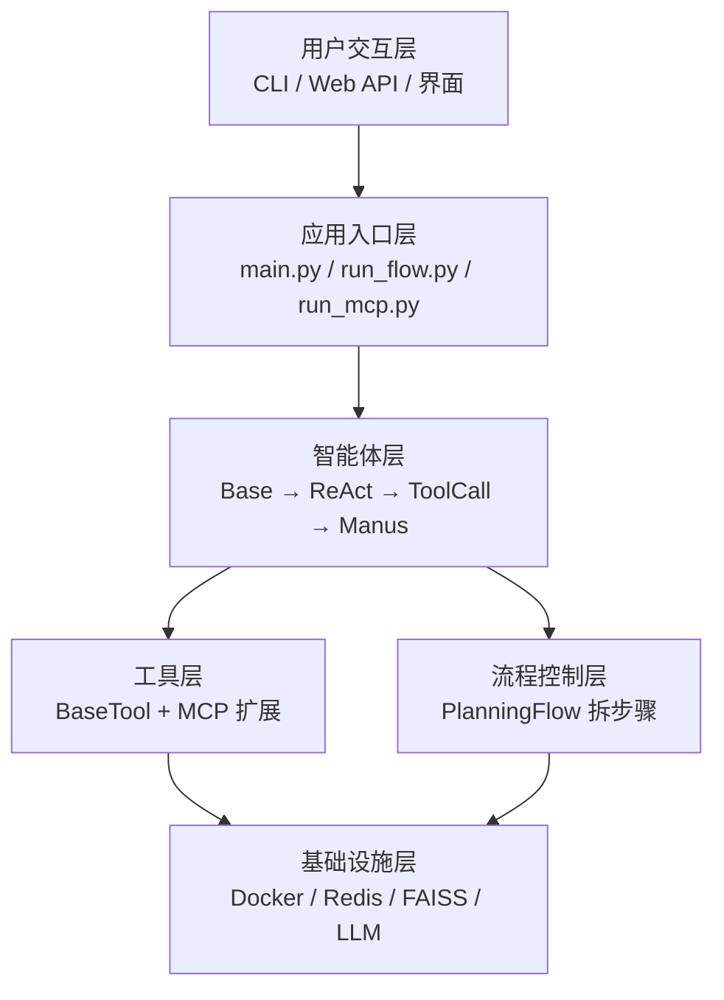
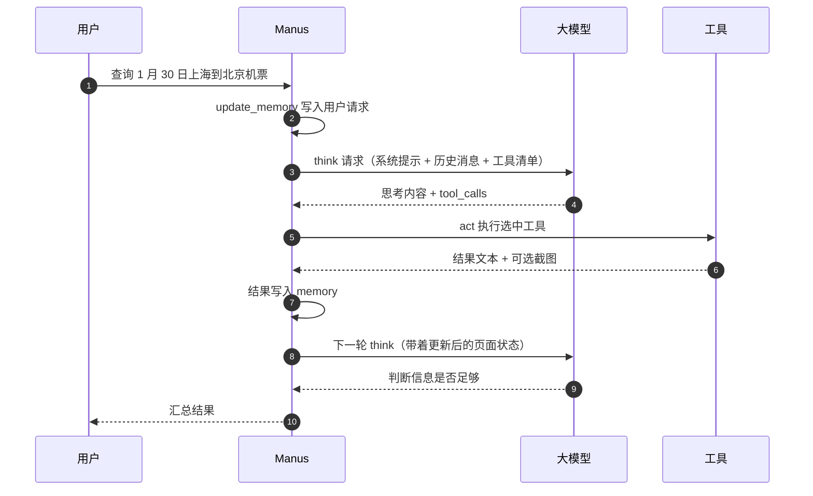
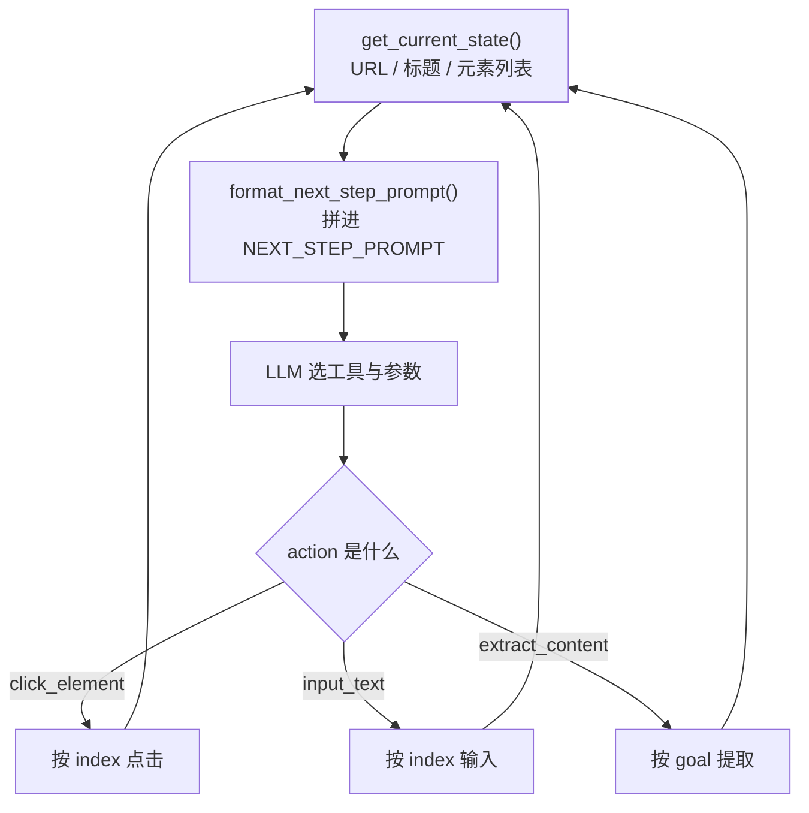
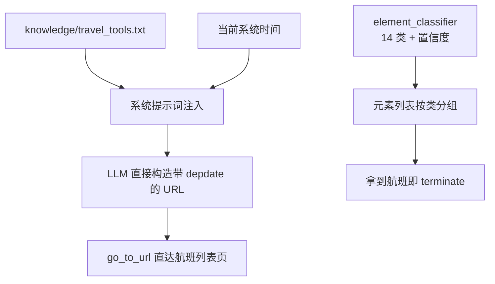
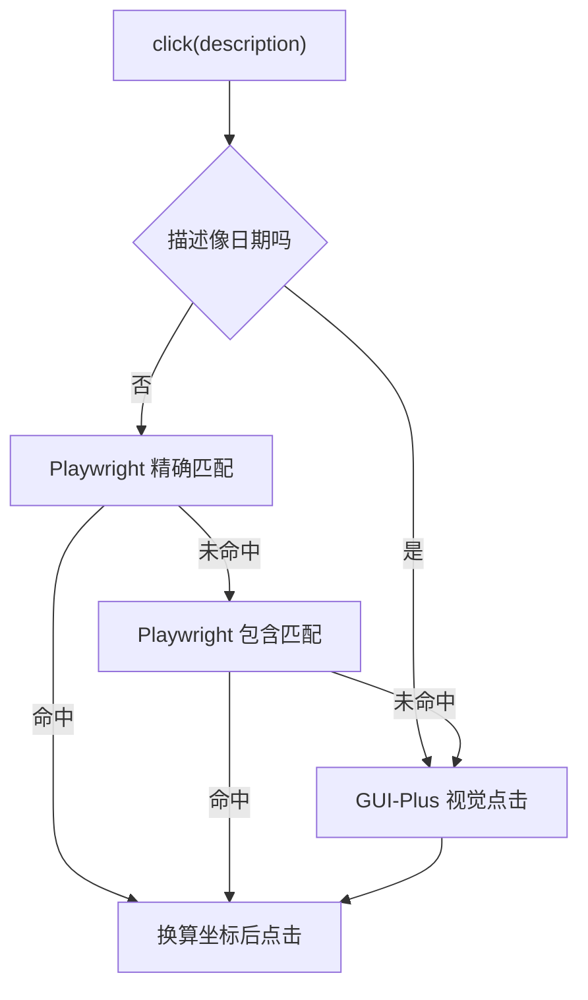
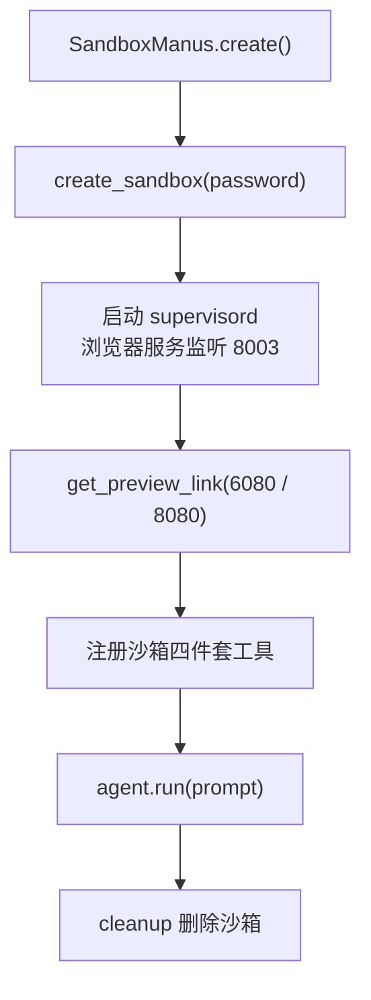
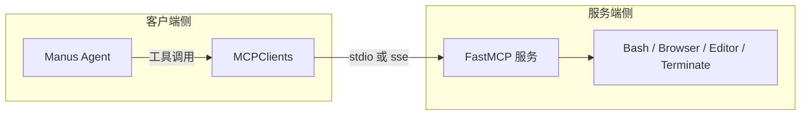

<!-- more -->

「查 1 月 30 日从上海到北京的机票。」这句话人读完不到两秒，OpenManus 跑完 20 步还没点中日期格子。它不缺理解力：模型准确判断出要用浏览器、要看日历、要输入出发地和目的地，缺的是把「1 月 30 日」这四个字翻译成一次精确的 DOM 操作。中间隔着元素编号、文本匹配、视觉坐标三层翻译，每一层都有自己的盲区。

这一章沿着这条线往下走。先看 OpenManus 的六层结构与四级继承，它决定了「能力」被安放在哪一层、改动会牵动谁；再把一次任务的 think 与 act 拆到代码级，看 20 步上限到底意味着什么；然后用浏览器自动化这个最难的场景当主线，从元素编号一路走到 RAG 与视觉模型两条改造路线；最后把执行搬进 Daytona 沙箱，说清「在自己电脑上跑」和「在隔离环境里跑」的边界差别。走完之后，你会知道一个通用 Agent 的可靠性，其实取决于它对页面状态的描述精度。

案例对象固定为携程机票查询：查 1 月 30 日从上海到北京的航班。选它不是因为难，而是因为这一页把纯文本方案的极限暴露得最彻底——133 个可交互元素，日历格子里 1 到 31 的数字反复出现，同一个月内还有上月的尾巴和下月的开头。后面所有代码都围绕这一页展开。

## 1. OpenManus 是什么

### 1.1 用开源复刻「手脑并用」

OpenManus 由 MetaGPT 团队在 2025 年 7 月开源，仓库在 [FoundationAgents/OpenManus](https://github.com/FoundationAgents/OpenManus)。它的定位是「无堡垒、纯开放」：没有订阅、没有额度、没有隐藏的工具白名单，目标是零成本复刻闭源 Manus 的手脑并用能力——把一句自然语言需求，直接变成一条可执行的工作流。

它内置了浏览器自动化、Python 代码执行、文件处理、数据可视化等 12 类工具，并且全部可插拔替换。这句话的分量比听起来重：工具可换意味着能力边界可调，一个只有搜索和代码执行的组合，和一个加了浏览器与沙箱的组合，是两种完全不同的产品。

被复刻的那一方是什么量级也有必要交代。Manus 本体 2025 年 3 月上线，出自蝴蝶效应团队，8 个月 ARR 破 1 亿美元；2025 年 12 月 Meta 以约 20 亿美元完成收购，创始人肖弘出任 Meta 副总裁，团队留驻新加坡，产品保持独立运营。开源版的价值不在于替代，而在于把「通用 Agent 到底怎么搭」这件事拆开给所有人看。

读这类框架，容易陷入两个误区：一是把它当成又一个「套壳 ChatGPT」，二是把源码当成 API 文档来背。它真正的骨架只有一句话——一个循环，循环里做两件事，一件交给模型，一件交给程序。剩下两百多个文件都是这两件事的工程化。

### 1.2 六层架构：能力被安放在哪里

课件的第 4 到 5 页把 OpenManus 拆成六层，这个拆法值得记住，因为它直接回答了「我想改一个功能，该动哪一层」。

| 层         | 这一层决定什么             | 代表实现                                       | 换掉它的代价                 |
| ---------- | -------------------------- | ---------------------------------------------- | ---------------------------- |
| 用户交互层 | 人怎么把任务交进来         | CLI、Web API、可视化界面                       | 只换入口，核心不动，代价最小 |
| 应用入口层 | 这次跑单智能体还是多智能体 | main.py、run_flow.py、run_mcp.py               | 换掉等于换整套协作模型       |
| 智能体层   | 推理与决策怎么发生         | BaseAgent → ReActAgent → ToolCallAgent → Manus | 换掉必须重写提示词与循环     |
| 工具层     | Agent 的手能伸多长         | BaseTool 加 12 类内置工具，可接 MCP            | 接口不变，能力边界变         |
| 流程控制层 | 复杂任务怎么拆成步骤       | PlanningFlow（线性或 DAG）                     | 换掉影响长任务成功率         |
| 基础设施层 | 跑在哪、存什么、连哪个模型 | Docker、Redis、FAISS、LLM 适配器               | 换掉影响部署方式与成本       |

表格里最容易被忽略的是「流程控制层」。单智能体靠一个 20 步的循环硬扛，多智能体则把任务拆给「项目经理 → 产品经理 → 执行专员」，让每个角色只面对自己那一小段。这两种跑法的差别不在代码量，而在失败时的可解释性：单智能体跑挂了，你只能看到一串日志；多智能体跑挂了，你能指出是哪个角色没交接好。

把六层画成一条链路，数据怎么往上走、能力怎么往下渗就清楚了。



读这张图要注意一件事：工具层与流程控制层是并列的，不是串联的。工具层解决「一次动作能不能做」，流程控制层解决「一串动作怎么排」。很多 Agent 项目在这两者之间选了错的着力点——工具做得极全，却没有规划，任务一长就散架。

### 1.3 四级继承：能力是一层层叠上去的

智能体层是一条继承链，每往下一级只加一件事。这条链是整个框架最该背下来的部分。

| 类            | 文件                  | 新增的那层能力                 | 关键参数                        |
| ------------- | --------------------- | ------------------------------ | ------------------------------- |
| BaseAgent     | app/agent/base.py     | 状态机、内存、主循环、卡住检测 | max_steps、duplicate_threshold  |
| ReActAgent    | app/agent/react.py    | 把一步拆成 think 与 act        | system_prompt、next_step_prompt |
| ToolCallAgent | app/agent/toolcall.py | 工具清单、调用解析、结果回填   | tool_choices、max_observe       |
| Manus         | app/agent/manus.py    | 通用工具组合、浏览器上下文注入 | max_steps=20、available_tools   |

链上有个细节很能说明工程的性格：`max_steps` 在四个类里被反复覆盖。BaseAgent 与 ReActAgent 默认 10，ToolCallAgent 放宽到 30，Manus 又收回到 20。所以课程里那句「把 step 改成 25」，实际要改好几处——只改一处，跑到最后仍然会被上一层盖掉。后面 GUI 版本里，Manus 是 30、BrowserAgent 是 25，同样是这个原因。

Manus 这一级只做两件事：固定一套通用工具（PythonExecute、BrowserUseTool、WebSearch、StrReplaceEditor、AskHuman、Terminate），以及在每次思考前把浏览器状态注入提示词。工具组合与状态注入，就是「通用」二字的全部实现。

### 1.4 四个入口，四种跑法

同一个框架提供了四个入口，很多人装了之后只用过 `main.py`，结果以为 OpenManus 就只是「命令行里聊天的 Agent」。差别其实很大。

| 入口        | 跑的是什么            | 适合谁     | 一句说明                          |
| ----------- | --------------------- | ---------- | --------------------------------- |
| main.py     | 单个 Manus            | 调试与实验 | 支持 `--prompt`，也可以交互式输入 |
| app.py      | FastAPI 包一层 Web    | 给别人用   | 配 openmanus-ui，任务走流式返回   |
| run_flow.py | PlanningFlow 多智能体 | 长链路任务 | 项目经理、产品经理、执行专员分工  |
| run_mcp.py  | MCPAgent 连接服务     | 复用工具   | stdio 走本地子进程，sse 走 HTTP   |

`main.py` 的骨架短到可以直接看，整个生命周期就是「创建、运行、清理」三段。

```python
agent = await Manus.create()
try:
    prompt = args.prompt if args.prompt else input("请输入你的提示: ")
    if not prompt.strip():
        logger.warning("提供的提示为空。")
        return
    await agent.run(prompt)
finally:
    await agent.cleanup()
```

`finally` 里那句 `cleanup()` 不能省。它负责关浏览器、断开 MCP 连接；漏掉它，跑几轮就会在后台攒下一堆浏览器进程，日志里看到的「端口被占用」多半是这么来的。

Web 入口走另一条路。课件第 7 页给的接入方式极简：把 openmanus-ui 的 assets、static、templates 三个目录连同 `app.py` 拷进项目，`python app.py` 就能在浏览器里用。`app.py` 本身是个 FastAPI 应用，负责把一次任务包装成带 id 的对象，用 SSE 把日志实时推给前端——这也是为什么界面里能看到 Agent 一步步「思考」的过程，而不是干等一个 loading。

多智能体入口 `run_flow.py` 才是课件里「流程控制层」的实体。它用 PlanningFlow 把任务拆成步骤，再按角色分派，适合那种「一个人做不完、需要分工」的长任务。代价是链路更长，一次失败要在三个角色的交接处找原因。

## 2. 一次任务到底怎么跑

### 2.1 主循环：20 次机会

所有执行都从 `run()` 开始。这是 `app/agent/base.py` 里去掉日志后的骨架。

```python
async def run(self, request: Optional[str] = None) -> str:
    if self.state != AgentState.IDLE:
        raise RuntimeError(f"Cannot run agent from state: {self.state}")
    if request:
        self.update_memory("user", request)

    results: List[str] = []
    async with self.state_context(AgentState.RUNNING):
        while (
            self.current_step < self.max_steps and self.state != AgentState.FINISHED
        ):
            self.current_step += 1
            step_result = await self.step()
            if self.is_stuck():
                self.handle_stuck_state()
            results.append(f"Step {self.current_step}: {step_result}")
```

三个细节决定了它的行为边界。

**循环条件只有两个**：步数没到上限，状态不是 FINISHED。注意这里没有「任务成功」这个变量。所以 20 步用完时，`run()` 返回的不是失败，而是一堆中间结果，最后再补一句 `Terminated: Reached max steps`。用户嘴里的「没成功」，在代码层面叫「步数用尽」。

**进入前必须是 IDLE 状态**。这条检查看着多余，其实是防止同一个 agent 实例被并发调用——两个请求同时跑，内存会互相污染，日志会交织成无法回溯的一团。

**每步都查一次卡住**。`is_stuck()` 不是可有可无的健康检查，它是唯一一个不依赖模型自觉的刹车。

状态机本身只有四个值：IDLE、RUNNING、FINISHED、ERROR。看着简陋，但它承担了两件事。一是并发保护，`run()` 开头那句检查挡住了「同一个实例被两个请求同时驱动」这种最脏的 bug。二是清理时机，`state_context(RUNNING)` 是个上下文管理器，退出时会把状态收回去，所以异常抛到外层也不会留下一个永远 RUNNING 的僵尸实例。真正把状态改成 FINISHED 的只有两处：模型调用了 Terminate，或者步数用尽后由 `run()` 自己收尾。

### 2.2 单步：think 与 act

一步的骨架短得惊人，`app/agent/react.py` 全文件不到 40 行，核心段就这几行。

```python
async def step(self) -> str:
    """执行单个步骤：思考和行动。"""
    should_act = await self.think()
    if not should_act:
        return "思考完成 - 无需行动"
    return await self.act()
```

`think()` 返回布尔值，语义是「这一轮需不需要工具」。不需要，就直接把模型的思考内容当结果；需要，就把这一轮选中的工具跑掉。ReAct 这个名字里的 Re 与 Act，落到代码上就是这两个方法名。

一次完整的交互，时序是这样流转的。



这张图里，模型只做两件事：选工具、填参数。真正让页面发生变化的是第 5 步到第 7 步，全是程序在动。把这条分界线记住，后面所有疑难问题都能归类：模型选错了工具，是提示词与工具描述的问题；工具执行失败，是浏览器与页面结构的问题；结果没被正确回填，是内存与序列化的问题。

### 2.3 think：把工具清单交给模型

`ToolCallAgent.think()` 是整条链上最长的方法之一，但真正决定成败的是三个参数。

```python
response = await self.llm.ask_tool(
    messages=self.messages,
    system_msgs=[Message.system_message(self.system_prompt)],
    tools=self.available_tools.to_params(),
    tool_choice=self.tool_choices,
)

self.tool_calls = tool_calls = response.tool_calls or []
content = response.content or ""
assistant_msg = (
    Message.from_tool_calls(content=content, tool_calls=self.tool_calls)
    if self.tool_calls
    else Message.assistant_message(content)
)
self.memory.add_message(assistant_msg)
return bool(self.tool_calls)
```

`tools` 传的是 JSON Schema 格式的工具描述，包括每个参数的名称、类型、示例。模型对工具的「理解」，完全来自这段描述——描述里没写清的参数，模型只能猜，猜错就报解析错误。

`tool_choice` 默认是 AUTO，意思是「你自己判断要不要调」。另有 NONE 与 REQUIRED 两种模式，前者禁用工具，后者强制必须调一次。还有一个很容易踩的坑：AUTO 模式下如果模型既没调工具又没给内容，`think()` 返回 False，这一轮什么都不做，白烧一步。

`memory.add_message()` 这一步容易被当成记账，其实是提供给下一轮的输入。模型没有跨请求的记忆，它「记得」什么，取决于你回填了什么。

### 2.4 act：执行、截图、回填

`act()` 的职责是遍历这一轮的工具调用，逐个执行，再把结果塞回内存。

```python
results = []
for command in self.tool_calls:
    self._current_base64_image = None
    result = await self.execute_tool(command)
    if self.max_observe:
        result = result[: self.max_observe]
    tool_msg = Message.tool_message(
        content=result,
        tool_call_id=command.id,
        name=command.function.name,
        base64_image=self._current_base64_image,
    )
    self.memory.add_message(tool_msg)
    results.append(result)
return "\n\n".join(results)
```

两处设计值得停下来看。`_current_base64_image` 每轮开头重置，意味着只保留最后一张截图——一轮里连续点三次，只有最后一次的画面能进上下文。`max_observe` 在 Manus 里是 10000 字符，超长的工具输出会被硬截断，这是防止上下文爆掉的保险丝，代价是截断处正好是信息最密集的地方。

`execute_tool()` 里还有一条特殊分支：Terminate 被归类为「特殊工具」，执行完直接把状态改成 FINISHED。这就是为什么「任务完成」在日志里表现为一次工具调用，而不是模型的自然语言宣告。课件里反复强调「拿到信息就 terminate」，原因就在这里——只有这个工具能真正让循环停下来，靠模型说「我完成了」是停不下来的。

### 2.5 内存：四种消息撑起一次任务

内存结构简单到只有四个字段，但每种消息都有它自己的坑。

| role      | 谁写的   | 内容                              | 典型问题                           |
| --------- | -------- | --------------------------------- | ---------------------------------- |
| user      | 程序     | 用户请求、每轮的 next_step_prompt | 每一步都追加一条，历史迅速膨胀     |
| assistant | 模型     | 思考内容加 tool_calls             | 内容完全相同会触发卡住检测         |
| tool      | 程序     | 执行结果文本、可选截图            | 超长被 max_observe 截断            |
| system    | 配置文件 | 角色、目录、行为规范              | 改这里最省事，也最容易引起连锁反应 |

课件第 44 到 45 页给了一张「关键数据流」的演进示意：一开始内存里只有一条 user 消息，think 之后多了一条带 tool_calls 的 assistant 消息，act 之后又多了一条 tool 消息。三轮下来，四条消息变成十几条。这个增长是线性的，却没有上限——20 步的浏览器操作，加上每步塞进去的元素列表和截图，轻松就是几万 token。所以 `max_observe` 和「不发送截图」这两个设计，本质上都是在给内存减重。

### 2.6 卡住检测：提示词补丁能救多少

`is_stuck()` 的逻辑朴素到有点可爱：最近几条 assistant 消息里，内容完全相同的超过阈值，就算卡住。

```python
def is_stuck(self) -> bool:
    if len(self.memory.messages) < 2:
        return False
    last_message = self.memory.messages[-1]
    if not last_message.content:
        return False
    duplicate_count = sum(
        1
        for msg in reversed(self.memory.messages[:-1])
        if msg.role == "assistant" and msg.content == last_message.content
    )
    return duplicate_count >= self.duplicate_threshold
```

`duplicate_threshold` 默认是 2。触发之后的处理方式是往 `next_step_prompt` 前面插一句话：「观察到重复响应。请考虑新策略，避免重复已经尝试过的无效路径。」

这句话有用，但有限。它改变的是模型的倾向，不是可选项。页面没变，元素列表没变，模型能选的仍然只有那 133 个索引，于是它大概率换一个说法、再点一次同一个位置。课程案例里那个「一直重复、20 步用完」的现象，正是这条修补的极限：文本相同才算重复，可模型每轮都会微调措辞，检测器反而抓不住真正的重复行为。

这条经验可以推广成一句判断：**提示词补丁只能改变倾向，不能改变可选项。** 当问题的根因是「可选项中根本没有正确答案」，再好的提示词也只是让模型更礼貌地失败。

## 3. 浏览器自动化：三次翻车与两条路线

### 3.1 两个开胃案例

课件先给了两个不那么极端的任务，用来建立基线。

第一个是 SEO 审查：对 [class.wucai.com](http://class.wucai.com) 做一次审查，输出优化报告和可操作建议。第二个是竞品分析：写一份 2025 年中国新能源汽车出海欧洲的竞品分析报告，重点关注比亚迪和小鹏。两个任务都用 Manus（本地浏览器）跑，都能出结果。

第二个案例暴露了第一个硬约束。课件第 23 页点出一个事实：单任务有 20 步硬上限，而 OpenManus 会把每一步再拆成若干子任务——「收集信息」这一句，实际会被拆成「搜索 A 产品功能」「搜索 A 定价」「搜索 A 用户评价」，一个环节就吃掉 3 到 6 步。等报告写到第二个品牌，步数就见底了。

这就是 20 步的真实含义：它不是耐心的上限，是成本的止损线。任务越像「查询」，越够用；越像「调研」，越不够。后面所有关于 max_steps 的调整，本质都是在为「调研型任务」争取预算。

### 3.2 编号是怎么生成的

浏览器工具的核心不是点击，是「让模型看见页面」。`BrowserUseTool.get_current_state()` 做三件事：截图、取 URL 与标题、把可交互元素压成一个字符串。

```python
state = await ctx.get_state()

screenshot = await page.screenshot(
    full_page=True, animations="disabled", type="jpeg", quality=100
)
screenshot = base64.b64encode(screenshot).decode("utf-8")

interactive_elements_str = (
    state.element_tree.clickable_elements_to_string()
    if state.element_tree
    else ""
)
element_count = interactive_elements_str.count("[")
```

`clickable_elements_to_string()` 来自 browser_use 库，输出格式是 `[index]<type>text</type>`。课件第 82 页给了携程机票页的真实输出：

```text
URL: https://flights.ctrip.com/online/channel/domestic
Element Count: 133
=== All Interactive Elements ===
[0]<button 酒店/>
[1]<button 机票/>
[2]<button 火车票/>
[3]<button 旅游/>
...
[37]<input />          <- 出发地输入框
[39]<input />          <- 目的地输入框
[40]<input />          <- 出发日期输入框
[43]<button 搜索/>     <- 搜索按钮
```

背后是 DOM 到编号的一一映射：DomService 遍历 DOM 树，识别 button、input、a 这类可交互节点，在页面上注入索引标签，同时维护一张「索引 → DOM 节点」的映射表。`<span>文字</span>` 这种不可交互的节点会被跳过，所以编号不连续，中间会跳号。

一个值得细看的工程决定在 `app/agent/browser.py` 里。`format_next_step_prompt()` 拿到截图之后，并不发给模型，而是主动丢掉。

```python
if self._current_base64_image:
    image_size_kb = len(self._current_base64_image) * 3 / 4 / 1024
    logger.debug(f"📸 Browser screenshot captured: {image_size_kb:.2f} KB (base64) - but not sending to LLM")
    # 不发送截图，只使用文本元素描述
    self._current_base64_image = None
```

注释写得很直白：元素文本描述足够详细，用文本匹配就够了，省成本、也更快。这个决定在静态页面上是对的，在日历组件上就是灾难的来源。

浏览器状态与决策之间是个闭环，每一圈都在重写提示词。



读懂这张图，就读懂了「为什么会一直重复」。闭环里没有任何一步会重新理解页面语义：状态是同一份，可选动作是同一批索引，模型重新决策一次，结果自然高度相似。

### 3.3 为什么编号到了日历就失效

把「1 月 30 日」翻译成一次点击，纯文本方案要跨三道坎。

第一道是**同形元素无法区分**。日历网格里 1 到 31 的数字全都在，相邻月份还会横向溢出几个日子。文本匹配看到的是「30」，页面上有十几个「30」，它们之间的差别只存在于坐标和层级里，而文本描述把这两样都抹掉了。

第二道是**层级信息丢失**。`[40]<input />` 告诉你这是一个输入框，却没有告诉你它点了之后会弹出日历，也没有告诉你日历在 DOM 的哪一支里、由哪段 JavaScript 渲染。课件第 85 页的学生提问抓得很准：这些日历格子看起来像是脚本动态生成的，难定位。是的，它们不在初始 HTML 里，翻源码是翻不到的。

第三道是**提取与操作脱节**。`extract_content` 走的是另一条路，对动态加载页面效果有限；而元素列表里其实已经包含航班信息，模型却仍然可能反复调用提取，直到步数耗尽。课件里那个「信息已经看到了，还在不停迭代」的现象，根因就在这里：模型不确定自己看到的算不算「拿到」。

这里有个反直觉的结论：**编号方案的上限，不取决于元素数量，取决于元素的「语义可区分度」。** 133 个元素不算多，但其中 30 个是孤零零的数字，方案就崩了。

### 3.4 路线一：RAG——把「怎么做」写进知识库

第一条改造路线叫 RAG 策略，但它不是向量检索，更像是「人工经验的前置注入」：把已知场景的正确解法写成文件，启动时读进系统提示词，让模型一开始就知道「这类任务有捷径」。

课件给的场景很具体。查机票这件事，最稳的路径根本不是操作日历，而是构造携程的直达 URL。这份知识被写进 `knowledge/travel_tools.txt`。

```text
## 情况1：查询机票（携程等网站）
### 推荐方法：使用 URL 参数直接跳转（避免操作日历选择器）
### 携程机票 URL 格式
单程：
https://flights.ctrip.com/online/list/oneway-{出发城市代码}-{到达城市代码}?depdate={日期YYYY-MM-DD}&cabin=y&adult=1&child=0&infant=0
### 常用城市代码
上海=sha, 北京=pek, 广州=can, 深圳=szx, 成都=ctu, 杭州=hgh
### 示例
https://flights.ctrip.com/online/list/oneway-sha-pek?depdate=2026-01-30&cabin=y&adult=1&child=0&infant=0
```

配套的加载逻辑在 `app/prompt/manus.py`，模块导入时就把 `knowledge/*.txt` 全部读进来，拼到系统提示词后面。这里有个必须处理的细节：知识库内容里的花括号会和 `str.format()` 打架，所以读进来先做转义。

```python
def _load_knowledge_base() -> str:
    knowledge_dir = Path(__file__).parent.parent.parent / "knowledge"
    knowledge_content = []
    if knowledge_dir.exists():
        for file_path in sorted(knowledge_dir.glob("*.txt")):
            with open(file_path, "r", encoding="utf-8") as f:
                content = f.read().strip()
            if content:
                # 转义大括号，避免与 str.format() 冲突
                content = content.replace("{", "{{").replace("}", "}}")
                knowledge_content.append(f"\n--- {file_path.name} ---\n{content}")
    if knowledge_content:
        return "\n\n=== 知识库参考 ===\n" + "".join(knowledge_content) + "\n=== 知识库结束 ===\n"
    return ""
```

同一份文件里还加了两样东西。一是当前系统时间——「当前系统时间：2026年01月21日22:20:25 星期三」，因为模型不知道今天是几号，让它自己算「1 月 30 日是今年还是明年」必然出错。二是任务完成策略，明确写死「查询类任务拿到信息就 terminate，不要反复询问用户要不要继续」。这两条都和解法本身无关，却是任务能不能收尾的决定因素。

第三样东西是元素分类器 `app/tool/element_classifier.py`，它把原始的元素字符串重新组织一遍：按 HTML 标签、文本、属性三个维度打分，归到 14 个类别里（CALENDAR、DATE、INPUT、BUTTON、LINK、SELECT、TAB 等），每个元素带一个 0 到 100 的置信度。

```python
def classify_element(self, ...) -> ClassifiedElement:
    category, confidence = self._classify_by_tag(tag_lower, type_attr)
    text_category, text_confidence, sub_cat = self._classify_by_text(text, text_lower)
    if text_confidence > confidence:
        category, confidence = text_category, text_confidence
    attr_category, attr_confidence = self._classify_by_attributes(all_attrs)
    if attr_confidence > confidence:
        category, confidence = attr_category, attr_confidence

    # 纯数字 1-31 且位于日历上下文，直接判为日历日期
    if self._is_calendar_date(text, tag_lower, all_attrs):
        category, confidence = ElementCategory.CALENDAR, 95
```

输出格式也跟着变了，从 `[37]<input />` 变成带类别与置信度的形状：`[37]<input>出发地/> (置信度:N)`。对模型来说，这相当于把「一屏文字」变成了「带标签的列表」，选中的概率明显提高。

整条路线的结构如下。



效果是可见的。课件第 93 页那次成功的运行，模型直接从元素列表里读出了航班，而不是去调提取工具：

```text
Manus's thoughts: 从页面内容来看，我们已经滚动并加载了航班列表。尽管提取操作没有成功抓取到
具体的航班信息，但我们可以直接从原始元素列表中观察到航班的详细情况。以下是 1月30日从上海到
北京的一些航班选项：
- 四川航空3U5163：空客330-300，共享，07:00出发（虹桥国际机场T2），09:20到达（首都国际机场T2）
- 东方航空MU5099：空客330-300，07:00出发（虹桥国际机场T2），09:20到达（首都国际机场T2）
- 厦门航空MF3515：空客330-300，共享，07:00出发（虹桥国际机场T2），09:20到达（首都国际机场T2）
```

以上结果来自课件演示。它同时说明了这条路线的天花板：**知识库是人工维护的分支表**。机票有 URL 捷径，是因为有人知道携程的 URL 格式并愿意写下来；换一个站点、换一类任务，就得再补一节。它稳定，但不泛化。

### 3.5 路线二：GUI——把定位交给视觉模型

第二条路线换了个思路：既然文本无法区分同形元素，那就让模型直接看屏幕。

阿里云百炼的 gui-plus 是这条路线的核心。它接收一张截图加一句自然语言，返回严格的 JSON，动作是 CLICK、TYPE、SCROLL、KEY_PRESS、FINISH、FAILE 里的一个，坐标是像素级整数。

```python
completion = client.chat.completions.create(
    model="gui-plus",
    messages=[
        {"role": "system", "content": GUI_PLUS_SYSTEM_PROMPT},
        {"role": "user", "content": [
            {"type": "image_url", "image_url": {"url": image_data_url}},
            {"type": "text", "text": "帮我选择 1月30日的出发日期。"},
        ]},
    ],
)
```

课件第 100 页贴出的返回结果是这样：

```json
{
  "thought": "用户想要选择1月30日作为出发日期。在截图中，我可以看到日历界面，并且找到了1月30日这个日期。因此，下一步操作应该是点击该日期。",
  "action": "CLICK",
  "parameters": { "x": 652, "y": 537 }
}
```

以上结果来自课件演示。对比一下文本路线：`click_element(index=40)` 需要模型先记住「40 号是出发日期」再映射到日历里的某个格子，而视觉路线一步到位，因为它跳过了「元素清单」这一层中间表示。

真正落地时，GUI 不是替代品，而是兜底。`OpenManus-gui` 把浏览器接口简化为 `click` 与 `type` 两个动作，参数从索引换成了自然语言描述，内部按三层顺序尝试。

```python
is_date_like = (
    element_description.isdigit() or
    re.search(r'^\d+[日号]?$', element_description) or
    re.search(r'\d+月\d+[日号]?', element_description) or
    "日历" in element_description
)
if is_date_like:
    # 日历网格里同一个数字会反复出现，文本匹配无法区分月份与日期
    return await self._execute_vision_action(context, vision_instruction, "click")

# 策略1：Playwright 精确匹配，再退一步做包含匹配
locator = page.get_by_text(element_description, exact=True)
# 策略2：都没找到，交给视觉模型
return await self._execute_vision_action(context, f"点击{element_description}", "click")
```

这段代码里最值钱的是那句注释。它承认了一件事实：日历是纯文本方案的照妖镜，与其在这一类组件上继续打补丁，不如直接切换定位方式。判断条件也写得很务实——描述是纯数字、或者长得像「X月X日」、或者提到「日历」，就走视觉。

视觉通道本身的实现有几个必须抠对的细节。

```python
page = await context.get_current_page()
await page.bring_to_front()
await page.wait_for_load_state()

# viewport 截图而不是整页截图，保证坐标与视口对齐
screenshot_bytes = await page.screenshot(type="png", full_page=False)
screenshot_base64 = base64.b64encode(screenshot_bytes).decode("utf-8")

debug_dir = Path("debug_html")
debug_dir.mkdir(exist_ok=True)
timestamp = datetime.now().strftime("%Y%m%d_%H%M%S")
with open(debug_dir / f"{timestamp}_vision_{action_hint}.png", "wb") as f:
    f.write(screenshot_bytes)
```

`full_page=False` 不是随便写的。模型给出的 `(x, y)` 是相对视口的坐标，如果截图是整页的，页面一滚动，坐标就整体错位，点击会落在完全无关的地方。截图落盘到 `debug_html/` 则是为了复盘——出了问题时，你能看到模型当时看到的到底是什么。

三层定位的顺序如下。



顺序本身是一条成本曲线：Playwright 匹配不花钱、几百毫秒返回；视觉模型要截一张图、过一次多模态推理，慢且贵。把便宜的放前面，是对的；把日期直接提到最前面走视觉，也是对的，因为在那类组件上便宜的方案命中率接近零。

课件第 111 页总结了这条路线补上的四件事：简化接口（click 与 type）、集成视觉模型（vision_click 与 vision_type）、日期处理兜底、调试能力增强（自动保存 HTML 与元素信息到 `debug_html/`）。四件事里最不起眼的是最后一条，实际上它决定了这套方案能不能被维护——没有现场留证，视觉点击偏了 3 个像素，你只能靠猜。

### 3.6 两条路线的分工

把三条方案并排放，边界就清楚了。

| 维度     | 原生编号                        | 路线一：RAG            | 路线二：GUI 视觉       |
| -------- | ------------------------------- | ---------------------- | ---------------------- |
| 定位依据 | `[index]<type>text</type>` 文本 | 预先写好的 URL 与知识  | 截图像素坐标           |
| 新增依赖 | 无                              | 知识库文件、元素分类器 | 视觉模型 gui-plus      |
| 泛化能力 | 通用但脆弱                      | 只覆盖写过的场景       | 通用，接近人类操作方式 |
| 单次成本 | 低，纯文本                      | 低                     | 高，每步一张图         |
| 稳定性   | 静态页好，动态组件差            | 命中即稳定             | 依赖截图质量，偶发偏移 |
| 失败表现 | 反复点同一个索引                | 未命中则退回原路径     | 点偏，或看不见就动不了 |

我的判断是三者不是替代关系，而是一条从便宜到贵的阶梯：能用结构化方式直达的（URL、API、表单提交），绝不要去点页面；页面结构稳定、元素文案明确的，用原生编号最划算；只有强交互组件（日历、画布、自定义下拉、验证码）才值得请出视觉模型。

而三者共享同一个前提：页面得先加载出来。这一条在携程上差点就卡死了——`flights.ctrip.com` 有风控，直接深链访问会返回一张 432 的空白页，代码里得先访问主站拿到 `*.ctrip.com` 的放行 cookie，再跳机票页。这个坑后面还会提到，因为它和「用哪种定位方式」毫无关系，却能让三种方式一起失效。

### 3.7 一次真实的调试循环

课件里最有价值的部分不是结论，是那段长达十几轮的调试记录。把它还原出来，比记住任何 API 都有用。

**第一轮：现象描述**。学生贴出日志并追问：「是不是一直重复问题，是什么原因让它一直重复，没有找到正确的按钮呢？比如这里应该选择单程，然后选择日期 1 月 30 日，出发地上海，目的地北京，然后查询就可以了。」注意这段话的三段结构：给现象、给预期路径、给验收条件。缺任何一段，AI 都只能瞎猜。

**第二轮：让它自己看**。「prompt 可以固定输入：查询 1 月 30 日从上海到北京的机票。你可以增加调试，把网页保存下来，查看下为什么没有找到日期选择器。」这一步把「我描述给你听」换成了「你自己去看现场」，模型才有可能发现日历是脚本渲染的。

**第三轮：修完还是不行**。课件第 58 页记了一句很诚实的话：「虽然让 AI 帮修复了，但是运行后还是没有提取到有效的日期，不过你让 AI 运行的时候，它会看到问题，会继续修复。」——自动修复能推进，但不能保证收敛。

**第四轮：改预算**。「终于找到了，而且还正确选择了单程，只是 20 个 step 已经用完了。」于是有了「把 step 改成 25」那一串指令。这一轮暴露的是参数分散问题：改一处不生效，得同时检查 Manus、BrowserAgent 和提示词里的步数描述。

**第五轮：稳定性**。「1 月 30 日设置有时候成功，实际上并不稳定，如何让它更稳定？」这是整段调试的分水岭——从「能不能做到」变成「能不能一直做到」。后面的 RAG 策略与 GUI 策略，都是在回答这个问题。

GUI 路线上的调试记录更长，也更能说明问题。课件第 102 到 110 页的指令是按顺序排的：「你看下最新的 log，是不是还是用的编号的方法」「程序尝试时间太长了不正确，你可以打印出来更多的信息」「现在输入框输入文字不成功，比如输入上海，还有北京」「不应该给具体的数值示例，以及城市名称的示例，应该有泛化能力」「现在这种方式是不是太复杂，有没有清晰有效的方式，考虑泛化，给我建议及置信度」。

这段记录里藏着三条方法论。**一是日志优先**：所有修复都从「让它打印更多」开始，而不是从改代码开始。**二是要求置信度**：0 到 100 的自评不是精确指标，但它强迫模型说明「凭什么这么判断」，比一句「已修复」有用得多。**三是警惕过拟合**：提示词里写死「上海到北京」的示例，模型就只会这一条航线；把示例换成占位符，泛化能力才回来。

这也是为什么第 111 页的总结里，「调试能力增强」被单列成一条：自动保存 HTML 与元素信息到 `debug_html/`，视觉操作保存截图并标记点击坐标。没有这些现场留证，上面五轮调试根本无从谈起。

## 4. 沙箱：把执行搬出你的电脑

### 4.1 本地浏览器与沙箱浏览器

课件里有个特别好的提问：我们打开的 wucai 网页，是在 Daytona 沙箱里，还是在自己电脑上？

答案是本地。因为那条命令跑的是 `main.py`，用的是 Manus 而不是 SandboxManus。Manus 挂的是 `BrowserUseTool`，基于 Playwright，直接在你桌面上弹出一个窗口；SandboxManus 挂的是 `SandboxBrowserTool`，浏览器跑在云端容器里，你通过 VNC 看。

| 特性         | BrowserUseTool（本地） | SandboxBrowserTool（沙箱） |
| ------------ | ---------------------- | -------------------------- |
| 运行位置     | 本地电脑               | Daytona 云端沙箱           |
| 使用的 Agent | Manus                  | SandboxManus               |
| 可视化方式   | 直接看到浏览器窗口     | 通过 VNC URL 查看          |
| 资源占用     | 占用本地资源           | 不占用本地资源             |

这张表里没有写、但很关键的一行是「风险」：本地浏览器用的是你的登录态、你的网络、你的文件系统；沙箱里跑的东西摸不到这些。课件第 8 页把 Daytona 的定位说得很清楚——安全沙盒执行器，把模型生成的代码放进隔离容器里跑，防止恶意操作，宿主机不受影响。

### 4.2 Daytona 最小可用

接入成本极低，注册账号、申请 API KEY、装一个包，然后四行代码就能跑起来。

```python
from daytona import Daytona, DaytonaConfig

config = DaytonaConfig(api_key=os.getenv("DAYTONA_API_KEY"))
daytona = Daytona(config)

sandbox = daytona.create()
response = sandbox.process.code_run('print("Hello World from code!")')
if response.exit_code != 0:
    print(f"错误: {response.exit_code} {response.result}")
else:
    print(response.result)
```

`daytona.create()` 起一个容器，`sandbox.process.code_run()` 在里面执行一段 Python，返回值里有 `exit_code` 与 `result`。整个交互和你本地跑 `subprocess` 的体验几乎一样，区别是执行环境在远端、用完即弃。

### 4.3 SandboxManus 的初始化

真正把它接进 Agent，要处理的是「沙箱起来之后，工具怎么挂上去」。

```python
@classmethod
async def create(cls, **kwargs) -> "SandboxManus":
    instance = cls(**kwargs)
    await instance.initialize_mcp_servers()
    await instance.initialize_sandbox_tools()
    instance._initialized = True
    return instance

# initialize_sandbox_tools 内部
sandbox = create_sandbox(password=config.daytona.VNC_password)
vnc_link = sandbox.get_preview_link(6080)     # 远程桌面
website_link = sandbox.get_preview_link(8080) # 沙箱内 Web 服务
sb_tools = [SandboxBrowserTool(sandbox), SandboxFilesTool(sandbox),
            SandboxShellTool(sandbox), SandboxVisionTool(sandbox)]
```

注意 `create()` 是异步工厂方法，而不是构造函数。原因在初始化过程本身：要创建远端容器、等 supervisord 起来、等浏览器自动化服务在 8003 端口就绪，最长等 60 秒。把这些放进 `__init__` 里，实例化一个对象就得阻塞一分钟。

完整链路是这样。



沙箱四件套的分工和本地工具一一对应：`SandboxBrowserTool` 管浏览、表单、内容提取；`SandboxFilesTool` 管沙箱内 `/workspace` 下的读写；`SandboxShellTool` 管命令行；`SandboxVisionTool` 管视觉识别。名字换了，语义没换，所以提示词可以基本复用——这也是这套设计聪明的地方，把「在哪执行」和「执行什么」彻底解耦了。

### 4.4 代价与边界

沙箱不是免费的午餐，课件里有两处提示很实在。

一是网络限制：用 Daytona 的话，tier1 和 tier2 的用户没法上网，要升级到 tier3 或 tier4。浏览器不能上网，等于整套方案退化成只能跑本地计算的脚本。

二是资源生命周期的管理：沙箱要显式 `cleanup()`，任务完成自动删除，否则会一直占着配额。`sandbox_link` 里存的 VNC URL 与 Website URL 也只在沙箱存活期间有效，事后回看日志只会得到一堆打不开的链接。

还有一处是概念上的：VNC 是观察窗口，不是控制通道。你能看到浏览器在做什么，但不能像本地那样接管鼠标。调试时这个差别很致命——本地版本卡住，你可以手动点一下看看到底哪里不对；沙箱版本卡住，你只能看录像加翻日志。

### 4.5 MCP：把工具变成可复用的服务

沙箱解决的是「在哪执行」，还有另一个问题没回答：这些工具能不能给别人用？这就是 `run_mcp.py` 的位置。

它支持两种连接方式。stdio 模式把 MCP 服务当作子进程拉起来——`sys.executable` 加 `-m app.mcp.server`，进程间用标准输入输出通信；sse 模式连一个已经在跑的 HTTP 服务，默认地址是 `http://127.0.0.1:8000/sse`。配置文件里只需要一行 `server_reference = "app.mcp.server"`，指向服务的模块路径。

服务端在 `app/mcp/server.py`，核心是把一个 `BaseTool` 转成 MCP 工具。这一步做的事，比看起来讲究。

```python
class MCPServer:
    def __init__(self, name: str = "openmanus"):
        self.server = FastMCP(name)
        self.tools: Dict[str, BaseTool] = {}
        self.tools["bash"] = Bash()
        self.tools["browser"] = BrowserUseTool()
        self.tools["editor"] = StrReplaceEditor()
        self.tools["terminate"] = Terminate()

    def register_tool(self, tool: BaseTool, method_name: Optional[str] = None) -> None:
        tool_name = method_name or tool.name
        tool_function = tool.to_param()["function"]

        async def tool_method(**kwargs):
            result = await tool.execute(**kwargs)
            if hasattr(result, "model_dump"):
                return json.dumps(result.model_dump())
            return json.dumps(result) if isinstance(result, dict) else result

        tool_method.__name__ = tool_name
        tool_method.__doc__ = self._build_docstring(tool_function)
        tool_method.__signature__ = self._build_signature(tool_function)
        self.server.tool()(tool_method)
```

关键在于 `to_param()`。它本来是给模型看的 JSON Schema，同一份结构在这里被复用成了「函数签名」：参数名、类型、是否必填、描述，全部来自那份 Schema，所以注册出来的 MCP 工具和 Agent 内部看到的工具描述天然一致。`__doc__` 与 `__signature__` 那一手是给 FastMCP 反射用的——FastMCP 靠它们生成工具清单，不设这两个属性，工具在客户端会显示成一个没有参数的裸函数。

这件事的意义可以用三句话讲完。**接口由谁定义**：`BaseTool.to_param()`，写工具的人定义，一次定义两处复用。**由谁运行**：MCP 服务进程，可以是本地子进程，也可以是别处的 HTTP 服务。**怎么被复用**：任何 MCP 客户端接上就能用，不需要读你的 Python 代码。



反过来也成立。`app/tool/mcp.py` 里的 `MCPClients` 与 `MCPClientTool` 让 Manus 能挂载别人写的 MCP 服务——本地工具与远程服务在工具层是同一种东西，提示词里看到的都是「名字加参数」。这种对称性，正是协议化的价值：能力可以像插件一样被装进来，也可以像服务一样被发布出去。

## 5. Prompt 是这套系统的另一半

### 5.1 三段提示词各管什么

如果只读代码，会误以为这是一个纯工程问题。实际上这套系统里有一半的行为是由提示词决定的，而且分工相当明确。

| 提示词                | 位置                  | 回答什么问题                             | 写错的后果                 |
| --------------------- | --------------------- | ---------------------------------------- | -------------------------- |
| SYSTEM_PROMPT         | app/prompt/manus.py   | 你是谁、目录在哪、什么情况下必须用浏览器 | 模型开始编造实时数据       |
| NEXT_STEP_PROMPT      | app/prompt/manus.py   | 下一步怎么选工具、什么时候该收尾         | 拿到信息还在反复提取       |
| Browser SYSTEM_PROMPT | app/prompt/browser.py | 输入格式怎么读、输出必须是什么 JSON      | 模型回一段话，解析直接失败 |

Manus 的 SYSTEM_PROMPT 短得能背下来，但它塞进了三件要命的事：身份（你是 OpenManus，一个全能的 AI 助手）、初始目录、以及一条硬约束——「对于需要实时信息的任务（如机票价格、当前天气、股票价格、新闻等），你必须使用浏览器工具访问实时网站。永远不要编造或猜测信息。」

这条约束解决的是大模型最顽固的毛病：不知道就编。加了这句话，模型在缺少信息时会去调工具；不加，它会给你一个格式完美、数字全错的答案。

### 5.2 浏览器的输入契约

Browser SYSTEM_PROMPT 更像一份接口文档，它规定了模型必须怎么读输入、怎么给输出。

输入侧固定三段：任务、之前的步骤、当前状态。当前状态从 `[Current state starts here]` 开始，包含 URL、标题、标签页、交互元素列表。元素列表的格式被明确解释了一遍——`[index]<type>text</type>`，index 是用于交互的数字标识，type 是 HTML 元素类型，text 是元素描述，示例是 `[33]<button>提交表单</button>`。

输出侧的要求更硬：必须始终以 JSON 格式响应；可以一次给多个操作，按顺序执行；只允许使用交互元素的索引；卡住了就尝试替代方法；任务完成后用 done 操作收尾。

这套契约是「文本方案能跑通」的前提。它把决策空间压成了一个离散的索引集合，代价是模型永远看不到索引之外的页面——日历弹窗里没被编号的格子、canvas 里画出来的按钮，全都不存在。

### 5.3 改提示词比改代码便宜，也更容易翻车

课件里有一种反复出现的调试手法值得单独说：让 AI 自己给「置信度（0-100）」，然后让它自己跑一遍测试、看日志、再改。

第 55 页那段 prompt 是典型样本：先描述现象「一直重复问题，没有找到正确的按钮」，再给出预期路径「应该选择单程、选日期 1 月 30 日、出发地上海、目的地北京」，最后要求「分析原因及置信度」。这种做法把 Agent 当成可观测系统来调，而不是靠猜。

但提示词有两个陷阱。一是**改动会互相打架**：为了让模型别反复提取，NEXT_STEP_PROMPT 里加一句「优先用元素列表里的信息」；为了让模型别乱定日期，SYSTEM_PROMPT 里加一句「当前系统时间」；两条一起上，模型可能在「要不要再确认一次」上犹豫，反而多花两步。

二是**提示词治不了结构问题**。课件里把 step 改成 25、把截止日期算对、把完成策略写死，这些都能缓解症状；可日历格子定位不准这件事，提示词写到再细也没用，最后还是靠视觉模型兜底。判断标准很朴素：如果结论依赖「模型更努力」，就改提示词；如果依赖「页面上多了一个模型看得见的东西」，就改代码。

### 5.4 常见疑问

课件里的提问大多集中在几个反复出现的点上，答案分散在各页，这里集中收一下。

**浏览器到底在本地还是沙箱里跑？** 看用的是哪个 Agent。Manus 挂 `BrowserUseTool`，基于 Playwright，在你桌面上开窗口；SandboxManus 挂 `SandboxBrowserTool`，跑在 Daytona 云端，靠 VNC 看。

**只能操作有编号的元素吗？** 默认走索引，但不是唯一方式。代码里还有按坐标点击（`click_coordinates`）和按文字滚动（`scroll_to_text`），GUI 版本干脆把入口换成了「描述加视觉」。索引只是最便宜的那条路。

**为什么不把截图直接给模型看？** 成本和速度。元素文本足以支撑大多数点击决策，一张全页截图换算成 token 要贵得多，也慢。截图只在 GUI 路线里成为主力，因为那条路线本来就放弃了文本。

**这里的 RAG 是向量检索吗？** 不是。它把人工总结的场景解法写进 `knowledge/*.txt`，启动时拼进系统提示词。没有 embedding、没有检索、没有相似度排序——只有「把经验提前喂给模型」。

**为什么它查到结果还反复问我要不要继续？** `NEXT_STEP_PROMPT` 里没写死收尾策略。补上「查询类任务拿到信息立即 terminate，不要等待用户确认」之后，这个行为就消失了。

**把 20 步改成 200 步行不行？** 上下文会先炸。每一步都往内存里追加元素列表和工具结果，步数翻十倍，token 最先爆掉。正确做法是按任务类型拆段，而不是把预算拉满。

**那个 0 到 100 的置信度是哪来的？** 是课件里让模型自评的调试手法，不是框架能力。它不精确，但能逼模型交代判断依据，比一句「已修复」信息量大得多。

## 6. 选型与三个坑

### 6.1 一张选型表

把前面所有判断压成一张表，遇到新任务时照着填。

| 场景                                   | 建议                    | 理由                           |
| -------------------------------------- | ----------------------- | ------------------------------ |
| 固定站点的固定查询（机票、快递、比价） | 结构化直达，URL 或 API  | 最便宜、最稳，一步到位         |
| 页面结构稳定、元素文案明确             | 原生编号加文本匹配      | 无需视觉模型，成本最低         |
| 强交互组件（日历、画布、自定义下拉）   | 视觉模型兜底            | 文本无法区分同形元素           |
| 需要隔离、需要可观察                   | SandboxManus 加 Daytona | 不污染本机，可 VNC 旁观        |
| 长链路调研型任务                       | 拆成多个 20 步子任务    | 单次上限是硬约束，不是耐心问题 |

最后一行值得再强调一次。20 步不是配置项，是设计假设：它假设每个任务都能在 20 个「思考-行动」里收敛。调研类任务天然不满足这个假设，所以正确的做法是拆任务，而不是把 20 改成 200——改到 200，上下文会先炸。

### 6.2 三个真实的坑

| 现象                                     | 原因                                               | 处理方式                                                        |
| ---------------------------------------- | -------------------------------------------------- | --------------------------------------------------------------- |
| 跑满 20 步，任务没完成，返回一堆中间结果 | 循环只判步数与状态，没有「成功」这个变量           | 把长任务拆段，或把 max_steps 按任务类型调高并配套压缩上下文     |
| 日历选不中，反复点同一个位置             | 1 到 31 的数字在页面上重复出现，文本匹配无空间信息 | 日期类动作直接走视觉模型，不要用文本匹配硬凑                    |
| 页面打不开，或者打开是空白 432           | 携程机票子域有风控，深链访问拿不到放行 cookie      | 先访问主站拿 cookie，再跳转目标页；同时把过期日期自动修正到当年 |

第三条的具体修法就在 `go_to_url` 里：检测到携程 URL 带 `date=`，解析出日期，如果早于今天，就按当前年份（必要时下一年）改写。这段兜底代码只有二十来行，却比任何提示词都管用，因为模型对「今年是哪一年」这件事，天生没有可靠认知。

### 6.3 下一步

课件最后留了三个打卡任务：网站 SEO 建议、竞品分析、飞机票查询。选哪个都行，但建议按这个顺序做——先跑 SEO，确认本地浏览器链路是通的；再做竞品分析，感受 20 步是怎么被调研任务吃掉的；最后啃机票查询，把编号、RAG、视觉三条路都试一遍，你才会真正理解为什么同一个页面需要三种定位方式。

如果只能带走一句话：**Agent 的可靠性上限，等于它对环境的描述精度。** 元素列表是一种描述，截图是另一种，URL 参数是第三种。选哪种描述，取决于你要操作的东西长什么样，而不取决于哪种技术更新。
