<!-- more -->

导出接口漏传了一个筛选条件。三条测试记录里，A17 和 A24 是「已完成」，A31 还在处理中，导出「已完成」却把三条都写了出去。模型看完任务说明、代码和测试结果，判断得很快：检查导出接口。这句判断是对的，但它不产生任何改变——文件里还是三条记录，代码一行没动。

从「检查接口」到「文件里只剩两条记录」，中间隔着一长串模型自己做不到的事：把失败的代码读进上下文、在获准的目录里改一行、把测试真的跑起来、逐条比对导出的记录、确认改完之后是不是真的好了。课件把这些事统一叫作 Harness。

定义很短：Harness 是让模型参与任务执行的运行系统，它管理模型调用、上下文、工具执行和任务进度，并按任务规则控制运行。模型加 Harness 才构成一个智能体（Agent）；设计、评估和改进这套运行系统，就是 Harness Engineering。理解这句话的关键不在「Harness」这个词，而在它和模型的交界处——模型只负责给出下一步判断，剩下的执行、接续、验收全部由另一套程序承担。

这一章沿着这条交界线往外走：先看模型的边界到底在哪，为什么必须外置一个执行系统；再用一次导出修复把「准备排查—定位原因—验收修复」三段拆开；然后把运行时的四个模块逐个过一遍，看它们各自接收什么、交出什么；接着把笔记里那套架构图摊开，看这些职责怎么落成可运行的组件；最后回到设计问题——如果让你从零搭一套，应该先确定什么。

## 一次导出修复，把 Agent 拆成两半

课件用同一个例子贯穿全章，值得先把它读完。

需求是导出「已完成」的记录，测试数据三条，符合条件的两条。修复前导出了全部三条，说明筛选条件没有生效。要定位原因，得先把失败的代码和规则找出来给模型看；模型据此判断下一步，比如读导出接口；读完之后它发现筛选条件没有传到查询函数；改完要重新跑测试；跑完还要逐条核对记录，而不是看一眼「测试通过」就交付。

这几步里，模型的产出是判断和请求：「这次应该读这个文件」「这里要补一个参数」。真正发生的事——读文件、写文件、跑命令、比对输出——发生在模型之外。四个角色是：用户给出任务目标，模型提出请求，Harness 执行获准的操作并把结果回传，环境（仓库与测试）提供真实状态。

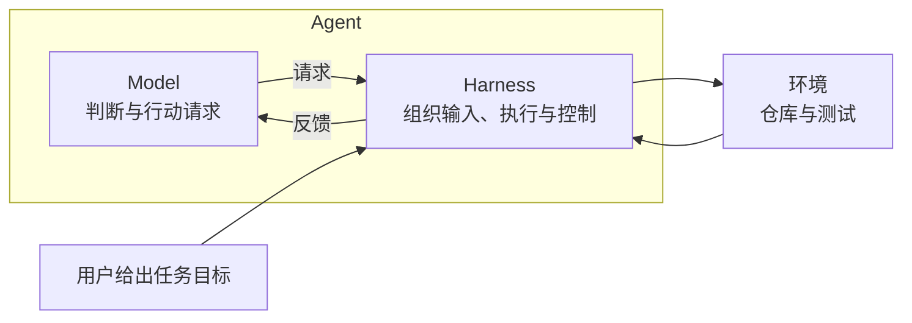

这张图里最容易被忽略的是那条从 Harness 指向模型的回箭头。它是整个系统的信息来源：模型下一轮能看到什么，完全由 Harness 决定。同一句「导出多了两条」，可以变成一段原始 stdout，也可以变成「A31 不在预期集合内，筛选条件疑似未传入」这样一句结论。回传的质量，直接决定模型下一轮能不能选中正确的动作。

模型这条边上没有环境，也没有文件：它只和 Harness 对话。这一点决定了后面所有的设计——想让 Agent 更可靠，能改的地方几乎都在 Harness 这一侧，而不是在提示词里再加一句「请仔细检查」。

## 模型的边界：它只会写下一个 token

要接受「必须外置执行系统」这个结论，得先承认模型能做什么、不能做什么。

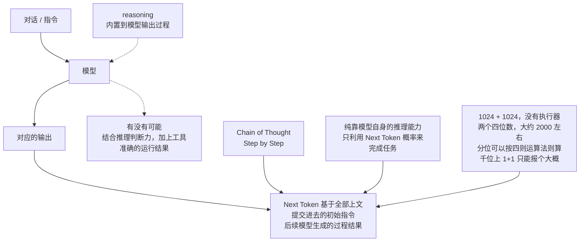

图的主线是这样：模型接收对话或指令，输出是「下一个 token」的条件概率，而每一个 token 都基于全部上文——提交进去的初始指令，加上它自己已经生成的过程结果。所谓思维链（Chain of Thought），本质是把推理过程也写成 token，让后面的 token 能「看到」前面想过什么。它提升了可达的推理深度，但没有改变输出形式。

真正的分界出现在需要执行的地方。图里举的例子是 1024 + 1024：模型没有算术执行器，它给出的不是严格运算的结果，而是「两个四位数，离 1000 这个概念很近，大概 2000 左右」这种基于分布的估计。分位计算还能靠四则运算法则硬撑，到千位就彻底不行——1 + 1 之所以能答对，是因为语料里见过太多次，而不是因为它算过。

这个观察推出一条很硬的结论：**模型的输出永远是「文本」，执行永远发生在文本之外。** 你说「跑一下测试」，模型能生成「运行 pytest tests/test_export.py」这一行，但这一行本身不跑任何东西。课件在架构图里给这句话留了一行红字批注：没有执行器，指令就只是文字。

工具接上模型之后，循环是这样：

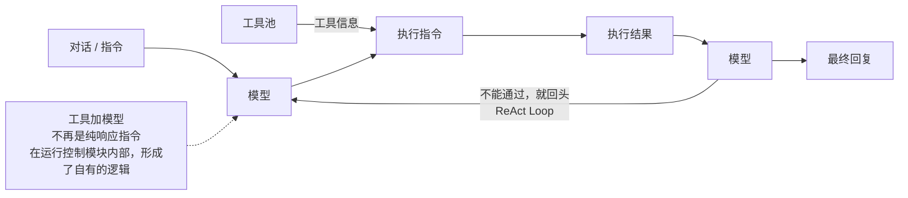

四步循环：判断是否需要工具、生成工具调用指令、拿到工具调用结果、结合结果给出答案。图里有一句判断很关键——「不再是纯响应指令，在运行控制模块内，形成了自有的逻辑」。也就是说，一旦模型开始请求工具，它就不再是一个问答接口，而是一个需要在多轮之间维持状态的运行实体。谁来维持这个状态、谁来决定什么时候进入下一轮、谁来判定这一轮的结果算不算通过，就是 Harness 的活。

顺带说一句 reasoning 模型。上面从 reasoning 指回模型的那条线，标的是推理内置到模型输出过程。这说明部分推理能力可以被训练进模型的输出过程，让它在内部多走几步再给答案。但这条线到不了执行：训练能把「想一想」变成「写出来」，不能让「跑一下」真的跑起来。模型越强，Harness 越要外置——因为越强的模型提出的动作越具体，落空的代价也越具体。

## Harness 到底在管什么

课件第 5 页把运行时的职责列成四个模块，每个模块都用「接收什么 / 交出什么」来定义。这种写法比列功能清单有用得多，因为它直接给出了模块之间的接口。

| 运行时模块     | 接收什么                               | 交出什么                                   |
| -------------- | -------------------------------------- | ------------------------------------------ |
| 模型接口       | 本轮材料、指令和输出约定               | 供程序处理的候选答复、工具请求或接口错误   |
| 上下文与状态   | 会话、任务进展和相关资料               | 本轮模型所需的材料，以及可供恢复的任务记录 |
| 工具与执行环境 | 工具请求、授权和执行范围               | 执行结果、产物引用或失败原因               |
| 运行控制       | 任务规则、模型输出、执行结果和当前状态 | 下一步动作，以及继续、等待或结束的决定     |

表里没有「提示词工程」，也没有「记忆」「规划」这类流行的词。这不是遗漏，而是视角不同：它描述的是程序在什么时机、拿着什么、交给谁。按这个视角看，提示词只是「模型接口」里的一个字段，记忆只是「上下文与状态」的一种实现。

四个模块之间的数据流可以这样串起来：

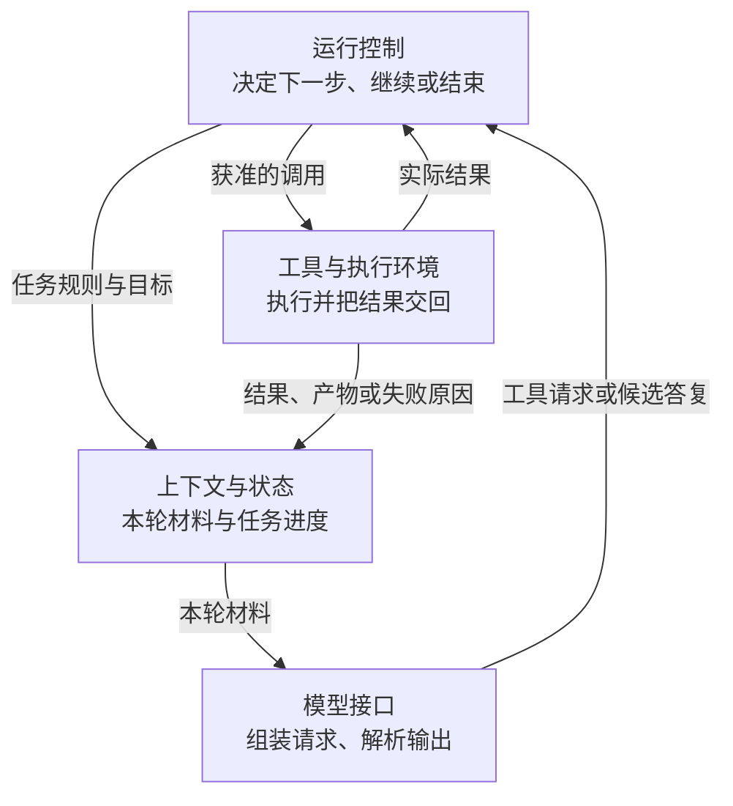

注意图上工具结果的去向有两条：一条进上下文，供下一轮模型判断；一条直接回到运行控制，供它做「继续还是结束」的决定。这两条分开是有原因的——验收不该等模型读完再说「我觉得可以了」，验收要拿实际结果对任务规则。

### 模型接口：把「说的话」变成可解析的结构

模型接口干三件事：发起请求、解析结果、返回错误。第二件是分水岭。

模型提出运行测试时，接口交出的不该是一段自然语言，而是工具名和参数；模型给出修复说明时，接口交出的是候选答复，可以直接作为交付物的一部分。这一步做不好，后面所有环节都要靠字符串匹配去猜，稳不住。

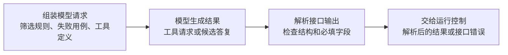

交接是四个动作：组装模型请求，模型生成结果，解析接口输出，再交给运行控制。第三个动作里那句「检查结构和必填字段」值得单独说：它意味着接口层要做校验，而不是把模型返回的东西直接往下传。缺字段、类型不对、工具名不存在，都该在这一层被拦下来并作为一种明确的返回值（接口错误）上报，由运行控制决定重试、补充材料还是结束。

把错误当成一种正常输出，是这套设计里最工程化的部分。它承认模型会出错，并且给错误预留了一条固定通道，而不是让错误在系统里散成异常。

### 上下文与状态：本轮看什么，和做到哪一步

这两个概念经常被混为一谈，课件把它们分得很开：上下文是模型本轮可见的材料，任务状态是系统已经做到哪一步。

混在一起的代价是具体的。假设你把「已修改代码、待复测」这件事只写进对话历史，那么一旦会话被压缩、模型换了、进程重启，这条信息就没了；系统重新接手时不知道改动是否已落盘，最省事的做法是重跑一遍——重跑本身可能又改坏一次。

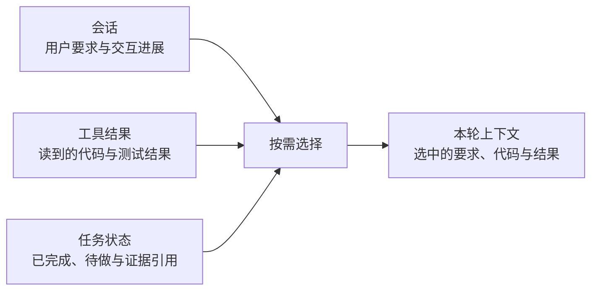

课件的做法是三层分工：上下文从会话、任务记录和已取得的工具结果里挑材料（最新的筛选要求、出错的代码、测试结果）；状态记录「代码改动已写入、测试尚未运行、改动在哪个文件版本」；实际文件仍然留在工作区，状态只做引用。恢复时先读进度，再用工具确认文件版本，最后补跑测试。外部写入的结果不明确时，先查再决定是否重试。

这里有一句容易被跳过的限定：**状态可以引用工作区的文件，但不能替代它。** 记录说「已修改」，工作区里的文件却是旧版本，这种情况一定会发生（比如用户手动回退了）。所以恢复流程里必须有一次用工具做的核对，而不是无条件相信记录。

### 工具与执行环境：能做，和在哪儿做

工具层做三件事：声明可用操作（参数与返回结果）、在获准的范围内执行、回传执行结果。第二件事是安全边界，第三件事是可恢复性。

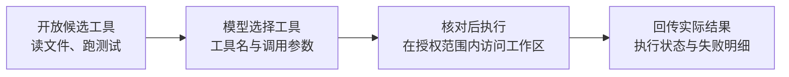

课件给的例子很具体：允许在任务目录内改代码、跑测试，但推送远程仓库要单独申请批准。这条规则的意义在于，它把「不可逆操作」和「可逆操作」分到了两条通道上——改本地文件错了可以回滚，强推远程仓库错了没法回滚。

回传结果也有讲究：要区分参数无效、缺少权限和命令失败。三者的处理方式完全不同。参数无效说明模型理解错了，应该把错误信息交回模型让它改；缺少权限说明是流程问题，应该走授权或换路径；命令失败说明环境有问题，盲目重试只会重复失败。把这三种失败糊成一句「执行失败」，运行控制就只能一律重试，重试几轮后预算耗尽，任务报告「失败」——但你并不知道失败在哪。

### 运行控制：下一步谁决定，什么时候停

运行控制是四个模块里唯一需要做决策的。课件把它拆成两个问题：谁选下一步，以及任务何时结束。

谁选下一步，有三种组织方式：流程编排（程序预先规定先复现故障、再排查和修复、最后验收）、Agent 循环（由模型根据新线索决定查什么）、以及两者的组合（预设流程把排查这一段交给 Agent 循环，等它返回改动和测试结果，再按约定规则验收）。

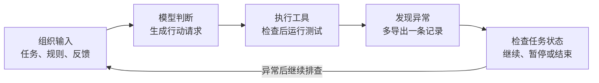

这条回路是：组织输入，模型判断并生成行动请求，执行工具，发现异常，再由运行控制检查任务状态。异常且还要查，就回到组织输入。这里有两个不同的「判断」：模型判断「该查什么」，运行控制判断「还该不该继续」。前者靠线索，后者靠规则和预算。

任务何时结束，课件给了四种去向，触发条件各不相同：

| 去向 | 触发条件               | 系统要留下什么               |
| ---- | ---------------------- | ---------------------------- |
| 完成 | 交付条件被实际结果满足 | 代码差异、测试结果、产物位置 |
| 继续 | 检查未通过且预算允许   | 失败明细交回排查流程         |
| 等待 | 需要人工授权           | 保存进度，等待后可从原处接续 |
| 停止 | 预算耗尽或用户取消     | 报告已完成与未完成的部分     |

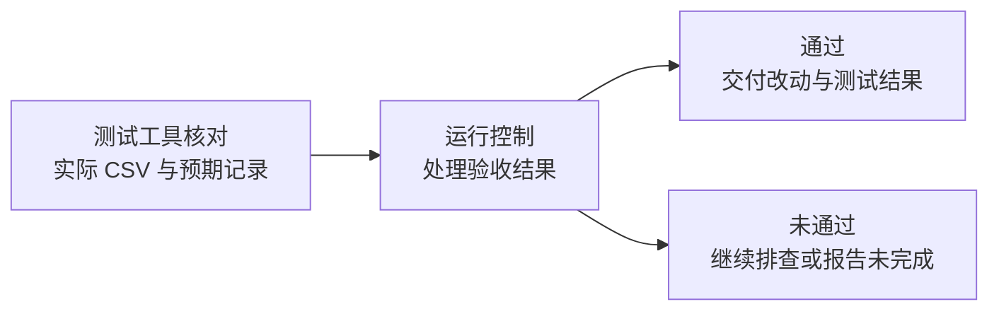

「完成」这一行的判定依据是「实际结果满足交付条件」，不是「模型说好了」。课件举的交付条件是可执行的：三条记录里两条符合筛选条件，导出文件应恰好包含这两条——这个检查可以由测试工具执行。能写成断言的条件才是交付条件，写不成的，最后一定会变成人来拍板。

## 为什么非要有它：同一组题，只换工具接口

如果 Harness 只是把模型的话变成动作，那它的价值还停留在「自动化」。课件第 3 页引了一项预印本的结论，说明它影响的是任务成功率本身。

实验设置很简单：在同一组代码修复题（SWE-Bench Verified）上，只改变工具接口——从只能通过 Bash 操作工作区，换成额外提供文件读取、搜索和编辑等结构化工具。结果两个模型走向相反：Mistral Medium 3.5 的成功率从 45.4% 升到 68.6%，Nemotron-3 550B 从 69.4% 降到 65.8%。

（数据与结论引自课件第 3 页，原始资料为《An Empirical Study of Harness Design for Coding Agents》2026 年 9 月，表 3。）

这两个数字摆在一起才是重点。如果两个模型都涨，结论是「结构化工具更好用」，照着抄就行。一涨一跌说明的是另一件事：工具接口和模型的匹配关系不是普适的。一个习惯了用 Bash 组合命令的模型，被塞进「必须先 search 再 read 再 edit」的固定接口后，反而丢了它原来擅长的路径。

课件给出的结论很克制：工具接口会改变 Agent 的任务表现，选型要用实际部署的模型验证。这句话的反面同样成立——你没法从一篇文章里抄到一个「最优 Harness」，只能在自己的模型和任务上测出来。

## 从生成内容到持续执行：系统怎样一步步长出来

把时间线摊开，会发现每一年的进展都在做同一件事：把原本由人承担的运行职责挪进系统。

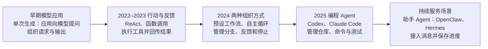

2022 年的 ReAct 展示了怎样交替组织推理、行动与观察——这是第一次把「想—做—看」写成一个可循环的结构。2023 年 OpenAI 提供结构化函数调用，应用可以解析模型给出的函数名和参数并执行，「模型说的话」第一次有了稳定的程序入口。2024 年 Anthropic 归纳了两种可组合的方式：工作流由程序预先安排路径，自主 Agent 让模型根据反馈选择动作。2025 年的编程 Agent 与助手 Agent 把这些机制用在了更脏的场景：仓库操作、消息接入、跨会话任务。

图里最右边一列写的是「持续服务场景」，对应「接入消息并保存进度」。这一步的跨度比前面都大：前面几步解决的是「一次任务怎么跑完」，这一步解决的是「任务跑到一半被中断、被打断、被追加需求，怎么接着跑」。这也正是 Harness 从「执行器」变成「运行系统」的地方。

一个实用的判据：如果你的场景里任务总能一次跑完、失败就重来，Harness 可以很薄；一旦出现「跑十分钟」「等人工确认」「中途来新资料」，Harness 的复杂度会立刻上一个量级，因为你要开始处理状态、接续和冲突。

## 把这些职责落成一套架构

抽象讲完，看一套具体的落法。笔记里那张架构图把「Harness Engineering」画成了一个以模型为底座的装配体，值得逐个部件读。

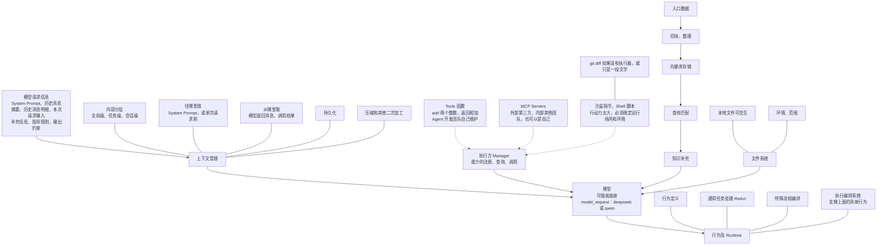

先看底座。中间那个「模型可插拔底座」，标注是 `model_request(model="deepseek" | "qwen")`——模型是被调用的一方，不是系统的主体。这个位置关系很重要：模型换了，Harness 不该重写；Harness 改了，模型不该感知。上面那组一涨一跌的实验数据，某种意义上就是在提醒：模型和 Harness 是两个可以独立变动的变量，必须分开评估。

往上一层是「执行方（Manager）」，它管三件事：能力的注册、能力的查询、能力的调用。三种执行入口并排挂在它下面：

- **Tools 函数**：本地函数，Agent 开发团队自己维护，图上写的是 `add(a: int, b: int) -> a+b` 这种最朴素的形态。
- **MCP Servers**：由 MCP Server 供应商维护，可以是外部第三方、内部其他团队，也可以是团队自己）。
- **沙盒指令 / Shell 脚本执行**：因为指令的行动力太大，必须放进限定性的运行场所和环境。

这三条通道的设计意图很清晰：能力越强，约束越硬。一个加法函数不需要沙盒，一条 `git diff` 需要，一条能删库的脚本更需要。

右侧是上下文管理，图上把它拆得很细：内容分三级（全局级、任务级、会话级），注入和取回分两个方向（往哪里放、从哪里取），再加上持久化和压缩/二次加工。往哪里放写的是 System Prompt 或单次请求前；从哪里取写的是模型返回消息和调用结果。这套分级的价值在于，它把「哪些信息该活多久」变成了显式的配置，而不是靠拼接字符串时的直觉。

下方是「行为及 Runtime」：通用任务处理走 ReAct，特殊流程走编排，两者之上还有一个执行编排系统支撑具体行为。左下角那行批注是全图最锋利的一句：

> 指令 `git diff ...` 如果没有执行器，就只是一段文字。

右侧边缘还有知识补充（入口数据 → 切块整理 → 向量库存 → 查询匹配）和文件系统（本地文件可交互、环境范围 awk）两条支线。它们回答的是另一个问题：当模型的「自有知识储备不足」时，材料从哪里来。

这张图不是标准答案，它是把前面四个模块的职责摊到具体组件上的一次尝试。值得对照着看的是它的取舍：它没有单独的「规划器」，规划被放进了行为 Runtime；它也没有单独的「记忆模块」，记忆被拆成了上下文管理的三级加持久化。同一个职责可以有很多种切法，切法不同，后面能改的地方就不同。

## Skill：能力被打包成可加载的单元

架构图里还有一个问题没回答：工具是一个个函数，那「一类任务的做法」怎么封装？

笔记里给了一个答案：技能（Skill）。

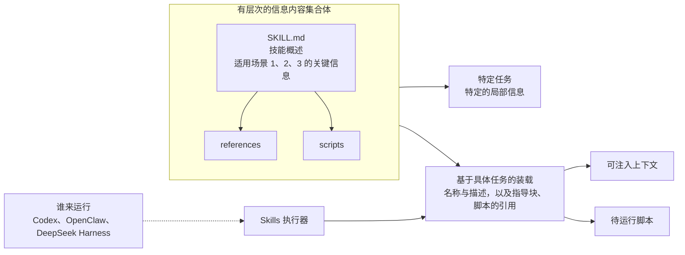

一个 Skill 目录里放三样东西：`SKILL.md` 提供技能的描述与头部信息（名称、描述、适用场景 1/2/3 各自对应的关键信息），`references/` 放指导材料，`scripts/` 放可执行脚本。图上把这套结构叫「有层次的信息内容集合体」，它的目的是：给定一个具体任务，只加载这个任务需要的那部分局部信息。

右边那条链是装载过程。谁来运行？图上列了 Codex、OpenClaw、DeepSeek Harness——也就是说 Skill 是一种跨运行时的约定，不是某个框架的私有格式。Skills 执行器做的事是「基于具体任务的装载」，装载结果分两路：一路注入上下文（变成模型能看到的内容），一路成为待运行脚本（交给执行环境）。

图下方那个「写作方法 SKILL」的例子把机制说透了：

```text
name: 写作指导
description: 适用于中文各种文体的写作场景

通用指导：中文病句，适用表达
叙事文（小说、日记、游记）：可以使用 references/叙事文写作手法.md 进行指导
应用文（...）：...
课堂讲义（...）：除了遵循应用文写作规范外，每次写完之后，必须调用
           scripts/讲义格式标准校验.py 进行校验，具体调用方法：py --var ...
```

注意最后一句：校验不是可选项，而是写在 Skill 里的硬约束，且给出了确切的调用方式。这就是 Skill 和「一段提示词」的区别——提示词只能建议，Skill 能把「必须跑这个脚本」变成装载到上下文里的一条可执行指令。

一段来自笔记的伪代码可以说明装载进上下文的是什么：

```python
from tool_manager import tool_manager

# 初始指令只描述目标，不描述做法
user_input = input("请输入您的问题")        # 例：帮我查一下今天的天气
tools_info = tool_manager.get_tools_info()  # 工具名、参数、返回结果的描述

template = f"""
初始指令：{user_input}
工具池：{str(tools_info)}
要求：不要直接回答初始指令，先选择合适工具并生成工具调用指令
"""
```

模型看到的是「工具池的描述」，不是工具本身。这段模板把两件事同时做了：给它可选项，并且明确禁止它绕过工具直接作答。执行发生在 Harness 里，模型只负责选。

## 一次导出修复的完整交接

把四个模块、三种执行入口、一套上下文管理放回那个 CSV 例子里，一次修复的交接是这样跑的。

| 步骤       | 模块怎样交接                                                                   | 得到了什么                                             |
| ---------- | ------------------------------------------------------------------------------ | ------------------------------------------------------ |
| 复现故障   | 运行控制调用测试工具，工具把实际记录交回                                       | CSV 多出了 A31，测试未通过                             |
| 定位原因   | 上下文选入筛选要求和失败明细，模型接口把材料发给模型，再交回它提出的读文件请求 | 工具读回导出接口代码，模型发现筛选条件没有传到查询函数 |
| 写入修复   | 模型提出修改，运行控制安排工具在获准目录写入，并记录当前进度                   | 筛选条件已补传，进度记录显示待复测                     |
| 复测与交付 | 测试工具重新导出，逐条核对记录，运行控制根据验收结果结束任务                   | 文件恰好包含 A17 和 A24，可以附上改动与测试结果交付    |

表格适合看职责，时序更适合看「谁在等谁」。

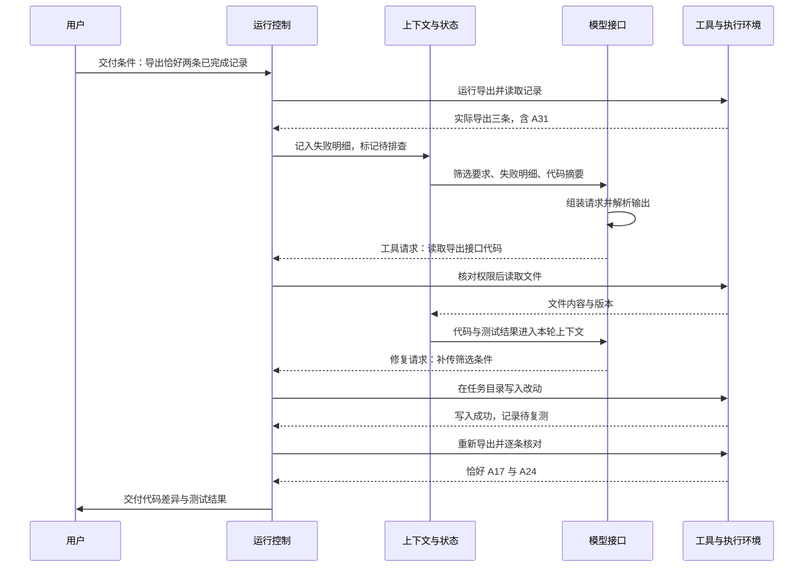

如果复测仍然多出 A31，运行控制会把这次失败明细交回排查流程。这时上下文里必须保留「已经试过的修改」和「上一轮复测结果」——否则模型会再一次提出同一个改法。课件特意提了这一句，因为它是长任务里最常见的死循环：状态只记了「失败」，没记「怎么失败的」。

## 长任务接到新资料，从哪里接续

CSV 修复的接续点很干净：改动已写入，等复测。真实任务没这么整齐。

课件换了一个例子：Agent 已经写好差旅、采购和请假说明的初稿，随后收到一份差旅补充通知——自 10 月 1 日起，销售部门正式员工境内出差，住宿上限从每晚 600 元调到 800 元，审批增加销售总监，其他部门继续按 600 元执行。

新资料到达时，Harness 要做四次判断：

| 接续时要回答的问题     | 制度整理中的做法                                                                           |
| ---------------------- | ------------------------------------------------------------------------------------------ |
| 已经做到哪一步？       | 从任务状态确认初稿已完成、哪些事项待确认，再到工作区读取初稿和原制度                       |
| 本轮应让模型看到什么？ | 选入补充通知、受影响的差旅条款和原有待确认事项，供模型判断应修改哪些内容                   |
| 哪些工作需要重开？     | 运行控制安排修改差旅部分，工具保存新版报告和修改说明，保留初稿供对照                       |
| 还有疑问时能否交付？   | 超标住宿由谁审批仍未明确，列入待确认问题，按「交付报告、问题清单和修改说明」的约定完成整理 |

第三行藏着一个容易忽略的设计：保留初稿供对照。新资料到达时，最危险的操作是就地覆盖——覆盖之后，你既没法对比改了什么，也没法回答用户「原来怎么写的」。

把四个判断串成流程：

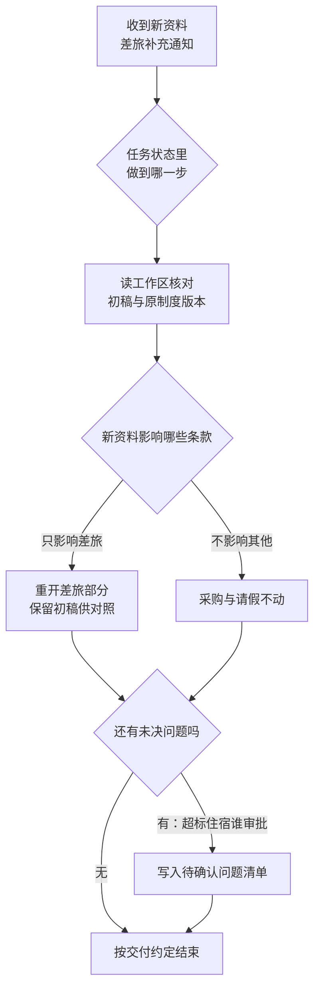

课件用一句话收束这个例子：CSV 修复的接续点是「已写入改动、等待复测」；制度整理收到新通知后，还要确定哪些已有产物需要更新。**保存的进度告诉系统从哪里接手，新资料的适用范围决定修改哪里。** 两件事缺一件，接续就会退化成「全部重做」。

## 反过来设计：先定验收，再定模块

前面九节都在讲「系统长什么样」，最后回到「你该怎么搭」。课件第 13 页给的不是清单，而是三个问题，顺序很重要。

| 设计问题                                                         | 要确定的答案                                         | 落到哪个模块            |
| ---------------------------------------------------------------- | ---------------------------------------------------- | ----------------------- |
| 模型接口交出哪几类结果？哪些材料要进入本轮上下文？               | 候选答复、工具请求、接口错误各是什么，材料清单是什么 | 模型接口 + 上下文与状态 |
| 工具可以在哪里执行？哪些操作需要授权？失败怎样回传？             | 工作区边界、授权点、三类失败的区分方式               | 工具与执行环境          |
| 哪些步骤由流程规定，哪些由模型按反馈选择？怎样完成、等待或接续？ | 流程骨架、Agent 循环的插入点、四类结束去向           | 运行控制                |

这三个问题都从「任务要改变什么、怎样确认改变已经发生」出发。课件给的例子是可检查的：验收导出修复时，可以查看实际导出的记录、测试结果和代码差异——三样都是产物，不是模型的说法。

反过来做会怎样：先选一个框架，再去找一个能塞进去的任务，最后发现「完成」这件事没法判定。这时候系统看起来每个模块都齐了，就是没法上线，因为没有人能说清它什么时候算做对了。所以在顺序上，交付条件应该写在第一行，模块划分写在第三行之后。

还有一层现实约束。前面那组 SWE-Bench 数据说明，Harness 和模型是绑在一起评估的；这意味着你不能只做一次选型，也不能假设换个模型不用重测。合理的做法是把 Harness 的变化和模型的变化都当成实验变量，用同一组样例跑对照——这也是课件提到离线评估的原因：用一组样例衡量系统表现，供 Harness Engineering 改进系统。

## 几个容易卡住的问题

**Harness 和 Agent 框架是一回事吗？** 不完全。框架提供的是模块的实现（模型客户端、工具注册、会话管理），Harness 描述的是这些模块之间的职责划分和运行规则。同一个框架可以搭出很薄的 Harness，也可以搭出很重的 Harness，区别在运行控制有多少是显式规定的。

**为什么上下文和状态要分开？** 因为它们的消费者不同。上下文是给模型看的，讲究「本轮最相关」；状态是给运行控制看的，讲究「跨轮不丢失、可核对」。混在一起的直接后果是：模型换掉或者会话压缩之后，系统就不知道自己做到哪一步了。

**能不能让模型自己判断该不该停？** 可以，但判定依据应该来自实际结果。课件把结束条件写成「交付条件被实际结果满足」，模型可以参与判断「下一步做什么」，不该独占「是否完成」的决定权——否则一次误判就会把没修好的代码当成交付物。

**工具是不是越多越好？** 前面的实验已经给了反例：同一个模型，接口从 Bash 换成结构化工具后成功率可能下降。工具多意味着选择多，也意味着上下文里要放更多描述、模型要更容易选错。加工具的正确理由应该是「某个动作现在做不了或者做不稳」，而不是「多一个能力总没坏处」。

**小任务要不要上这么重的系统？** 看任务是否一次成型。如果每次都能一遍跑完、失败重来成本很低，Harness 可以极薄，甚至只有一次工具调用加一次结果回填。真正需要重量的是那些「跑很久」「要等人」「中途会变」的任务，因为那时候状态、授权和接续才是主要成本。

**离线评估和在线验收有什么区别？** 离线评估用一组固定样例衡量系统表现，用来比较改动的效果；在线验收针对这一次具体任务，用实际产物判断能不能交付。前者回答「这套 Harness 好不好」，后者回答「这次做完了没有」。两者不能互相替代。

## 小结

回到开头那次导出。模型说「检查导出接口」，这句话的价值取决于有没有一套系统能把它变成「读文件、改一行、跑测试、核对两条记录」。这套系统就是 Harness，它管四件事：把材料按本轮需要送进模型，把模型的请求变成受控的执行，把执行结果变成可判断的状态，再按任务规则决定继续、等待还是结束。

Harness Engineering 的难点不在把模块搭齐，而在两处交界：一处是模型和 Harness 之间——回传的信息质量决定模型下一轮能不能选对；另一处是 Harness 和任务之间——交付条件必须能被实际产物验证，否则「完成」永远是个主观判断。

如果只带走一句，可以是这句：模型负责判断，Harness 负责让判断变成可验收的事实。判断的质量靠模型，事实的质量靠你。
