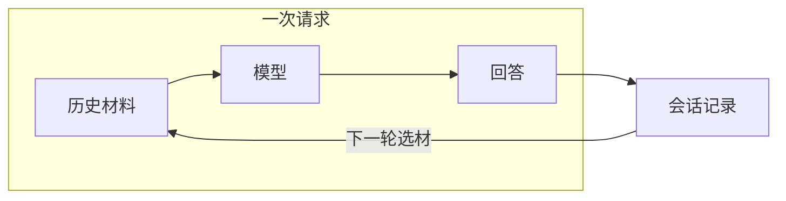
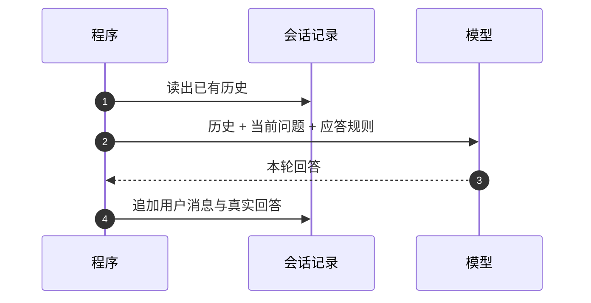
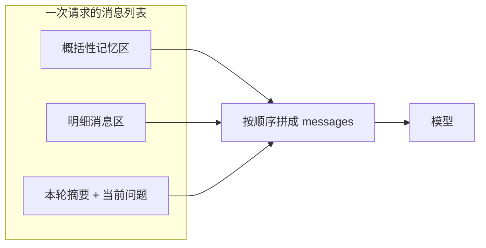
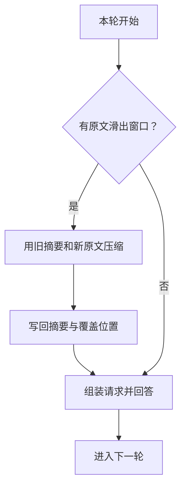
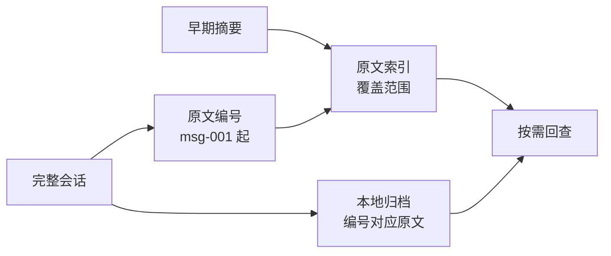
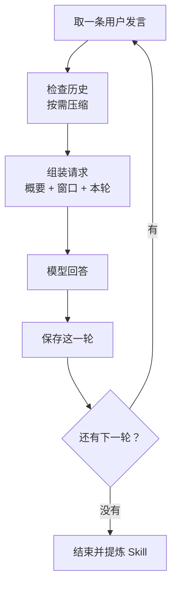

<!-- more -->

第五轮，用户问「这次交接的样品批次号是什么」。模型回答：当前材料未提及。

可这条消息就在完整会话的第一条里，几分钟前刚刚确认过。程序也没有删它——记录里一共 8 条消息，一条不少。问题出在另一步：这次请求只带了最近 2 条。

这是「Agent 失忆」最常见的形态，也是 Hermes 这类持续在线的助手 Agent 每天都会遇到的事。它不像人那样「记得」或「忘了」，它每一次作答能看到的，只有这一次请求里装进去的那些文字。存下来的东西，不会自动变成带上来的东西。

这一章沿着「一次请求里到底装了什么」走一遍：先把每一轮对话存回去，再看不带全量历史会发生什么，然后依次补上滑动窗口、概括性记忆、滚动摘要、原文索引和跨会话查找，最后在会话结束时把确认过的做法提炼成可复用的 Skill。所有示例共用同一个剧本——样品交接，批次号 PX-7319、排期从 14:00 改到 16:00、签收表放在前台——每一版只改变「发给模型的材料」，其他都不动。

## 1. 记忆不在模型里，在每一次请求里

模型的调用是无状态的。它不保存上一轮，也没有「会话」这个对象。所谓多轮对话，是程序在每次请求前重新拼一份消息列表，把历史一起递过去。课件把这条回路画成一个圈：用户输入 → 模型响应 → 输出 → 存储会话记录 → 下一次载入。



圈里有两个动作经常被混为一谈：**存**和**带**。存是持久化，写文件、写数据库、写一份 JSON；带是选材，决定这一次请求里放哪几条消息。绝大多数「Agent 忘了」的事故出在第二个动作上——记录好端端躺在磁盘里，只是没进这次请求。

会话记录本身长得很朴素，就是一份按时间追加的列表，每条形如 `{"role": "user", "content": "..."}` 或 `{"role": "assistant", "content": "..."}`。`role` 不是装饰：它告诉模型这句话是谁说的。把模型自己说过的话标成 `user`，它会以为这句话来自用户；把用户的确认标成 `assistant`，它会以为这是自己许下的承诺。后面的摘要与 Skill 都要靠这个区分来判断「哪条事实是被谁确认的」。

还有一个更隐蔽的后果：模型不知道自己缺了什么。它拿到的上下文里没有批次号，就不会说「我看不到批次号」，而是顺着已有材料给出一个听起来合理的回答。课件白板上把这种现象归到「不在训练语料里」的那一类：没有依据时，模型倾向于补全，而不是承认缺失。

所以后面每个示例的指令里都有一句几乎一样的话：

> 缺少依据时回复「当前材料未提及」。

这句不是客套。它把「失忆」从一种看不见的内部状态，变成一句可以在输出里查到的现象。没有它，你只能看到模型答错了；有了它，你能分清是材料没带进来，还是带进来了但模型没用对。

| 现象 | 先查 | 再查 |
| --- | --- | --- |
| 回答「当前材料未提及」 | 这条事实有没有进请求 | 摘要是不是把它改写掉了 |
| 回答给出错误的值 | 请求里有没有互相冲突的版本 | 指令有没有规定冲突时以谁为准 |
| 回答含糊其辞 | 窗口里还有没有原文 | 摘要是不是丢了标识符 |

这张表的用法是固定的：从上往下查，不要跳。材料选错了，改提示词是白费；材料选对了模型还用错，才轮到换说法或换模型。

上下文窗口（Context Window）还有一层现实的约束。一次请求的预算要同时装下历史、当前指令和输出预留，三者抢同一份额度。课件示例里窗口取 8 条和 2 条，选得这么小是为了让差异在一屏里看清；真实业务里一轮对话可能就占掉几千 token，能装多少条历史要先算，再定。

## 2. 第一版：把真实发生的一问一答追加回历史

第一版解决的问题最小：让第二次请求能看见第一次。

```python
history: list[dict[str, str]] = []
message = "这次交接的样品批次号是 PX-7319，标签要保留。"

# 先请求模型，再保存真实发生的一问一答。
answer = Agently.create_request().input(message).instruct("请用一句话确认收到交接信息。").get_text()
history.append({"role": "user", "content": message})
history.append({"role": "assistant", "content": answer})

# 第二轮：历史放进 prompt，本轮问题放进 input。
question = "这次交接的样品批次号是什么？"
answer = (
    Agently.create_request()
    .set_prompt("chat_history", history)
    .input(question)
    .instruct("查阅本次请求里的历史消息，找到用户报出的样品批次号。只回答批次号。"
              "历史消息没有提供批次号时，回复“当前材料未提及”。")
    .get_text()
)
```

这段里有三处容易写错。

**第一处是追加的内容。** 存进去的必须是模型这一次的真实输出，不能是你预期它会说的话。如果第二轮请求里的「助手回答」是程序预设的，那么第三轮的问题就建立在一句从未发生过的话上——模型会认真地顺着它继续编，而你在日志里看到的每一轮都「正常」。课件里这个示例专门先请求一次、拿到回答，再把这一问一答一起追加，就是为了避免这种自欺。

**第二处是两个入口的分工。** `set_prompt("chat_history", history)` 放的是背景材料，`input(question)` 放的是本轮问题。两者在最终请求里的位置不同：历史在消息列表前部，问题在最后。这个位置差异在第三版会变得关键——模型对最后一条用户消息的注意力最强，所以「本轮提醒」要写在那里，而不是混进历史。

**第三处是那句兜底规则。** 它同时做了两件事：告诉模型去哪找（本次请求里的历史消息），以及找不到时怎么答。少了前半句，模型可能去猜；少了后半句，它可能编。

课件第 2 页记录的结果是：第二轮请求里只有两条历史消息，模型据此答出了 PX-7319。到这里，记忆的最小闭环成立了——存一轮，带一轮。

示例里第一轮只让模型「用一句话确认收到」，也有用意：回答短、无歧义，存进历史后不会挤占窗口，也不会给第二轮引入额外的解释。真实项目里第一轮往往就是一大段业务说明，这时候更要注意存储粒度——是按每条消息存，还是按每轮对话存。按条存更细，回查更准；按轮存更省，压缩时也更难丢上下文。这个选择会一直影响到第六版。

这一版的边界也很清楚：历史只增不减。四轮 8 条，八轮 16 条，二十轮 40 条。每次请求都要把这些消息连同当前问题一起发出去，token 成本线性上涨。窗口是有限的，超长之后有两种失败方式：请求被服务端直接拒绝（你能看到错误，好处理），或者被静默截断（更糟，你不知道截掉的是开头还是结尾）。

所以下一版不是加东西，是减东西。



这张图值得记住的地方在最后一步：回答写回历史，是在请求结束之后。也就是说，模型这一轮看到的历史，永远不包含它自己刚才的输出；那一条要等下一次请求才会出现。所有关于「记忆」的设计，都是在这个时序上做文章。

## 3. 第二版：滑动窗口让「带什么」变成一次取舍

第二版只改一个变量：不再带全部历史，只带最近几条，也就是常说的滑动窗口（Sliding Window）。

```python
WINDOW_SIZE = 2

recent = history[-WINDOW_SIZE:]

answer = await ask_model(recent, user_message)

history = history + [
    {"role": "user", "content": user_message},
    {"role": "assistant", "content": answer},
]
```

`recent` 取的是「已经发生的历史」的尾部，本轮问题仍然由 `input` 另行提交。回答写回之后，下一轮再取尾部，窗口自然滑到了最新的一轮。这里按条数计算窗口，不是按 token。

课件第 4 页给了一组对照：同样问第五轮的批次号，同样一份 8 条消息的完整历史，只改窗口大小。

| 这次发送 | 批次号是否进入请求 | 一次 DeepSeek 实跑的回答 |
| --- | --- | --- |
| 最近 8 条历史 | 第一条含 PX-7319 | PX-7319 |
| 最近 2 条历史 | 只发了签收表的一问一答 | 当前材料未提及 |

同一道题，答案翻了。原因不复杂：8 条窗口恰好覆盖第 1 轮到第 4 轮，第一条就是用户报批次号的那句；2 条窗口只覆盖第 4 轮的「签收表放在前台」一问一答，批次号已经在窗口之外。

还有一个次生效应容易被忽略。程序在最后追加的是「用户问题 + 短窗口给出的回答」，也就是那句「当前材料未提及」被当成真实发生过的一轮写回了历史。窗口不仅决定模型看到什么，也决定记录里留下什么。一次因为窗口太短导致的错误回答，会以「事实」的身份进入后续所有轮次，除非有人显式纠正它。

课件还留了两句提醒，都是踩过坑才写得出来的：

- 这里按条数演示，实际应用还要考虑输入容量。一条长消息可能占掉好几条短消息的位置，按条数切会在长度不均时失手，更稳的做法是按 token 预算切，并给输出预留固定额度。
- 排查「失忆」时，先看所需信息有没有进入请求，再看模型有没有正确使用它。这两件事对应两种完全不同的修法：前者改选材，后者改提示或换模型。

判断可以下得直接一点：滑动窗口不是省 token 的小技巧，它是一种取舍机制，而取舍一定有代价。这一版丢掉的，是签收表以外的所有内容，其中包括那个唯一能回答问题的标识符。

这里还藏着一个默认选择：保留最近的，还是保留最早的。滑动窗口保留最近的，因为对话里的事实通常「越新越权威」——时间改到 16:00 之后，14:00 就不再是答案。但这只是默认值，不是定理。如果前置条件写在开头（比如「所有批次号以入库单为准」），那就要么把它挪进系统提示，要么在压缩时优先保留，否则它会和窗口外的其他内容一起被丢掉。

到这里，问题从「怎么存」变成了「丢了怎么办」。后面三版都在回答这个问题，一层比一层具体。

## 4. 第三版：给记忆分区，空位却不会自己长出内容

第三版的改动在请求结构：历史不再是一个平铺的列表，而是分成两段；本轮任务也不再直接塞进 `input`，而是和问题一起组成最后一条用户消息。

课件第 5 页把三个区域的位置和职责列得很清楚。

| 在请求中的位置 | 区域 | 放什么 |
| --- | --- | --- |
| 历史列表前部 | 概括性记忆区 | 从早期历史提炼、后续多轮仍可能用到的事实和约定 |
| 历史列表尾部 | 明细消息区 | 最近窗口内的原始消息，保留角色、文字和顺序 |
| 最后一条用户消息 | 本轮信息摘要区 | 此次任务需要的一两条提醒，和当前问题分段写 |

对应的代码只有几行改动。

```python
memory_area: list[dict[str, str]] = []  # 这一版里区域始终为空

reminder = "当前任务是样品交接。"
if turn == 5:
    reminder = "只核对标签上的批次号。"

current_message = f"【本轮信息摘要】{reminder}\n\n【当前消息】{user_message}"
answer = await ask_model(memory_area + recent, current_message)
```

三处细节值得说。

`memory_area + recent` 说明两个区在请求里仍然是同一个列表。概括区在前，明细在后，顺序就是优先级：先给结论和约定，再给最近的原文。这个顺序不是排版偏好，它影响模型对材料的组织方式。

`current_message` 是分段拼出来的，本轮提醒和问题各自成段。合成一段会怎样？模型会分不清「这是任务要求」和「这是要回答的内容」，把提醒当成问题的一部分复述出来。

`reminder` 只在这一轮变化，而且**不进历史**。它属于本轮的任务上下文，不是发生过的事实。如果把它也当作一轮对话存进记录，下一轮的窗口里就会多出一条「只核对标签上的批次号」，而那一轮的任务可能根本不是核对标签。

结果在课件第 6 页：概括区是空的，明细区只有签收表那一问一答，最后一条用户消息里带着「只核对标签上的批次号」和「这次交接的样品批次号是什么」——DeepSeek 仍然回答「当前材料未提及」。

为什么分区了还是答不出？因为区域是容器，不是内容。空着的概括区不会自己长出记忆；本轮提醒告诉模型「要核对什么」，但没有告诉它「值是多少」。这是两件事，在请求里缺一件都答不出。课件把这个现象单独列了一页，用意就是打掉一种很常见的错觉：以为把结构搭好，记忆就会自动流过去。

这一版的收益其实不在答案，而在结构。它给了「以后要补的事实」一个明确的落点，也把「本轮任务」和「历史事实」拆成了两类东西。后面两版做的事，就是往那个空位里填内容，并保证填进去的东西可核对。

位置也决定了注意力。概括区放在历史前部，等于告诉模型「这是背景，往后看」；本轮摘要放进最后一条用户消息，等于告诉它「这是这次的要求」。反过来做——把提醒塞进系统提示词——模型确实能看到，但它和当前问题的距离变远了，遇到材料冲突时更容易被最近的消息带走。课件把三个区域的位置定得很死，原因就在这里：位置本身就是指令的一部分。



三个区域最终汇成一份消息列表，这件事看起来平淡，但它解释了一个常见困惑：为什么「我把资料放进 system prompt 了」和「我把资料放在最后一条消息里」效果差很多。位置不同，模型对它的使用方式就不同。

## 5. 第四版：让模型把窗口外的原文压成摘要

第四版终于往概括区里填东西：压缩。

触发条件是历史满 8 条首次压缩，之后只处理新滑出窗口的原文。压缩发生在回答之前——回答时摘要已经就位，这一点很重要，顺序反了就等于这一轮白压。

```python
# FIRST_COMPRESSION_AT = 8；WINDOW_SIZE = 2
async def check_history(data):
    history = data.get_state("history", [])
    memory = data.get_state("memory", {"summary": "", "covered": 0})
    needs_summary = (
        len(history) >= FIRST_COMPRESSION_AT
        and len(history) - WINDOW_SIZE > memory["covered"]
    )
    await data.async_emit_nowait("compress_history" if needs_summary else "reply", data.input)

async def compress_history(data):
    history = data.get_state("history", [])
    memory = data.get_state("memory", {"summary": "", "covered": 0})
    boundary = len(history) - WINDOW_SIZE
    new_older_messages = history[memory["covered"]:boundary]

    summary = await (
        Agently.create_request()
        .input({"上一版摘要": memory["summary"], "新增早期原文": new_older_messages})
        .instruct("用两句以内更新样品交接摘要。逐字保留标识符及对应对象，"
                  "保留已确认的约定，合并重复信息。同一事实有明确修正时，用最新约定替换旧约定。")
        .async_get_text()
    )
    await data.async_set_state("memory", {"summary": summary, "covered": boundary}, emit=False)
```

这段代码里有四处设计决定了它是一次正确的压缩。

`boundary = len(history) - WINDOW_SIZE` 划出了可压缩的边界：窗口外的部分才能压，窗口内的原文必须保持原样。为什么？因为近处的信息最可能要逐字使用——批次号、时刻、人名，一旦被模型改写成「某批次」，就再也回不来了。

`memory["covered"]` 是上一次摘要覆盖到哪一条的位置。它让压缩变成幂等的：只处理新滑出窗口的原文，已经压过的不再重复。没有这个指针，每轮都会把整段早期历史重压一遍，摘要会越来越长、越来越像转述的转述。

摘要请求的输入只有两样：上一版摘要和刚离开窗口的原文，连当前问题都不带。这是刻意的——如果把当前问题也塞进去，摘要就会被当前任务「带偏」，只保留这次问到的内容，其余全丢。摘要应该服务的是未来所有轮次，不是这一轮。

`emit=False` 让这次状态更新不触发事件。压缩步骤如果也发出 `next_turn`，就会自己触发自己，形成压缩循环。

摘要写回时，摘要正文和 `covered` 是一起存的。课件第 8 页专门提了一句：需要跨进程接续时，要把摘要及其覆盖位置一并保存，恢复会话时再载入。只存摘要不存位置，下次启动要么重压一遍，要么漏掉一段。

指令里有三条硬要求，每一条都对应一种失败：

- **逐字保留标识符及对应对象。** 摘要最常见的错误是把 PX-7319 写成「某批次」，句子通顺了，答案没了。
- **保留已确认的约定和待确认事项。** 要区分「说过了」和「还没定」，否则模型会把待确认的说法当成事实用。
- **同一事实有明确修正时，用最新约定替换旧约定。** 14:00 改成 16:00 之后，摘要里不能两条都留着。

结果在课件第 7 页和第 11 页：第 5 轮答出了 PX-7319；第 6 轮用户把时间改到 16:00，第 8 轮开始前第 6 轮的原文滑出窗口，程序把这两条交给模型更新摘要，回答仍然是 16:00。两版使用同一组用户发言和相同的窗口大小，唯一差别是概括区里有没有那版摘要。



不过，摘要是有损压缩，而且损失会累积。课件白板上把上下文滑动窗口的问题列成三类：摘要本身可能失真；单一摘要承担全部早期信息，压缩机制过于粗糙；只按运行时的需要取舍，容易把后面才用到的内容丢掉。课堂代码里还留了一句很实在的注释——摘要「缓慢膨胀」：每轮都把上一版摘要和本轮原文再压一次，句子越写越长，真正的事实占比越来越低。

压缩还有两项实打实的成本。它本身是一次模型调用，每压一次就多一次请求，延迟和费用都往上走；所以触发时机要选。常见三种：按条数（本例）、按 token 预算、按轮次。按条数最好实现，按 token 最贴近真实上限，按轮次最稳但最浪费。选哪种，取决于你更怕「超窗」还是更怕「多花钱」。

示例里还有一行防御，容易被当成噪音：摘要为空时直接抛错，停止流程。宁可这一轮失败，也不要带着空摘要继续——空摘要不会报错，只会让后面每一轮都少一段记忆，而且你从输出里看不出来。

所以只有摘要还不够。摘要能告诉你「是什么」，但不能告诉你「从哪来」。当摘要把批次号写错，或者干脆漏掉，你没有任何办法发现——请求里只有一段通顺的转述，看不出它和原文的差别。

## 6. 第五版：摘要挂上原文编号，细节留待回查

第五版只加一件事：给摘要附上能定位原文的索引。

```python
def source_ids(covered: int) -> list[str]:
    return [f"msg-{position:03d}" for position in range(1, covered + 1)]

# 从状态里取出摘要和覆盖位置，组装概括性记忆区
memory = data.get_state("memory", {"summary": "", "covered": 0})
memory_area: list[dict[str, str]] = []
if memory["summary"]:
    sources = "、".join(source_ids(memory["covered"]))
    memory_area.append({
        "role": "user",
        "content": f"【早期会话摘要】{memory['summary']}\n【原文编号】{sources}",
    })
```

会话结束时，再按同一套编号把原文归档。

```python
path.write_text(json.dumps({
    "memory": {"summary": memory["summary"], "source_ids": source_ids(memory["covered"])},
    "archive": dict(zip(source_ids(len(history)), history)),
}, ensure_ascii=False, indent=2), encoding="utf-8")
```

这里最重要的是编号规则：按完整历史中的追加顺序分配，`msg-001` 是第一条用户消息，也就是含批次号的那条。规则只允许有一条，因为摘要里的索引和磁盘上的归档必须能对上。如果摘要用「覆盖到的最后一条」编号、归档用另一套顺序，两边就会错位，回查等于没做。

`source_ids` 跟着 `covered` 走：首次压缩指向 `msg-001` 到 `msg-006`，之后随覆盖范围增加，索引自动变长。归档那行用 `dict(zip(...))` 把编号和消息对象绑定，用的还是同一个函数，避免了「两处各写一套编号逻辑」这种最常见的漂移。

课件第 9 页把这个做法叫**渐进式披露**（Progressive Disclosure）：先给概要和线索，需要时再展开细节。摘要负责「概」，索引负责「线」，归档负责「细节」。三者分开存，各有各的失效条件。

| 存什么 | 给谁看 | 什么时候失效 |
| --- | --- | --- |
| 摘要 | 模型，每轮随请求发送 | 压缩时漏掉标识符 |
| 原文索引 | 模型，需要回查时使用 | 编号规则变了 |
| 本地归档 | 程序或人，事后核对 | 被覆盖、没持久化 |



这一版的边界也要说清楚。本例的索引指向「整批原文」，不是每条事实各自的出处。要逐条核验，得给每条事实单独挂编号——比如明确写出「批次号来自 msg-001」。索引的粒度决定了回查能做到多细：整批索引只能回答「这段话出自哪一段」，逐条索引才能回答「这个数字出自哪一句」。课件在第 9 页明确点了这一层，并且提醒 `memory_demo.json` 每次运行都会覆盖，做实验时别把有价值的归档冲掉。

回查的动作其实很具体：打开归档，用 `msg-001` 找到那条用户消息，看它写的是不是「这次交接的样品批次号是 PX-7319，标签要保留」。摘要里如果写成了别的编号，这一步立刻就能发现；没有索引，能做的只有重跑一遍会话。索引的价值不在于模型平时会不会去查，而在于出错时你还有一条确定的路。

## 7. 第六版：把五个单点接成一次完整会话

前五版都是单点：一次请求、一个动作。真实会话是循环。

课件第 11 页把这个循环写成一条链：取下一条用户发言 → 检查历史，按需压缩 → 组装请求并回答 → 保存这一轮 → 继续。

| 运行到哪里 | 在流程里看什么 |
| --- | --- |
| 第 1 至 4 轮 | 每轮实际增加两条消息，完整历史累积到 8 条，明细窗口最多 2 条 |
| 第 5 轮 | 窗口版对照 8 条和 2 条历史；摘要版压缩前 6 条后，再回答同一问题 |
| 第 6 至 8 轮 | 第 6 轮更正交接时间，第 8 轮前更新摘要；即使更正原文已离开窗口，回答仍能从摘要取得 16:00 |

这里的分工是：TriggerFlow 串起各轮，脚本负责选择历史、触发压缩和更新记忆，模型负责生成摘要和回答。后面的示例用 `flow.when(...)` 把「检查」和「压缩」拆成两个事件，就是为了让这条链在运行时可观察——你能看到哪一轮触发了压缩、压缩了几条。

课堂上另外写过一个销售场景的版本，用的是另一种接法：`if_condition` 判断用户输入是不是 `#exit`，末尾再回到 `user_input`，形成一个显式循环。两种接法做的事完全一样，区别只在事件驱动还是循环驱动。

那个版本的 `store_history` 很值得看，因为它把「窗口大小」和「切片下标」绑在了一起。

```python
chat_history = data.get_state("chat_history", [])
chat_history.extend([
    {"role": "user", "content": data.get_state("user_input")},
    {"role": "assistant", "content": data.get_state("model_response")},
])

messages_to_compact = chat_history[-4:-2]   # 刚滑出 2 条窗口的上一轮
context_window = chat_history[-2:]          # 保留最后 2 条完整消息

new_summary = (
    agent.input({
        "之前的摘要": data.get_state("summary", ""),
        "最新需要添加进入摘要的信息": messages_to_compact,
    })
    .instruct("请总结以上历史消息的要点，尤其注意保留哪些信息是用户说的，哪些信息是assistant说的。"
              "我们主要是做汽车销售的，仅需要保留与汽车相关的讨论要点，包括车辆需求、用户自有车辆情况等。")
    .start()
)
data.set_state("summary", new_summary)
data.set_state("context_window", context_window)
```

`[-4:-2]` 看起来像个魔术数字，其实是由窗口大小推出来的：窗口 2 条，所以每轮离开窗口的正好是上一轮的一问一答，而它就在倒数第 3、第 4 条。改窗口大小必须同时改这个切片，否则压缩的就不是「刚离开窗口的那部分」，而是别的段落——摘要看着还在更新，覆盖范围却错位了。

摘要指令是一套业务规则，不是通用压缩。它要求保留「谁说的」（用户还是助手），只留与汽车销售相关的讨论要点，其余全部摈弃。换句话说，摘要是**筛选**，不是缩写。同一段对话，在样品交接场景里要保留批次号和时间，在汽车销售场景里要保留车型偏好和预算——摘要的取舍标准来自业务，不来自文本长度。

还有一处细节：摘要以 `assistant` 消息的形式回填进下一轮请求（`之前对话信息的摘要: ...`）。模型会把它当成自己此前说过的话。好处是它更容易被当作已确立的背景，坏处是摘要里的错误不会被质疑，只会被延续。这也是为什么上一节的索引和归档不能省。

代码里还有两处值得留意。`create_execution(auto_close=False)` 和最后的 `async_close()`：前者让流程跑完不自动收尾，后者把结束时的状态取出来。记忆系统里，状态就是记忆——`history`、`summary`、`context_window` 全在 state 里，执行结束时能不能取到它们，决定了这次会话能不能被归档、被下一次接续。用默认的自动关闭，状态会在流程结束时释放，归档那一步就只能靠额外写盘。

另一处是 `get_state` 的默认值。第一次运行时状态里什么都没有，取到的就是调用时写的那个默认值；默认值写错，错误不会在初始化时暴露，而是在第一次压缩时才炸——那时上下文已经跑了一半，排查成本高得多。记忆系统的初始化 bug，几乎都长这样。

自触发的阈值是 `len(chat_history) % 6 == 0`，每 3 轮触发一次技能提炼。这个数字很粗糙，但它点出了一个结构问题：**触发机制本身是记忆系统的一部分**。什么时候压缩、什么时候提炼、由谁决定，这些问题的答案比压缩算法更容易被忽略。



把这条链路走完，可以看到一件事：这一章所有示例都在改「请求里装什么」，没有一个在改模型。记忆是运行时的工程问题，不是模型能力问题。想让它「记得牢」，能动手的地方几乎都在程序这一侧。

随课的示例放在 `examples/` 下，编号大致对应前面几节：01 到 05 是逐版递进的五个单点，06 是会话结束后的 Skill 提炼；第六版的多轮串接，对应课件第 11 页那个示例。

## 8. 记忆变多以后：从「带什么」到「找什么」

前面七节都在一段会话里。Hermes 这类长期在线的 Agent，记忆要跨会话，问题就从「带什么」变成了「找什么」。

课件第 10 页给了三种组织或查找方式，以及各自的麻烦。

| 组织或查找方式 | 什么时候适用 | 需要处理的问题 |
| --- | --- | --- |
| 按主题维护摘要 | 对话反复涉及少数稳定主题，例如样品、时间、签收 | 事实涉及多个主题时要同步更新 |
| 按标识符或关键词查找 | 用户常给出批次号或订单号 | 别名和不同表述可能查不到 |
| 用向量库按语义找候选 | 提问和记忆里的表述经常不同 | 相似结果仍需核对原文 |

用法的顺序是先缩小范围，再按线索定位。只知道「上次交接的样品」时，按语义查；知道 PX-7319 时，按编号查，快且准。三种方式不是替代关系，是漏斗的三层。

三种方式落到代码里通常是一条管道：先用主题或时间范围把候选缩到几十条，再用标识符或向量排序，最后把命中的原文取出来核对。每一层都可能出错，所以最后一层必须是原文，不能是摘要。课件那句「相似结果仍需核对原文」说的就是这个——向量检索给的是候选，不是答案。

跨会话记忆还必须带**适用范围**。课件举的例子是：用户说「以后每次交接都要附签收记录」，这条可以进跨会话记忆，但要注明它适用于交接任务，而不是所有任务。没有适用范围的长期记忆会污染别的场景——这是长期在线 Agent 比单次会话更危险的地方。一次会话里记错，错一轮；跨会话记错，错一个月。

白板上把外部记忆分成三类载体，正好对应三种规模：

- **结构化事实**：用户偏好、沟通风格，落到 `user-info.json` 这类文件里，按用户读取。
- **历史会话**：作为检索语料，进 RAG（检索增强生成）数据集，按语义召回。
- **本地文件**：交给文件系统管理，按目录和命名约定检索。

三类载体的共同点是：都不是「再塞进上下文」，而是「需要时取」。这就是渐进式披露在跨会话尺度上的版本——摘要和索引解决一次会话内的展开，这三类载体解决跨会话语料的展开。

比「怎么找」更早的问题是「写什么」。长期记忆的写入标准不能是「发生过」——照这个标准，临时状态、模型的推测、用户随口的一句抱怨都会沉淀下来。更稳的标准是三条：用户明确确认过的（「以这个时间为准」）、跨任务仍然成立的（「以后每次交接都要附签收记录」）、以及能追溯到具体发言的。三条都满足才写，缺一条就留在会话内，随会话结束丢弃。

写入还要去重。同一件事被确认三次，记忆里不该有三条；否则检索时三条同时命中，模型得先判断它们是不是同一个约定。课件把「合并重复信息」写进摘要指令，对长期记忆同样适用。

| 层 | 内容 | 载体 | 取用方式 |
| --- | --- | --- | --- |
| 会话内 | 窗口原文、摘要、索引 | 内存与 JSON | 每轮组装 |
| 跨会话 | 用户偏好、长期约定 | 结构化文件 | 按用户和任务取 |
| 能力 | 核对步骤、话术 | Skill 文件 | 按任务匹配 |

分层的意义在于：越往下越稳定，越往上越具体。会话内的东西一轮一变，跨会话的东西一个用户一套，能力层的东西换谁用都成立。混在一层里，就会出现「把这次的批次号写进用户偏好」这种事故。

## 9. 会话结束以后：把做法写成 Skill

前八节的产物都是「这一次」的记忆：批次号是 PX-7319，时间是 16:00，签收表在前台。换一批样品，这些全没用。真正能跨任务复用的是「怎么做」。

课件第 12 页给了一组对照。

| 这次会话确认了什么 | 下次还能怎么用 |
| --- | --- |
| 本次批次号是 PX-7319 | 从当前样品的标签核对批次号 |
| 旧排期是 14:00，接收方后来确认 16:00 | 排期有冲突时，以接收方最新确认的时间为准 |
| 签收表要求交给前台值班人员 | 从本次签收表确认交给谁，缺项标为待确认 |

左列是事实，右列是方法。会话摘要只能保住左列，Skill 保的是右列。

流程是：用户确认结束 → 写回最后一轮 → 用完整会话提炼做法 → 生成 Skill 草稿。注意第二步——最后一轮的问答也要先写回，否则提炼时看到的会话缺了结尾，而结尾往往正是用户确认标准的那一段。

```python
draft = await (
    Agently.create_request()
    .input({"已结束的样品交接核对会话": history})
    .instruct("提炼用户最终确认、可用于下一次同类任务的核对方法。"
              "把本次具体批次号和时刻改为需要查证的字段。"
              "说明每项的依据、遇到冲突或缺项时怎样处理，以及交付时应写什么。")
    .output({
        "description": (str, "一句话说明做什么、在什么任务中使用，最多 120 字"),
        "steps": [(str, "一条独立的可执行指令。全列表按顺序列 3 至 5 条，纯文本，不加编号")],
    })
    .async_get_data(type="parsed", ensure_keys=["description", "steps"])
)

description = draft["description"].strip()
steps = [step.strip() for step in draft["steps"]]
if not 1 <= len(description) <= 120 or not 3 <= len(steps) <= 5 or not all(steps):
    raise ValueError("提炼结果缺少适用说明或完整步骤。")

frontmatter = (
    f"---\nname: {SKILL_NAME}\n"
    f"description: {json.dumps(description, ensure_ascii=False)}\n---"
)
instructions = "\n".join(f"{number}. {step}" for number, step in enumerate(steps, 1))
```

四处设计值得展开。

**结构化输出。** 模型只交 `description` 和 `steps` 两个字段，格式由 schema 约束，不靠「请输出 YAML」这种口头要求。口头要求会漏，schema 不会。

**程序校验。** 字数 1 到 120、步数 3 到 5、每步非空，任何一条不满足直接抛错。宁可让流程失败，也不要把半成品写进 Skill 库——技能是要被反复调用的，一条坏规则会污染后面每一次任务。

**程序定格式。** 目录名、文件名、frontmatter 的字段顺序由代码确定，模型只负责内容。这个分工把「格式错误」变成一件在代码里能修的事，而不是每次都要祈祷模型输出对齐。

**抽象要求。** 指令里那句「把本次具体批次号和时刻改为需要查证的字段」，是从「这次」到「下次」的关键动作，必须显式写出来。不写的话，模型很可能把 PX-7319 直接写进规则，Skill 就退化成一条只对这批样品有效的备忘录。

生成的 SKILL.md 结构很小，课件第 13 页把它拆成三块。

| 文件里的位置 | 示例写入什么 |
| --- | --- |
| YAML 的 name | sample-handoff-review，与目录名一致 |
| YAML 的 description | 一句话说明用途与使用时机 |
| Markdown 正文 | 按顺序写依据、冲突和缺项的处理，以及交付内容 |

最小形态是目录里只有一个 SKILL.md，样例在随课的 `skill-demo/sample-handoff-review/SKILL.md`。正文是五条按顺序执行的指令：核对批次号以标签为准、核对时间以接收方最新确认为准、核对去向以签收表为准、冲突时按来源优先级采信且无法判定时标待确认、交付时逐项写明值与依据。每一步都能回到会话里的某句用户发言——这是判断一条 Skill 是否「有依据」的最直接标准。

还有一层容易被低估：`description` 决定这个 Skill 什么时候被调用。Agent 加载技能时先看这段描述，判断当前任务是否匹配；描述写得含糊，技能再对也不会被选中。所以指令里要求「一句话说明做什么、在什么任务中使用」，两个要素缺一不可——只说做什么，路由时不知道边界；只说场景，加载后不知道步骤管不管用。

课堂白板把这条路画成一个闭环：会话 → 触发机制 → 提炼 → 人工审核 → Skill 库 → 下次调用。

这条闭环就是「自进化」的最小形态：不是模型自己变强，而是系统把每次会话的产物沉淀成下一次可加载的能力，中间保留一道人工闸门。


闭环里最容易被跳过的是**人工审核**。一次会话的结论可能只是特例——这次签收表恰好在前台，不代表每次都放在前台；用户说「以接收方最新确认为准」，也可能只是这一次的处理方式。Skill 会被反复调用，错误会复利。审核要看的不是文笔，是每一步能不能在会话里找到依据，以及这条规则的适用范围有没有写清楚。

课件第 13 页还给了扩展方向：先检查每一步能否从会话中找到依据，再换一组交接材料试用；重复核对交给脚本，固定交付格式整理成模板，较长的业务规则放进参考资料，由 SKILL.md 说明何时查阅。这个顺序不能倒——先验证依据，再谈自动化。

一个判断：摘要解决「这次别忘了」，Skill 解决「下次别重学」。前者是记忆，后者是能力，两者共用同一份会话记录，但抽取的方向相反——摘要往里收，把细节压成要点；Skill 往外推，把个案推成方法。

## 10. 选型表与三个坑

把前面几层收成一张表。

| 场景 | 建议 | 代价 |
| --- | --- | --- |
| 单次任务、三四轮对话 | 全量历史，直接带 | 短，不会爆 |
| 固定流程的多轮任务 | 窗口 + 滚动摘要 | 摘要失真 |
| 需要审计、追责 | 窗口 + 摘要 + 原文索引 + 归档 | 工程量大 |
| 重复性任务 | 会话结束后提炼 Skill | 提炼质量不稳定 |
| 长期在线、跨会话 | 以上全部 + 跨会话记忆与检索 | 需要治理适用范围 |

三个坑，每一个都能在课件和示例代码里找到对应。

**坑一：把摘要当记忆。** 摘要漏掉 PX-7319，模型回答「当前材料未提及」，你查请求也查不出问题——因为请求里确实没有这条事实。修法是把「逐字保留标识符」写进指令，并给摘要挂索引，让漏掉的东西能被发现。

**坑二：窗口按条数算。** 一条长消息可能挤掉好几条短消息，按条数切在长度不均时会失手。修法是按 token 预算切，并给输出预留固定额度——预算要同时装下历史、当前指令和输出，三者抢的是同一份额度。

**坑三：摘要只增不减。** 每轮把上一版摘要和新原文再压一次，句子越来越长，事实占比越来越低。修法是在指令里要求合并重复、用最新覆盖旧冲突，并在摘要超过一定长度时重写而不是叠加。

### 几个容易卡住的问题

**能不能直接把全部历史塞进去，不做窗口？** 能，直到窗口装不下。窗口是硬上限，不是设计偏好；而且就算装得下，历史越长，模型抓重点越难。窗口和摘要不是省钱技巧，是注意力管理。

**摘要会不会越压越错？** 会。每压一次都是一次有损转换，误差会累积。所以要配原文索引和归档，出错时能回到原文；要求标识符逐字保留，就是给这种累积设一道闸。

**为什么 Skill 一定要人工审核？** 因为一次会话的结论可能只是特例，而 Skill 会被反复调用。审核成本是一次性的，错误的成本是每次调用都要付。

**记忆要存多久？** 看用途。会话内的窗口和摘要可以随会话结束丢弃；归档按审计要求保留；Skill 长期留存并版本化。三类东西的生命周期不同，不要用同一个存储策略。

### 最小实现清单

把这一章压成一张能落地的表，一个可运行的记忆系统大约需要这些。

| 需要的东西 | 最少几个 | 各自负责什么 |
| --- | --- | --- |
| 状态 | 3 个 | 完整历史、摘要与覆盖位置、当前窗口 |
| 函数 | 4 类 | 组装请求、判断是否压缩、执行压缩、写回一轮 |
| 文件 | 2 个 | 带编号的会话归档、Skill 草稿 |

如果只记一句：先确认信息有没有进请求，再怀疑模型。这一章里几个版本的差别，全在「装什么」这三个字上——存、选、压、查、沉淀，每一步都是一次取舍，每一次取舍都要能被观察、被回查、被纠正。

下一章把单个 Agent 扩成多个：主 Agent 怎么调度、子 Agent 之间怎么交接。到那时，记忆的边界会变成协作的边界——一个 Agent 记下的摘要，怎样让另一个 Agent 在需要时取到，同时又不把它的错误一起传过去。
