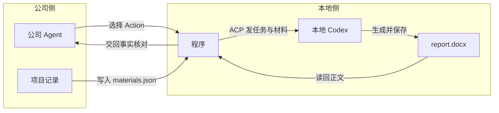
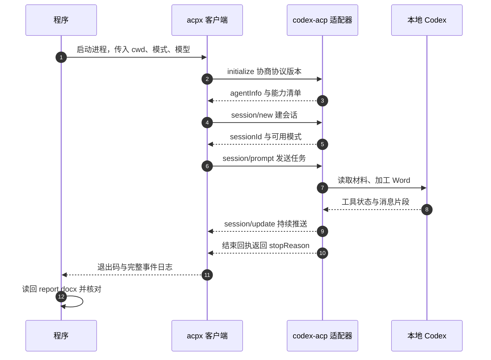
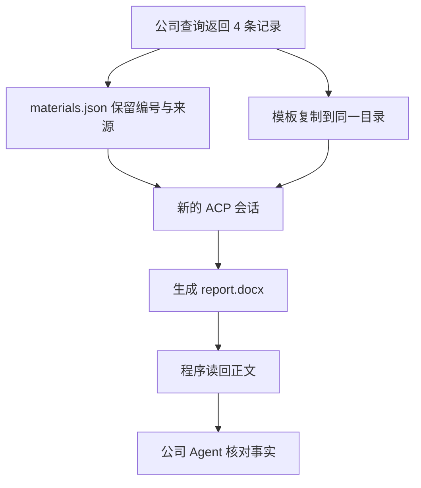
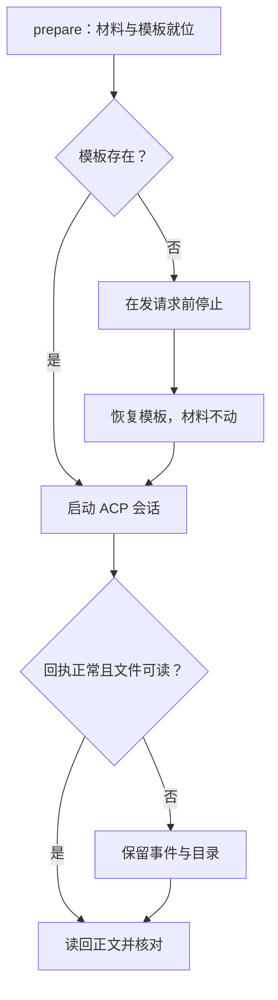
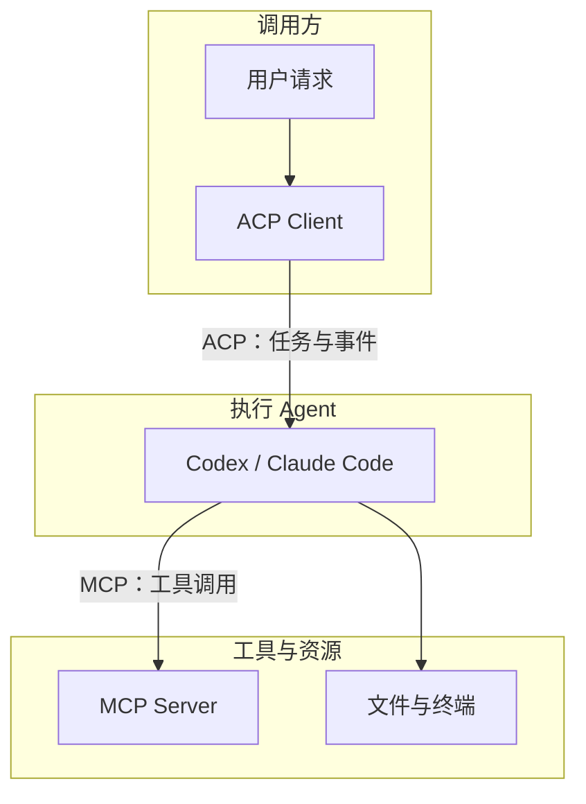
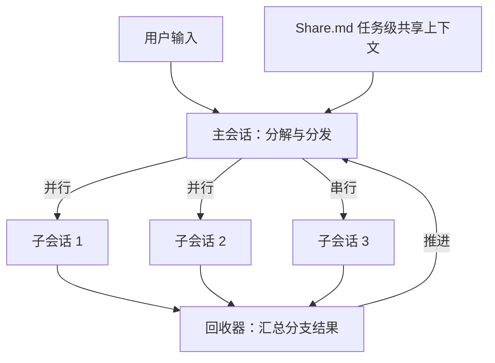

<!-- more -->

「根据公司十月项目记录，按我电脑里的模板，做一份 Word 月报。」

这句请求里其实是两个环境：记录躺在公司服务平台上，模板躺在员工自己的电脑里。公司 Agent 拿得到前者，本地 Codex 拿得到后者，谁也无法单独完成。

可把两个 Agent 凑在一起，并不自动等于一次协作。真正难的是另外四个问题：任务交给谁、做到哪一步、结果到底是什么、失败了从哪继续。这一章沿着这四个问题走一遍——先看两个 Agent 的能力为什么天然错位，再看 ACP（Agent Client Protocol）如何把「调用一个现成 Agent」变成标准动作，然后把一次调用拆成五步逐一验证，接着补上资料交接、事件观察、结果核对与失败恢复，最后回到主 Agent 这一侧：它凭什么决定委派，又该怎样组织子会话。

所有示例共用同一个剧本：合成数据、客户服务平台 2026-10、四条记录 P101—P104，最后产出一份 38189 字节的 `report.docx`。每一节只增加一层能力，其他都不动。

## 1. 一份报告，为什么一个 Agent 做不完

课件第 2 页把两个角色的能力列得很清楚。公司 Agent 能查询公司资料、判断是否需要文件、调用「制作报告」这项能力，它决定查什么、是否委派；本地 Agent 能读资料和 Word 模板、加工并保存 `report.docx`，它决定文件加工的具体步骤。中间还有一段程序：保存交接材料、启动本地会话、读回实际文件。

三个角色，三种决定权。把它们混成一句「让 Agent 自己想办法」，你会在第一次出错时不知道该查哪一层。

| 角色 | 本例中是谁 | 有什么 | 没有什么 | 决定什么 |
| --- | --- | --- | --- | --- |
| 应答 Agent | Agently 公司 Agent | 公司查询凭证、对话与事实核对 | 员工电脑上的文件操作 | 查什么、要不要委派 |
| 执行 Agent | 本地 Codex（经 codex-acp） | 本地目录、模板、python-docx | 公司内网凭证 | 文件怎么改 |
| 程序 | `demo.py` / `acp_client.py` | 目录、材料、事件日志 | 不替任何一方做判断 | 材料放哪、怎么验 |

这张表的最后一行最容易被忽略。很多人以为多 Agent 协作是「两个模型聊天」，实际上两个模型之间没有直接通道：消息由客户端转，材料由程序存，文件由程序验。课件第 2 页底部那句话是个准确的总结——ACP 传消息，程序验文件。

课堂白板把这条链路画得更完整：企业微信、飞书这类入口接在手机上，手机不具备处理能力，只负责把需求送到网关（Gateway）；网关后面才是真正干活的电脑，上面跑着 Hermes、OpenClaw，再往下调度 Codex、Claude Code、WorkBuddy 这些执行型 Agent。白板旁边写了一行判断：不是所有的会话处理与应答，都需要最强的模型。这句话解释了为什么要有「应答 Agent ↔ 处理 Agent」的分层——便宜的模型负责对齐需求，贵的模型只在该动手时动手。



图上每一条箭头都在程序里有对应代码，没有一条是「模型自己想连就连」的。这也意味着：协作的可靠性不取决于模型多聪明，而取决于这些箭头的每一段是否可观察、可校验。

本课的最小实现没有直接改 Hermes，而是用 Agently 写了一个公司 Agent 当主 Agent，用 ACP 调本地 Codex 当执行 Agent。把这套结构放大，就是 Hermes 在宿主里调度多个执行型 Agent 的样子：主 Agent 决定派谁，协议负责把任务送到，程序负责验收。规模变了，分工方式没变。

一个判断先放在这里：多 Agent 的价值不是「用了更多模型」，而是「把不同权限放进不同进程」。公司内网凭证不该出现在员工电脑的进程里，员工电脑的文件也不该被公司侧直接改——两边各退一步，才轮得到协议。

## 2. 协议解决的是「标准」问题

在写代码之前，值得先回答一个问题：既然已经有 MCP（Model Context Protocol），为什么还需要一个 ACP？

课堂白板上的问法是「为什么需要有 protocol」。答案不是抽象的「为了规范」，而是一笔重复劳动的账：没有协议时，每个客户端都要重新实现一遍「怎么调 MCP、怎么查数据、怎么改文件」；想复用现成的 Claude Code 或 Codex，只能照着它私有的方式对接，换一个 Agent 就重写一遍。有了协议，调用方按标准动作发任务，Agent 按标准动作回事件，换谁都能接。

白板用「猫类」打过一个比方：猫类规定了抓老鼠、喵喵叫、跑、吃饭这些标准行为，具体某只猫怎么叫可以不同。ACP 定义的就是这套标准行为——`initialize`、`session/new`、`session/prompt`、`session/update`、结束回执。不同 Agent 各自实现，客户端只认行为。

顺带纠一个常见误记：白板上原本写着「Agent Communication Protocol」，被划掉了。正确名字是 Agent Client Protocol。差别在 Client 这个词——它规范的对象是调用方这一侧的客户端，而不是两个 Agent 之间的对等通信。

| 协议方法 | 做什么 | 本例由谁发出 |
| --- | --- | --- |
| `initialize` | 协商协议版本与双方能力 | acpx 客户端 |
| `session/new` | 建会话，给工作目录和 MCP 服务列表 | acpx 客户端 |
| `session/prompt` | 发送本轮任务 | acpx 客户端 |
| `session/update` | 推送工具状态、消息片段、用量等过程事件 | 适配器与 Codex |
| 结束回执 | 返回 `stopReason`，标明本轮怎么结束 | 适配器 |

课件第 4 页还有一句原文说明：新建会话时要提供工作目录和 MCP 服务列表，MCP 用来提供工具或资源，本例使用本次任务目录，不通过该列表添加额外服务。这句话把 ACP 和 MCP 的边界先钉住了——ACP 管会话，MCP 管工具，两件事不重叠。

接入现成 Agent，白板上列了三条路：让 Codex 支持 ACP（适配器）；用 ACP SDK 自己实现一个 AgentClient 类；走 CLI。本例选第三条，理由很实际：CLI 是无视语言的。Python 里不需要引一套 SDK，`subprocess` 起一个 acpx 进程就能用。

```python
def acp_command(work: Path, mode: str = "workspace-write"):
    """cwd 是工作位置；实际权限由 Agent 模式和运行环境共同决定。"""
    env = os.environ.copy()
    env.pop("DEEPSEEK_API_KEY", None)
    env.pop("OPENAI_API_KEY", None)
    env["CODEX_PATH"] = shutil.which("codex") or "codex"
    env["INITIAL_AGENT_MODE"] = mode
    command = [
        str(ROOT / "node_modules/.bin/acpx"),
        "--agent", shlex.join([str(ROOT / "node_modules/.bin/codex-acp")]),
        "--cwd", str(work.resolve()),
        "--mcp-config", str(ROOT / "demo/no-mcp.json"),
        "--model", os.getenv("ACP_CODEX_MODEL", "gpt-6.1-sol"),
        "--format", "json", "--timeout", "600",
        "--deny-all", "--no-fs", "--no-terminal",
    ]
    return command, env
```

这段是整个调用器的地基，几处参数值得逐个看：

`--agent` 指向 `codex-acp`，也就是让 Codex 支持 ACP 的适配器；`acpx` 只是发起调用的客户端。`--cwd` 传的是绝对路径，不是相对路径——任务目录一旦被解析到别处，后面所有「文件在不在」的判断都会失真。`--mcp-config` 指向一个空配置 `{"mcpServers": []}`，这样课堂会话不会连上个人已有的外部服务。`--format json` 让输出变成一行一条的 JSON，下一节的事件循环靠它逐行解析。

`--deny-all`、`--no-fs`、`--no-terminal` 是三个客户端侧开关：拒绝额外权限申请，并关闭客户端提供的文件与终端能力。它们很重要，但不是沙箱——Codex 仍可以用自己运行环境里的文件和命令。这一点第 5 节会用实验说明。

`env.pop` 那两行同样是有意的：DeepSeek 密钥只属于公司 Agent，不传给 Codex 子进程。Codex 用自己已有的登录。密钥隔离不是靠嘱咐，是靠进程环境。

最后一句判断来自课件第 4 页：本例选择 ACP，是因为已有可用的 Codex 适配器，任务重点是调用本地文件加工 Agent 并观察执行过程；文件交接和成品检查仍由我们的程序完成。协议只覆盖「会话」，剩下的工程责任还在你手里。

## 3. 五步：把一次调用拆成可单独验证的观察点

完整程序里同时发生的事太多：握手、建会话、发任务、读文件、写 Word、推事件、收尾。一次性看全部，出错时只能看到「报错了」。

课件第 5 页把它拆成五步，每一步只回答一个问题：

| 步骤 | 入口 | 只观察这一件事 |
| --- | --- | --- |
| 先准备材料 | `prepare` | 目录里有资料和模板 |
| 1. 建立连接 | `connect` | 收到本次会话的答复 |
| 2. 验证工作范围 | `scope` | 只读模式下写入被拒绝 |
| 3. 发送任务、看过程 | `write` | 看见读取材料和加工文件的状态 |
| 4. 确认本轮结束 | 查看 `write` 保存的回执 | 正常结束还是失败 |
| 5. 检查实际文件 | `inspect` | 文件存在，正文能读出来 |

这个顺序是按成本从低到高排的：建立连接最便宜，只验证协议能不能通；权限实验次之，只发一个必然被拒的请求；真正跑文件加工最贵，放在后面。任何一步不通，后面的步骤都没有意义。

一次完整的调用在协议层是这样流转的：



图上有两类动作，读者最容易混淆，这里显式拆开。

**哪几步是模型做的。** 第 7 步之后的事：读哪个文件、用什么库、先做哪一步、什么时候重试，都是 Codex 自己决定的。你只给了任务文字和一个工作目录。

**哪几步是程序做的。** 发起进程、跑完 1 到 6 步的协议往返、把每条事件写进日志、收尾时保存回执，最后按固定路径验文件。程序不参与内容判断，也不解析模型的话来决定下一步。

这个分工带来一个很实际的约束：程序不能相信模型在答复里给出的路径。实测的公开消息里确实出现过这样的句子——「已生成 `[report.docx](runs/report/report.docx)`」。这是模型写的相对链接，可能是它对工作目录的理解，也可能只是复述任务里的文件名。`inspect_report()` 因此只认 `work / "report.docx"` 这个约定位置，不认任何从文本里抽出来的路径。

## 4. 第一步：先让它回答「连接成功」

第一步不验证能力，只验证通道。

```bash
python demo/demo.py prepare --work runs/steps
python demo/demo.py connect --work runs/steps
```

`prepare` 建目录、复制 `report_template.docx`、写入 `AGENTS.md`，再保存四条十月合成记录。它不调用任何模型——这一步的意义是先把「接手者能读到的输入」摆好。

`connect` 用只读模式新建会话，发送一句「不要用工具，只回复：连接成功。」任务里明确禁用工具，是为了让失败只可能发生在协议层，而不是工具层。

课件第 6 页列了该看什么：

| 程序显示什么 | 说明什么 |
| --- | --- |
| 协议版本 | 双方完成了基础协商 |
| 工作目录、Agent 模式、会话号 | 知道这次调用在哪工作、对应哪个会话 |
| 「连接成功」与结束回执 | 收到答复，以及本轮已结束的通知 |

附件里保存的实测回执是这样的：

```json
{
  "session_id": "01a1e2ef-db62-7510-a0d4-d6185b11f86e",
  "stop_reason": "end_turn",
  "exit_code": 0,
  "messages": ["连接成功。"],
  "error": null
}
```

五个字段各有分工：`session_id` 是这次会话的身份，后面所有事件都靠它筛选；`stop_reason` 是协议层对本轮结束原因的判断，`end_turn` 表示 Agent 认为自己说完了；`exit_code` 是 acpx 进程的退出码；`error` 是调用层记录的错误；`messages` 是公开答复的集合，下一节会讲它怎么拼出来。第 8 节会看到，这几个字段并不总能同时可信。

握手阶段还能拿到一份能力清单。保存的事件里，`initialize` 的返回包含 `protocolVersion: 1`、适配器名称 `@agentclientprotocol/codex-acp` 与版本 2.6.0，以及 `session/new` 返回的四种模式：

| 模式 | 含义 | 本例用途 |
| --- | --- | --- |
| `read-only` | 改文件与联网都需要批准 | 连接实验、权限实验 |
| `workspace-write` | 可改工作区，工作区外与联网需批准 | 正式制作报告 |
| `agent` | 只对判定为高风险的动作询问 | 未使用 |
| `agent-full-access` | 不限制联网与本机文件 | 未使用 |

注意这份清单是 Agent 侧报上来的，不是客户端强加的。所以「设了只读」并不等于「一定写不进去」，还要看 Agent 是否遵守、运行环境是否兜底。这正是下一步要实验的事。

如果登录或连接失败，先解决报错，不要假定会话已经建立。带着一个假死的会话往下做，后面的所有现象都会被误读。

## 5. 第二步：工作目录不等于权限边界

课件第 7 页的问题很尖锐：指定了目录，是否就等于 Agent 只能操作这个目录？

不是。这一节用一个只读探针把它验证清楚。

```bash
python demo/demo.py scope --work runs/steps
```

任务文字是「尝试在当前目录创建 `scope-probe.txt`，内容为 scope-check。权限拒绝则停止，不申请提权。」程序在调用结束后还会自己检查一次文件是否存在，存在就报错。

保存的实测答复有两段：

```text
我会尝试创建该文件；若权限拒绝就停止，不申请提权。
创建被权限拒绝，已停止，未申请提权。
```

`scope-probe.txt` 没有生成。回执里 `stop_reason` 仍是 `end_turn`、`exit_code` 仍是 0——这两项只说明对话正常结束，不说明任务成功。

课件把三个容易混淆的配置分得很清楚：

| 配置 | 本例怎样使用 | 要理解的区别 |
| --- | --- | --- |
| 工作目录 `cwd` | 指向本次任务目录的绝对路径 | 告诉 Agent 去哪里找材料 |
| Agent 模式 | 测试用 `read-only`，制作用 `workspace-write` | 权限还取决于 Agent 的执行环境 |
| 额外权限申请 | 客户端拒绝申请 | 不等于禁止所有内置工具 |

三条结论，逐条记：

**第一，被拒绝的是这一个写入请求。** 不是「只读模式一定安全」，也不是「目录之外一律不可达」。

**第二，`cwd` 是工作位置，不是沙箱边界。** 它改变的是 Agent 找材料的默认起点，不改变进程能碰到的文件系统。

**第三，`workspace-write` 不承诺只能读当前目录。** 它承诺的是「工作区内可写，工作区外和联网要询问」，而「询问」是否发生、由谁批准，取决于 Agent 与运行环境。

再加一条容易漏的：客户端的 `--deny-all` 只拒绝额外权限申请，不能解释成禁止所有内置工具。把这两件事混为一谈，你会以为已经锁死，实际只是没批准新的申请。

| 你想达到的效果 | 该做什么 | 不能指望 |
| --- | --- | --- |
| 减少误改 | 设 `read-only` 或 `workspace-write` | 它替代不了操作系统权限 |
| 隔离目录 | 容器、独立账号、挂载限制 | `--cwd` 提供不了隔离 |
| 不泄漏密钥 | 启动子进程前清理环境变量 | Agent 会主动不用密钥 |
| 不连外部服务 | 空 MCP 配置 + 网络策略 | `--no-fs` 能断网 |

课件的边界也很坦白：本课只验证了只读写入被拒绝、工作域内报告能成功生成这两件事。真实的多租户隔离、审计与配额，不在这一课的范围里。

## 6. 第三步：新会话不会继承记忆，交接靠文件

现在轮到真正的问题：本地 Agent 没参加过前面任何一轮对话，它怎么知道报告该写什么？

答案朴素得让人不太放心——靠文件。程序把公司查询的结果保存成 `materials.json`，保留编号、正文、日期和来源；把模板复制到同一目录；再把任务要求写成文字发过去。新的 ACP 会话读这两个文件，生成 `report.docx`。



`prepare` 里还有一段常被忽略的代码——它往任务目录写了一份 `AGENTS.md`：

```python
def prepare(work: Path):
    if work.exists():
        raise FileExistsError("目录已存在，请换一个新目录，避免覆盖旧产物。")
    work.mkdir(parents=True)
    shutil.copyfile(HERE / "report_template.docx", work / "report_template.docx")
    (work / "AGENTS.md").write_text(
        "本目录是课堂报告任务。只处理当前目录中明确提供的合成资料与模板。"
        "禁止读取父目录、密钥或其他项目，禁止联网或安装依赖。"
        "允许在当前目录编写临时加工脚本并生成 report.docx。\n", encoding="utf-8")
```

这份文件是给 Agent 的工作区说明，会进上下文，但不是权限系统。它降低「Agent 顺手去看看父目录」的概率，真正的限制仍来自模式与运行环境。把它当成文档而不是防火墙，心态就对了。

真正决定加工质量的是任务文字。`make_report()` 里这段提示词值得逐句读：

```python
task = (
    f"你是本地文件加工助手。任务：{requirements}\n"
    "当前目录的 materials.json 是公司 Agent 交接的合成资料，你没有内网权限。"
    "先读取它与 report_template.docx，基于模板生成当前目录的 report.docx。"
    "使用资料记录编号标注事实来源，保持模板章节和样式。不要虚构成本或完成状态。"
    "只读本任务材料，不浏览父目录，不联网，不安装依赖，不改模板和资料。"
    f"已安装 python-docx，可使用解释器 {sys.executable}。"
    "本轮职责只包括读取、填充模板和读回正文，不承担最终交付。"
    "调用方已完成模板验证，并负责最终成品的渲染、视觉检查和交付。"
    "请直接使用上述已确认环境完成文件加工，不再执行模板分析、技能调研或渲染工具排障。"
    "生成后自己读回正文检查，最后说明实际文件名及待确认事项。"
)
```

五处设计，每一处都对应一类失败：

**身份与边界。** 第一句就说清「你是本地文件加工助手」，第二句补充「你没有内网权限」。不写这两句，模型可能试图自己去找数据，或者在答复里暗示它查过公司系统。

**事实纪律。** 「使用资料记录编号标注事实来源」「不要虚构成本或完成状态」。报告里的每一个数字都要能追到 P101—P104，成本必须写成待确认，而不是给一个看起来合理的估算。

**输入范围。** 「只读本任务材料，不浏览父目录，不联网，不安装依赖，不改模板和资料」。这些都是常见的时间黑洞：一次 `pip install` 就可能把十分钟的任务拖成半小时。

**职责切分。** 「不承担最终交付」「调用方负责渲染、视觉检查和交付」。这句话解决的是扯皮：排版好不好看、字体有没有缺字，不该让执行 Agent 反复自证。

**停止条件。** 最后一句「不再执行模板分析、技能调研或渲染工具排障」，是拿真实事故换来的。附件里保存的超时记录中，Agent 已经开始讨论「模板预览出现中文缺字」，并准备排查渲染工具。它没有做错什么——任务文字没有划清「这一轮只做什么」，模型就会把「让报告好看」也算进职责。任务越开放，越容易滑向无关的工具排障。

三件交接物缺一件会怎样，可以列成一张表：

| 缺什么 | 立刻出现的现象 | 模型会怎么补 |
| --- | --- | --- |
| `materials.json` | 任务里没有可引用的事实 | 编一个合理的进展，或反复询问 |
| 模板副本 | 不知道章节和样式 | 自造一个通用结构 |
| 明确任务文字 | 不知道要做到哪一步 | 把「检查排版」也当成任务 |

还有一条容易被忽略的规则：九月对照记录不进 `materials.json`。资料范围由程序按接口条件筛选，不由模型猜「可能要参考一下上月」。查询函数里 `project` 和 `period` 是精确筛选条件，这是有意的——交给执行 Agent 的材料越窄，它编造的空间越小。

课件第 8 页把这件事总结成一句：接手靠明确的任务与文件。新会话不会自动继承公司 Agent 的聊天记录，服务器上的文件也不会因为一个路径自动出现在本机。

## 7. 第四步：边做边看，事件流就是执行状态

报告制作要等。等的时候如果只能看一个转圈，你无法判断它是在读文件、在写 Word，还是卡在某个工具上。

ACP 的解法是把过程变成事件。`run_acp()` 用一行一条 JSON 的方式持续读取客户端输出，收到一条处理一条：

```python
for line in process.stdout:
    packet = json.loads(line)
    method = packet.get("method")
    update = packet.get("params", {}).get("update", {})
    if method == "_auth/status_update" or update.get("sessionUpdate") == "agent_thought_chunk":
        continue
    log.write(json.dumps(packet, ensure_ascii=False) + "\n")
    if method == "session/prompt":
        session_id = packet["params"]["sessionId"]
    elif method == "session/update":
        if packet["params"]["sessionId"] != session_id:
            continue
        kind = update["sessionUpdate"]
        if kind == "agent_message_chunk":
            messages.setdefault(update.get("messageId"), []).append(update["content"]["text"])
```

这里省略了工具与计划两个分支，只保留主骨架。三件事值得说明：`json.loads` 解析一行；`method` 区分消息类型；`session_id` 之后用来过滤——同一个进程里可能有多条会话的消息，不过滤就会串台。

课堂白板把 Agent 的一次响应拆成五段：回应段落、正在调用、调用结果、思考与中间过程、最终回复。这五段在事件流里各有对应：

| `sessionUpdate` | 含义 | 本例用途 |
| --- | --- | --- |
| `tool_call` | 某个工具开始执行，带 `toolCallId` | 显示「正在做什么」 |
| `tool_call_update` | 同一工具的状态变化 | 按 id 配对开始与完成 |
| `agent_message_chunk` | 公开答复的文本片段 | 按 `messageId` 拼成完整消息 |
| `plan` | 可选的计划条目 | 有就显示，没有不影响完成 |
| `usage_update` | token 用量统计 | 估算成本 |
| `available_commands_update` | 可用命令清单变化 | 会话初始化信息 |
| `session_info_update` | 会话元信息变化 | 排障时看 |

附件 `run-summary.json` 记录了那次真实运行的事件计数：`agent_message_chunk` 210 条、`tool_call` 2 条、`tool_call_update` 2 条、`usage_update` 3 条、`session_info_update` 3 条、`available_commands_update` 1 条，没有 `plan`。该轮 `totalTokens` 为 73432，其中缓存读取 60800、输出 2139。

两个观察：

**没有 `plan` 也能完成。** 计划是可选事件，课件里专门写了「本次报告运行没有单独的 plan 事件」。如果你把计划面板当成执行真相，就会在它不出现时误判为「什么都没做」。真相在工具事件、结束回执和文件里。

**消息要按 `messageId` 合并，不能把最后一段当唯一答案。** 实测的 `report-reply.txt` 有三段：先说打算怎么做，再报进度，最后给结论。只读最后一段，你会漏掉中间事实；把三段拼起来，才看得出它确实按模板走了。程序因此保留全部公开消息，而不是「猜哪一段是答案」。

一轮结束后，程序把会话号、结束原因、退出码、消息和错误写进回执：

```python
result = {
    "session_id": session_id, "stop_reason": stop_reason,
    "exit_code": process.returncode,
    "messages": ["".join(parts) for parts in messages.values()],
    "error": error,
}
```

注意 `messages` 是列表，不是一段字符串。这个结构在排障时很有用：哪一段是哪一步说的，一眼能分开。

日志里还筛掉了两类事件：认证状态更新与思考片段。这是为了教学日志可以对外分享。完整日志可能包含业务正文，分享前需要自己检查——这条提醒在附件 README 里也写了。

## 8. 第五步：它说做完了，还要看什么

公开消息里出现「已经生成」，是否就能结束等待？不能。课件第 10 页把三类结果分开：公开消息、结束回执、Word 文件。它们不是同一件事。

先看结束回执。正常记录长这样：

| 字段 | 本次成功记录 | 含义 |
| --- | --- | --- |
| `exit_code` | `0` | 客户端进程正常退出 |
| `stop_reason` | `"end_turn"` | Agent 本轮正常结束 |
| `error` | `null` | 这次没有记录到调用错误 |

只看这一张表还不够，两个反例都在附件里。

**反例一：只读实验。** `scope` 的回执同样是 `0` / `end_turn` / `null`，但它明确没有写出文件。所以「正常结束」描述的是对话，不是任务。

**反例二：超时。** 保存的 `timeout-result.json` 里是 `exit_code: 3`、`stop_reason: null`、`error: null`。看起来像「没报错但退出了」，实际原始错误在 `timeout-acpx-error.json` 里：

```json
{
  "jsonrpc": "2.0",
  "id": null,
  "error": {
    "code": -32070,
    "message": "Timed out after 240000ms",
    "data": { "acpxCode": "TIMEOUT", "origin": "cli" }
  }
}
```

原因是当时那版代码只按 `prompt_id` 匹配错误，而 acpx 自身的超时用的是 `id: null`，于是错误被漏掉。现在的代码补了一个分支：

```python
    # ……前面的分支处理会话与工具事件……
    elif prompt_id is not None and packet.get("id") == prompt_id and not method:
        stop_reason = packet.get("result", {}).get("stopReason")
        error = packet.get("error")
    elif not method and "error" in packet:
        # acpx 自身的超时等错误可能使用 id: null，不能只匹配 prompt_id。
        error = packet["error"]
```

这个坑值得单独记一句：`error` 为 `null` 只表示「没匹配到错误」，不表示「没有错误」。判定成功要三条同时成立，再加一条文件可读——`exit_code == 0`、`stop_reason == "end_turn"`、`error is None`，且 `report.docx` 存在、正文非空。

文件检查由 `inspect_report()` 完成，它只认约定路径：

```python
def inspect_report(work: Path):
    """只验本次任务约定的文件，不相信模型返回的任意路径。"""
    target = work / "report.docx"
    if target.is_symlink() or not target.is_file():
        raise ValueError("本次任务没有生成普通文件 report.docx")
    document = Document(target)
    text = "\n".join(p.text for p in document.paragraphs)
    for table in document.tables:
        text += "\n" + "\n".join(" | ".join(c.text for c in row.cells) for row in table.rows)
    if not text.strip():
        raise ValueError("报告正文为空")
    receipt = {
        "file": "report.docx", "bytes": target.stat().st_size,
        "sha256": hashlib.sha256(target.read_bytes()).hexdigest(),
        "paragraphs": len(document.paragraphs), "text": text,
    }
```

四个动作：拒绝符号链接、读段落、读表格、正文为空就报错。符号链接那一行不是洁癖——一个指向别处的链接能让「文件存在」变成假象。

那次真实运行的制品回执是：38189 字节、12 个段落、SHA-256 以 `abf5518` 开头。摘要值的作用是让「同一份文件」可以被跨机器核对，而不是靠文件名。

读回正文之后，核对五条事实：

| 要核对的事实 | 本次报告的实际结果 |
| --- | --- |
| 计划与完成不同 | 计划 12 项，已验收 10 项，剩余 2 项 |
| 问题是否已解决 | 导出仍在处理中；审计 11 月 8 日是计划日期 |
| 没有可靠金额 | 成本明确写「待确认」 |
| 事实有出处 | 使用 P101—P104 标注来源 |
| 未完成不写成已完成 | 批量导出保留「尚未验收」 |

这五条不是文风检查，是事实检查。它们对应四类常见的报告失真：把计划写成完成、把目标日期写成完成日期、把缺失数据补成估算、把来源丢掉。

最后一步是打开文件看版面。正文读回只能核对文字；字体、分页、表格边框、中文缺字，必须在 Word、LibreOffice 或兼容阅读器里看。任务文字里写明「调用方负责渲染、视觉检查和交付」，就是把这部分责任明确留在程序这一侧——执行 Agent 不该为它看不见的渲染结果反复返工。

## 9. 什么时候才值得委派：选择权给模型，边界留给程序

前面五步都是「已经决定要委派」之后的事。真正影响成本的是更早的那个决定：这次请求到底要不要启动文件加工。

课件第 12 页把公司 Agent 的循环写成四拍：选择行动 → 执行 → 读取结果 → 再决定。程序用 Agently 注册两项可选能力：

```python
@agent.action_func
def query_company(project: str, period: str) -> dict:
    """查询公司内网项目记录。project 为项目名称，period 为 YYYY-MM。"""
    records = query_records(project, period)
    queried[:] = records
    save_json(work / "materials.json", records)
    return {"records_text": "\n".join(
        f"[{r['id']}] {r['source']}（{r['date']}）：{r['content']}" for r in records)}

@agent.action_func
async def create_report(requirements: str) -> dict:
    """委派本地 Agent，按模板制作 Word 月报。先查公司资料；仅文件请求需要此能力。"""
    if not queried:
        return {"status": "failed", "message": "请先查询到本次报告的公司资料。"}
    if attempts:
        return {"status": "failed", "message": "本轮已尝试制作，请依据已有结果答复，不重复运行。"}
    attempts.append("started")
    result = await asyncio.to_thread(make_report, work, requirements)
    return {"status": "file_created", **result}
```

两个函数的 docstring 是写给模型看的能力说明，参数由模型自己填。返回结构也有讲究：`query_company` 返回一段可直接阅读的 `records_text`，同时把完整结构化记录写进 `materials.json`——给模型的要短，给接手者的要全。

`create_report` 里两个保护条件值得注意。没查询就调用，返回 `failed` 而不是抛异常，模型能读懂并先补查询；本轮已经试过，也返回 `failed`，避免同一轮里反复启动会话。失败以「数据」的形式回到循环里，模型才有机会解释它，而不是让整个程序崩掉。

注册与循环参数只有三行：

```python
agent.use_actions([query_company, create_report])
agent.set_action_loop(max_rounds=4, concurrency=1, timeout=720)
turn = agent.input(question).instruct(
    "你是公司 Agent。按需使用已注册能力。项目事实必须来自查询。"
    "只有需要文件制品时才委派制作，文件制作需要已有的查询资料。"
    "拿到文件实际读回正文后，核对关键数字、日期、状态与来源。"
)
```

`max_rounds=4` 是给 ReAct（推理与行动交替）循环的预算：查询、委派、核对、答复，四拍够用，再多通常意味着模型在原地打转。`concurrency=1` 表示这一轮不并行——本例的两个能力有先后依赖，并行没有意义。`timeout=720` 是给整轮的上限，比 ACP 自身的 600 秒略长，让 ACP 先超时、程序后兜底。

两个请求的对照是这一节最值得看的实验：

```bash
python demo/demo.py chat --work runs/chat
python demo/demo.py all --work runs/report
```

| 请求 | 实际 Action 序列 | 产物 |
| --- | --- | --- |
| 只在聊天里报告进展 | `query_company` | `company-actions.json`、`company-reply.txt`，无文件 |
| 按模板制作 Word 月报 | `query_company` → `create_report` | 上述两项，加 `report.docx` 与制品回执 |

保存的实测记录里，`chat` 只调用了 `query_company`，答复里明确写「按你的要求未生成文件」；`all` 调用了两项，公司 Agent 拿到读回的正文后逐条核对了数字、日期、状态与来源。

`company-actions.json` 里最值得读的不是 `ok: true`，而是 `purpose` 和 `kwargs` 两个字段。`purpose` 是模型自己写的调用理由，`kwargs` 是它自己填的参数——这两处直接暴露它有没有理解任务。实测里 `create_report` 的 `requirements` 把 P101—P104 四条事实完整抄了进去，还写了「不得估算或编造」。这不是程序拼的，是模型在委派时自己整理的。

一个必须强调的点：程序没有用「报告」这个关键词替模型决定分支。如果代码里写着 `if "报告" in question: create_report()`，那这个实验只能证明正则表达式有效，不能证明模型会判断。用两个请求、两个新目录各跑一次，看的是模型的真实选择。

## 10. 失败以后：保留输入，修复条件，再决定重跑

最常见的失败不是超时，是缺文件。课件第 13 页给了一条完整的恢复路径：

```bash
python demo/demo.py prepare --work runs/retry
mv runs/retry/report_template.docx runs/retry/template-backup.docx
python demo/demo.py write --work runs/retry
mv runs/retry/template-backup.docx runs/retry/report_template.docx
python demo/demo.py write --work runs/retry
```



第三条命令会失败。关键在于失败发生在哪里：`make_report()` 一开始就检查模板，缺了就直接抛错，此时 ACP 还没有启动，`materials.json` 完好无损。

```python
def make_report(work: Path, requirements: str):
    """公司 Agent 的 Action 与分步入口共用这段真实调用。"""
    if not (work / "report_template.docx").is_file():
        raise FileNotFoundError("缺少 report_template.docx；保留 materials.json，补齐模板后再运行 write")
    if (work / "report.docx").exists():
        raise FileExistsError("report.docx 已存在，请先运行 inspect 核对；新请求使用新任务目录。")
```

这个顺序是有意的：最便宜的检查放在最前面。为了一个必然失败的调用付一次完整会话成本，是最不该犯的浪费。

恢复模板后直接重跑同一个目录，新的会话靠保留的材料继续，不需要重新查询。保存的 `retry-result.json` 是 `0` / `end_turn` / `null`，会话号是新的——说明它确实是另起了一轮，而不是复用之前的进程。

同目录重试还要解决日志覆盖的问题。`run_acp()` 在启动前把上一轮的 `report-*` 文件归档到 `previous-report-N/`：

```python
previous = list(work.glob(f"{label}-*.*"))
if previous:
    archive = work / f"previous-{label}-{len(list(work.glob('previous-*'))) + 1}"
    archive.mkdir()
    for path in previous:
        path.rename(archive / path.name)
```

这样重试不会把「上一次为什么失败」的证据冲掉。失败现场比成功结果更值钱，因为它只出现一次。

| 失败位置 | 已保留什么 | 不要做什么 | 下一步 |
| --- | --- | --- | --- |
| 缺模板，请求未发出 | 材料、目录 | 删目录重来 | 恢复模板，同目录重跑 |
| 会话超时 | 事件日志、可能的半成品 | 盲目重跑覆盖 | 先 `inspect`，有文件就核对 |
| 结束回执异常 | 回执、原始错误 | 把聊天声明当交付 | 查 `error` 与退出码 |
| 已存在 `report.docx` | 旧成品 | 直接删除 | 先读回核对，再决定新目录 |

这里没有自动断点恢复。恢复的是文件与记录，不是模型脑子里的状态。新的 ACP 会话不会记得上一轮想过什么，它只知道目录里有什么。课件把这条边界说得很直白：本例不实现自动断点恢复或无限重试，重试会创建新 ACP 会话，靠明确保存的资料文件继续任务。

## 11. ACP、MCP、A2A：三个协议各管一段

名字都带 Agent，作用却不在同一层。课件第 14 页的对照表可以压成一张更薄的表：

| 名称 | 可以用来做什么 | 与本例的关系 |
| --- | --- | --- |
| ACP | 调用 Agent 会话，接收过程与结束回执 | 用来驱动本地 Codex |
| MCP | 向 Agent 提供工具或资源接口 | 公司查询可以采用；本例直接读合成 JSON |
| A2A（Agent2Agent） | 独立 Agent 服务之间发现能力、交接任务与结果 | 双方作为网络服务时再评估 |
| 自有程序 | 保存材料、处理目录、接收错误、检查文件 | 把一次调用变成可交付的报告任务 |

白板上有一句更短的概括：ACP 是 Agent 与 App 之间的接口，MCP 是工具与 Agent 之间的接口。一个是「把任务交给谁」，一个是「它手里有什么」。



三种组合，按需要选：

| 组合 | 结构 | 适合什么 |
| --- | --- | --- |
| 只有 MCP | 自己的 Agent + 一组工具 | 工具能力是自建的，Agent 也是自建的 |
| 只有 ACP | 自己的程序 + 现成 Agent | 想复用 Claude Code、Codex 的执行力 |
| ACP + MCP | 程序 → 现成 Agent → 工具服务 | 既要现成执行力，又要接自己的业务工具 |

本例是第二种，而且把 MCP 明确关掉（`{"mcpServers": []}`）。这不是说 MCP 不重要，而是课堂只验证 ACP 这一段：多挂一层服务，就多一个可能出错的变量。真实项目里公司查询完全可以用 MCP 暴露，那时才需要两层。

白板上还画了 MCP 的两种落位：用 FastMCP 把脚本封装成 MCP/API，作为本地进程通过 stdio 接；或者起一个远程服务监听端口，用 HTTP 调。前者简单、生命周期跟着主进程；后者能被多台机器复用，但要处理鉴权、并发与超时。选哪种取决于「谁会来调」，不取决于哪种更时髦。

A2A 的位置在更外层：两个独立部署的 Agent 服务互相发现能力、交接任务。本例没有验证它——同机、两个角色、一个程序，用不上服务发现。课件把公开样例放在附件 README，供研究时查阅，这个边界划得很清楚。

## 12. 主 Agent 的调度模型：主会话、子会话、回收器

把视角拉回主 Agent 这一侧。它凭什么决定「这件事交给谁」，又怎样保证交出去之后还记得？

课堂白板给了一个典型结构：主会话带着 System Prompt 和一份任务级共享上下文（`Share.md`），负责分解与分发；下面是若干子会话，可以并行也可以串行；每个子会话有独立上下文，只继承主会话允许它看到的那部分；最后有一个回收器，把各分支结果汇总，再推进主会话。



图里最容易被低估的是「子会话能看到什么，是主会话决定的」这句话。它不是权限设置，是上下文设计：给多了，子会话被无关信息淹没；给少了，它得不出结论。白板把这个做法叫渐进式披露——先给任务级摘要，需要细节时再展开。

这也解释了白板另一处笔记：上下文摘要集以「主题 → 引用」的形式存在，子会话发现「主题 A 和主题 B 都和我当前处理的事相关」时，可以沿着引用去取具体信息；如果它意识到「我似乎应该看一下全局上下文」，也应该有一条回查的路径。隔离带来注意力集中，代价是缺少全局观。回收器与索引就是用来付这个代价的。

这正好接上上一章的记忆问题：单个 Agent 里，摘要要挂原文索引才能回查；多个 Agent 之间，摘要要挂主题引用才能跨会话取用。机制是同一个——摘要负责「想起来」，索引负责「查得到」。

白板还列了四种组织方式，值得和本课对照：

| 组织方式 | 谁决定下一步 | 什么时候适合 |
| --- | --- | --- |
| 按需委派 | 主 Agent 判断是否调用能力 | 本课：需要报告才启动加工 |
| 固定顺序 | 程序按规则推进 | 每次都要查询、制作、交付 |
| 并行分工 | 程序或主 Agent 分派，完成后汇总 | 多个调查方向互不依赖 |
| 生成与评审 | 评审给意见，程序决定继续或停止 | 结果需要核验，必要时返工 |

本课只实现了第一种，加上人工的结果核对。课件第 15 页举了 Anthropic 研究系统的例子：主 Agent 把不同调查方向交给子 Agent 并行搜索。报告案例不能并行——必须先拿到公司资料，才能加工文件，依赖关系决定了它只能串行。

这也是选型时最实用的一条判断：**并行只适用于互不依赖的分支**。看起来可以并行的两个子任务，只要共享一份输入或一个产物，就会在回收器里打架。

把镜头再拉远一点，Hermes 这类宿主就是这个结构的放大版：Dot、Grokbot 这类入口接用户，Hermes Agent 负责分解，往下是中文写作、代码开发这些能力位，分别由 DeepSeek Harness、Codex、WorkBuddy 承担，能力清单写在 `AGENTS.md` 里。入口只是网关，不是执行者；主 Agent 只是调度者，不是全能的执行者。分清这三层，才不会把「接入了多少个 Agent」当成能力本身。

## 13. 怎样检查一项 Agent 协作方案

最后收成一份可用的检查表。课件第 16 页的六个问题，几乎覆盖了一次协作会出问题的地方：

| 要问的问题 | 本例的明确答案 |
| --- | --- |
| 为什么需要两位 Agent | 一位有公司资料，一位有本地文件加工能力 |
| 谁发起、谁决定下一步 | 公司 Agent 选择委派，本地 Agent 决定加工步骤 |
| 接手者读什么 | 明确任务、四条查询材料、Word 模板 |
| 怎么知道它在做什么 | 客户端持续接收工具状态与公开消息 |
| 怎么知道任务完成 | 结束回执、实际文件、正文事实、版面 |
| 失败后怎样继续 | 保留材料与记录，修复条件后重试或处理已有文件 |

六行里最容易被跳过的是「接手者读什么」。它不是文档问题，是设计问题：如果接手者要读的东西说不清，说明这次交接本来就没定义好。

选型的时候，可以按这张表往下走：

| 场景 | 建议 | 代价 |
| --- | --- | --- |
| 单 Agent + 自建工具就能完成 | 不上协议，直接调函数 | 能力边界受限于自己的代码 |
| 需要复用现成 Agent 的执行力 | ACP 调会话 | 多一层进程与权限配置 |
| 工具体系要被多个 Agent 复用 | MCP 暴露工具 | 需要服务治理与鉴权 |
| 多个独立 Agent 服务跨团队协作 | 评估 A2A | 服务发现、认证、传输都要补 |
| 结果必须核验 | 加生成与评审，或人工核对 | 多一轮成本 |

三个坑，每个都能在本课的记录里找到出处。

**坑一：把 `end_turn` 当成功。** 只读实验也是 `0` / `end_turn`，但没有文件；超时那次甚至是 `error: null`。成功要三条同时成立再加文件可读，少一条都不算。

**坑二：把 `cwd` 当沙箱。** 工作目录只改变默认起点。要做隔离，得用容器、独立账号或挂载限制，而不是改一个参数。

**坑三：把会话当记忆。** 新会话不会继承上一轮的聊天记录。交接靠文件与明确任务；重试靠新会话加保留的材料，不靠模型回忆。

### 几个容易卡住的问题

**为什么不直接让公司 Agent 读写 Word？** 因为那段代码要跑在员工电脑上，要模板、要 Office 环境、要文件权限。把这些搬进公司服务端，等于把本地文件能力塞进内网，权限边界会立刻糊掉。

**ACP 和 MCP 能只用一个吗？** 能。被调用方是「一个会自己干活的 Agent」就用 ACP；被调用方是「一组工具」就用 MCP。两个都用，是因为现成 Agent 既需要被调用，又需要接你的业务工具。

**能不能把密钥交给本地 Agent？** 不该。本例在启动子进程前就 `pop` 掉了两个密钥变量，Codex 用自己的登录。密钥隔离靠进程环境，不靠嘱咐。

**超时了要不要立刻重跑？** 先看目录里有没有半成品，再看事件日志停在哪。有文件就先 `inspect`，没有文件再重试；重试会新建会话并归档旧日志。

**能不能并行做多个报告？** 可以，但每个任务要有独立目录、独立材料、独立会话。共享一个目录的并行，最后一定在「谁的 `report.docx`」上打架。

### 最小实现清单

把这一章压成能落地的部件：

| 部件 | 最少几个 | 各自负责什么 |
| --- | --- | --- |
| 可委派能力 | 2 个 | 查询事实、制作文件 |
| 材料目录 | 1 个 | 资料、模板、任务文字、产物 |
| ACP 调用器 | 1 套 | 启动、逐行接收、收尾、写回执 |
| 事件日志 | 2 份 | 过程事件、公开消息 |
| 制品检查 | 1 个 | 固定路径、正文非空、摘要值 |

如果只记一句：**先确认「任务、材料、产物」三件东西都在文件系统里，再去相信任何一句答复。** 这一章里五步、两次对照、三类失败，讲的都是同一件事——把一次委托拆成可观察的段落，让每一段都能被单独验证、单独复现。

下一步不在「再加一个 Agent」，而在把这条链路搬进真实环境：认证连接、资料传输、审计与配额，每一项都比换模型更影响能不能上线。等这些补齐，并行调度与自动返工才有讨论的基础。
