<!-- more -->

AI Coding 改变的不是"要不要写代码"，而是任务被拆成什么样、由谁负责、在哪里交接。分工的形成有它的经济学理由，变化也有它的触发条件。真正需要重新回答的问题是：哪些环节仍然需要独立的专业深度，团队用什么方式保证完整结果，个人又该把判断力沉淀在哪里。

这篇文章按四层展开：分工为什么会变、新的关键职责是什么、工程复杂以后团队怎样配合、个人应该怎样积累能力。

## 一、分工为什么会形成，又为什么会变化

### 传统分工在专业化收益与交接成本之间形成

岗位划分从来不是凭习惯定的，它落在一个权衡上：专业化带来收益，交接产生成本。分工的价值在于让人在窄领域里积累经验，并让多条工作线可以并行推进。

- **专业化**：知识面广、学习成本高，分工有助于积累经验、并行工作。
- **三层架构（3-Tier）**：表示层负责界面交互，应用层负责业务逻辑，数据层负责数据管理。
- **协作三角**：产品与设计明确用户任务，前端实现交互，后端提供规则、接口与数据能力。
- **变化入口**：Agent 降低跨环节实现成本，原有岗位边界需要重新判断。

需要区分两个维度：系统层次与岗位协作并不是一回事。产品设计属于协作角色，而不是某一层。岗位配置还受团队规模、工作量与专业要求影响，同样的技术栈在不同团队可以有不同的划分。

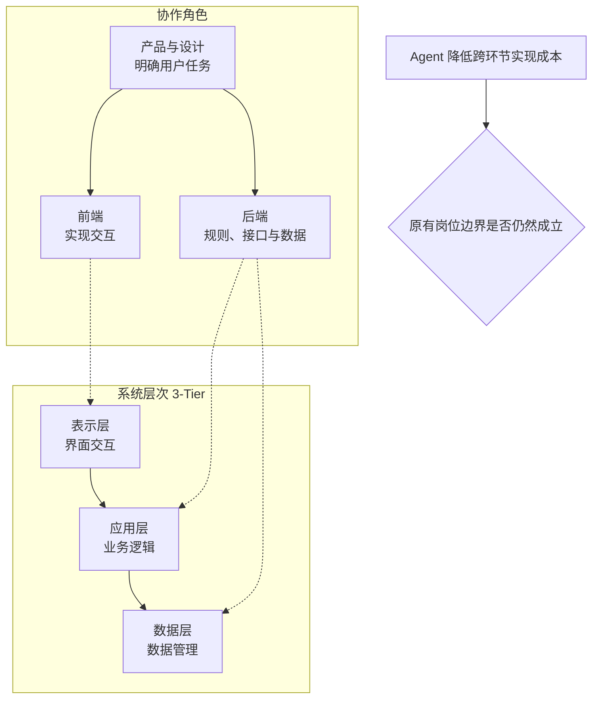

### 岗位靠什么连接成完整结果

把任务切碎再各做一段，结果往往是拼不起来的。协作真正包含三件事：依据传递、共同取舍与结果反馈。

- **业务与产品**：确认使用场景、问题价值和投入顺序。
- **设计、前端与后端**：共同约定操作、接口、数据和异常行为，再并行实现。
- **测试与运维**：提前提供质量与运行条件，持续反馈验证和使用结果。
- **架构与交付负责人**：协调系统边界、跨角色依赖和重要取舍。

以"导出筛选后的评论"为例，需要共同确认的不只是按钮在哪，还包括导出范围、字段、状态提示、验证方法与资源影响。任何一项没对齐，最后都会在联调或上线时以返工的形式暴露出来。

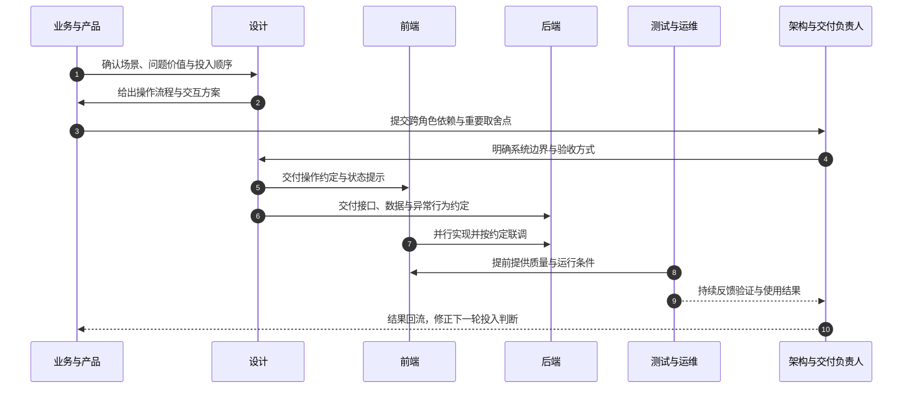

### 先判断任务变化，再判断岗位与人力

Agent 介入后，人工执行时间可能下降，一个人可覆盖的环节可能扩大。判断顺序应该是：先看任务怎么变，再看角色是否还要独立配置，最后才谈人力。

- **更易压缩的任务**：材料转录、常规页面与接口、重复回归、标准部署和状态汇总。
- **角色是否独立配置**：看剩余任务的专业深度、工作规模与责任要求。
- **人力怎样变化**：同时看任务数量与单项人工时间；效率提高也可能用于扩大范围和改善质量。
- **适用条件**：资料可获得、行为可描述、环境可运行、结果可检验。

这里最容易犯的错误是倒着推：看到生成代码量大，就推断岗位或人力应当减少。正确的做法是拿同一项常规需求做前后对比，同时保留专业判断与结果责任这两项没有消失的东西。

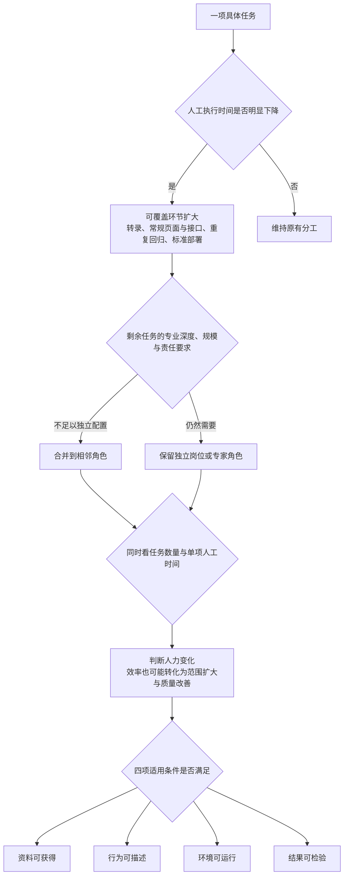

## 二、新的关键职责：关注什么，需要什么能力

新的职责不再按"功能模块"划分，而是围绕完整结果组织工作：人提供上下文、作取舍与判断，Agent 承担可委托的执行。四类职责各自关注的重点、需要的能力和可观察的产物如下。

| 关键职责 | 关注重点 | 关键能力 | 可观察的产物 |
| --- | --- | --- | --- |
| 价值与规格定义 | 为谁解决什么问题，为什么值得投入 | 业务理解、用户沟通、拆解与优先级判断 | 场景、方案理由、Spec 与验收案例 |
| 系统与执行组织 | 边界、数据、复用及任务委托 | 架构基础、接口设计、调试与技术取舍 | 系统方案、任务安排、可运行实现 |
| 结果验证与质量取舍 | 行为正确、使用有效、运行可靠 | 测试设计、数据分析、业务与风险判断 | 测试依据、差异分析、交付决定 |
| 持续交付与改进 | 接入、发布、恢复、服务与成本 | 运行意识、交付组织、沟通与维护 | 运行记录、处理方案、更新资料 |

这四类职责构成一条闭环：定义清楚了才有组织的前提，组织出实现才有可验证的结果，验证通过才谈得上持续交付，而交付中暴露的问题又会反过来修正规格定义。

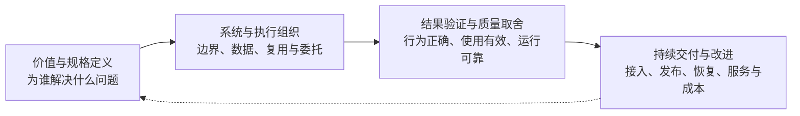

职责划分不等于必须配人。小项目一人可兼任多类职责；复杂产品则由业务小组、平台和专家共同承担。组织安排上还需要明确决策责任、资料与客户关系归属，以及业务结果和公共能力贡献分别怎么评价——否则职责写在纸上，协作仍然会卡住。

## 三、工程复杂以后，团队怎样配合

### 全栈连接完整路径，专业深度处理困难问题

工程越复杂，越需要把"广度"和"深度"组合起来，而不是二选一。

- **功能负责人**：理解从用户入口到数据与运行的路径，关注架构、部署、观测和恢复。
- **业务小组**：持续负责一组用户结果，减少常规功能的反复交接。
- **共享平台**：维护共用数据、权限、部署和运行能力。
- **专业支持**：处理一致性、复杂查询、可靠性与安全等高难度问题。

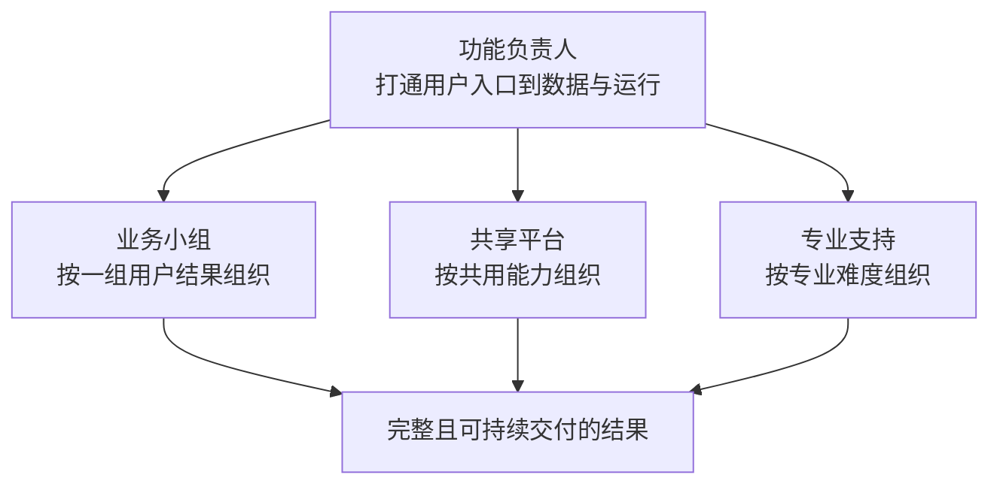

三条线按不同依据分工：业务小组按结果，共享平台按共用能力，专家按专业难度。具体边界随团队规模与工作量调整，不存在一套固定答案。

### 业务能自己动手以后，产研怎样配合

业务用原型验证想法，产研把有价值的尝试接入持续交付。这两件事不能互相替代，边界在于谁承担长期责任。

- **业务侧**：提供场景、规则与样例，验证操作流程，反馈实际效果。
- **产品侧**：发现共性需求，比较价值，安排投入顺序。
- **研发与平台侧**：提供接口、数据、运行环境和长期维护能力。
- **共同决定**：哪些原型继续投入，哪些能力成为公共产品；质量与价值一起验证。

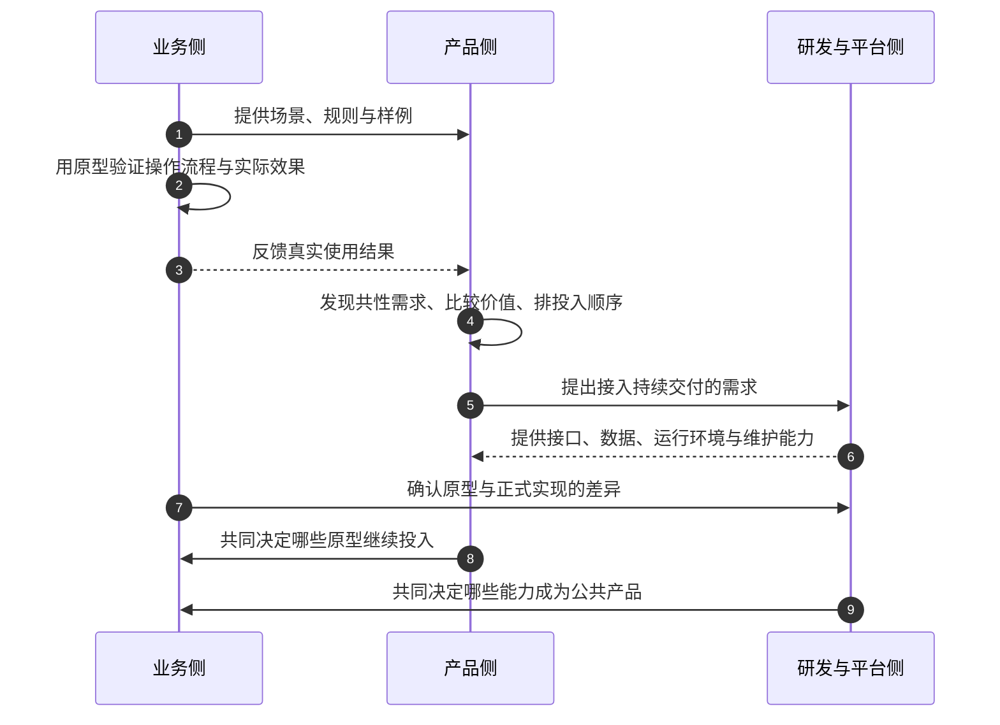

个人原型、团队工具、跨团队或外部产品，对应的规则约束、技术要求和交付责任完全不同。原型阶段就要分清它最终落在哪一档，否则后期会为一次"顺手做出来的东西"补一整套治理成本。

### 做出功能以后，商业化还要承担什么

商业化需要同时满足客户采用、持续交付与经营条件，缺一项都不成立。

- **客户价值**：谁会持续使用或付费，为什么选择这个产品。
- **产品与交付**：流程完整，接入、权限、异常反馈、升级与恢复有安排。
- **经营与服务**：核算获客、计算、人工服务和维护成本，有人处理承诺与反馈。
- **共同取舍**：业务、产品、研发与服务围绕价值、质量、成本作决定。

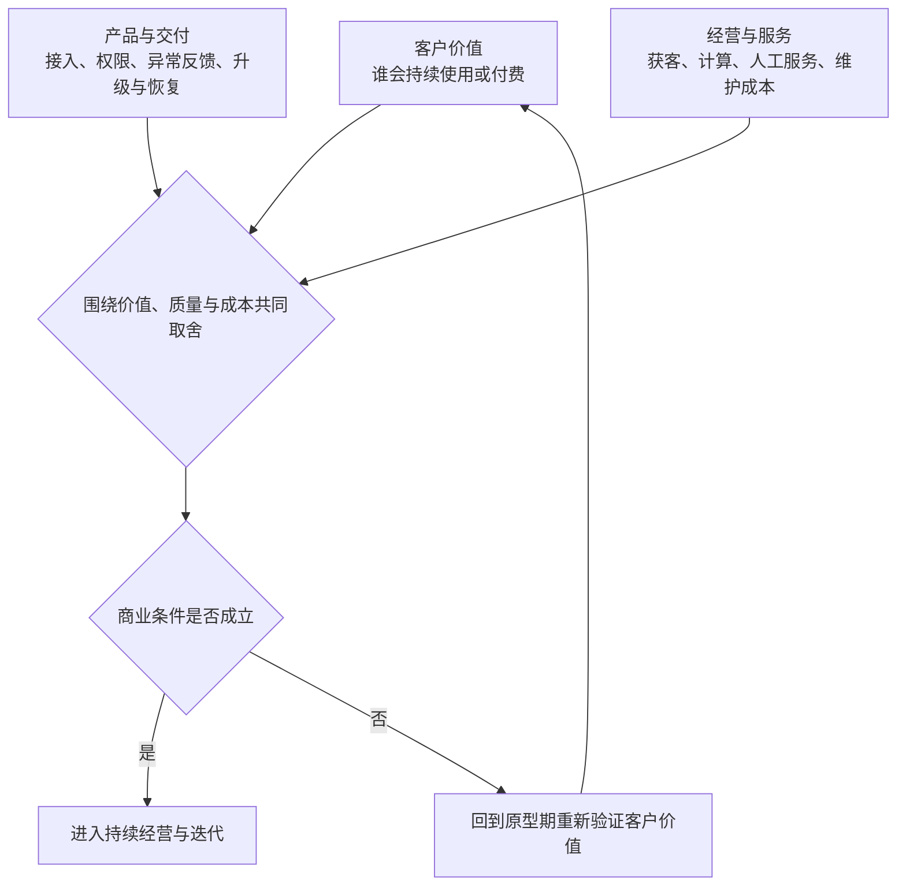

关键是从原型期就开始验证客户价值，而不是等产品做完再问谁买单。商业产品可以处于投入期，但经营判断必须看清成本结构与持续承诺，否则"做出来了"和"活下来了"是两件事。

### 团队长期积累什么，怎样保持可用

把验证过的理解、能力和经验，变成他人能采用的资料，是团队真正的复利来源。这类积累有五类内容。

- **领域与用户**：场景、规则、规格与采用理由。
- **系统与交付**：稳定接口、组件与公共平台。
- **质量与运行**：测试集、问题、运行与修复记录。
- **可重复的方法**：有适用条件和验证依据的 Rules、Skills 与流程。
- **客户与经营**：反馈、交付、渠道、成本与服务认知。

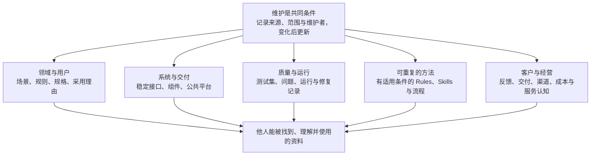

五类内容的价值不在数量，而在可用性：能被找到、能被理解、能被直接采用。维护是所有类别的共同前提，资料一旦停止更新，就会从资产变成误导。

## 四、个人判断力：为什么人还要留在链路上

### 持续理解过程，才能发现缺失信息并修正方向

一个容易被忽略的事实是：把更多环节交给 Agent，并不会自动提升结果质量，反而可能让偏差更难被发现。

- **内部测试观察**：端到端盲跑、开发与检查双 Agent 的组合，都出现过效果很差的情况。
- **待检查的机制**：两个 Agent 若沿用同一组不完整假设，互相回复也可能保留偏差，形成"左脚踩右脚"。
- **有效检查的依据**：明确标准、独立运行验证、真实业务和运行证据。
- **人的观察位置**：方案确定、关键实现、异常出现与结果核对；参与频率随任务调整。

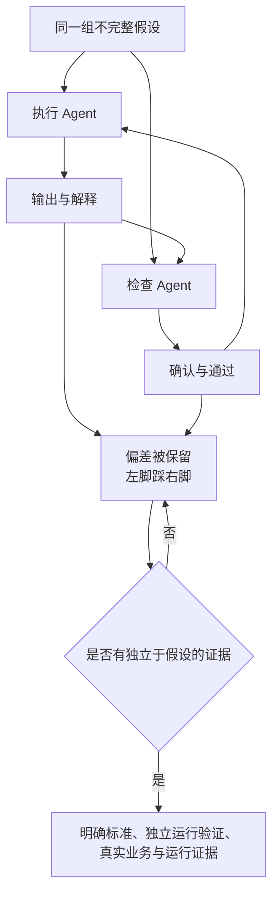

需要说明的是，这些是内部观察，不代表双 Agent 普遍无效。具体效果取决于任务、模型、工具与反馈条件，必须放到实际任务中验证。可以确定的是：缺乏独立证据时，"两个角色都同意"不构成验证。

### 人可以补充哪些外部信息

外部信息指当前执行与检查尚未掌握、却可能改变判断的信息。它在模型内部没有，只能由人带进来。

> - **业务洞察**："数据在直播结束后批量处理，用户更在意完整性。"
> - **方向疑问**："错误集中在鉴权阶段，为什么先改数据库？"
> - **细节追问**："每次操作读写几次？鉴权是否重复？依据在哪里？"
> - **判断反馈**："文件能下载，但缺少跨页记录，未满足确认范围。"

这四类信息分别修正目标、方向、实现和验收，形式上是同一件事：给出可以被核对的具体线索，而不是笼统地说"再检查一下"。

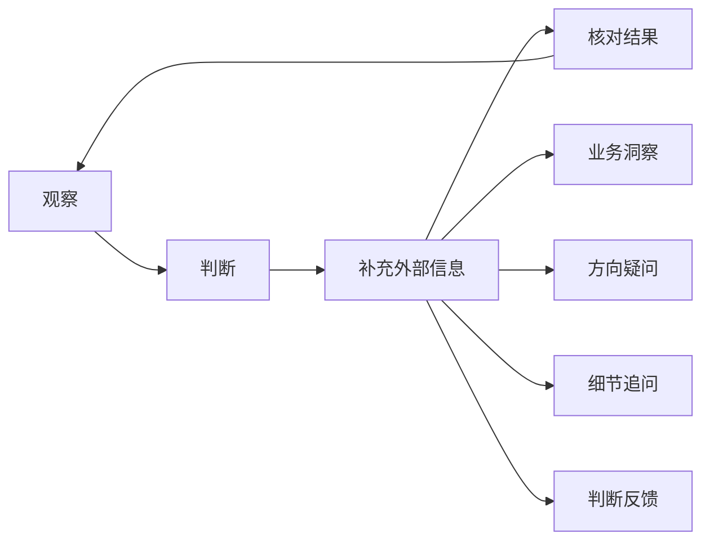

人也可以推动 Agent 去获取日志、测试、资料与用户反馈，让核对建立在证据上；核对结果又会修正人自己的判断，形成持续循环。

### 读懂诊断，才能继续判断

"数据库读写频次高，SSO 鉴权成为瓶颈"——这是一条待核验的诊断，不是结论。能不能读懂它，决定了人还能不能参与后续判断。

- **追证据**：哪些请求报错，日志、错误率与耗时支持什么。
- **问机制**：读写怎样导致错误，鉴权等待发生在哪里。
- **比方案、看结果**：比较不同改法及其代价，在相近负载下核对改善。
- **基础认知**：系统论看边界与反馈，工程结构看模块与依赖，架构知识看状态、并发与容量。

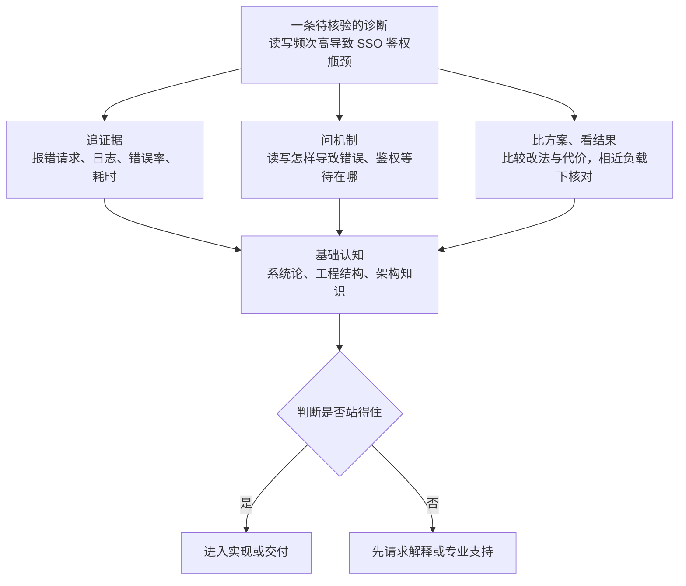

业务洞察与工程证据共同支持判断。理解不足时，正确做法是先请求解释或专业支持，而不是放弃参与——保留继续判断的能力，比在某一刻做对更重要。

### 个人从一次真实工作开始

能力不是靠读更多材料积累的，而是在一次真实工作里扩大交付广度、深化能改善判断的专长。

- **多连接一段工作**：开发者多理解业务；业务与产品人员做原型；测试与运维人员沉淀公共检查能力。
- **保留一项专业深度**：围绕反复出现的问题，积累业务、数据、架构或质量判断。
- **执行前**：记录自己的理解、不确定处和预期现象。
- **执行中**：观察关键选择，提出一处有依据的追问或反馈。
- **完成后**：对比预测与结果，记录判断怎样改变，以及耗时、返工、质量和实际效果。

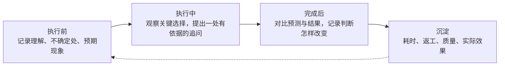

## 五、从完成工作，到积累判断

分工的变化最终落到一个朴素的标准上：理解过程，提出问题，用实际结果修正判断。

工具让执行变快，但把一个完整结果做对，仍然需要有人定义价值、组织执行、验证结果并承担交付责任。这四件事没有因为 Agent 出现而消失，只是从"分配任务"变成了"配置判断"。

延伸观看：复旦大学赵斌教授《AI 最可怕的，不是取代你，而是让你无效成功》，约 15 分钟，[视频地址](https://www.bilibili.com/video/BV1f7aw6nEip)。观看时可以继续思考：借助 AI 完成工作以后，自己真正理解了什么，哪些判断经过了实际结果检验？
