<!-- more -->

一个能回答问题的助手，和一个人人可用的助手，中间隔着的往往不是模型能力，而是使用路径。同事不想为了问一句「评论里大家在抱怨什么」，先打开一个网页，再请人帮忙启动脚本。把助手接进飞书、企业微信或钉钉这类 IM 之后，请求从聊天窗口进来，结果回到同一个会话。

接入带来三个变化：程序要持续在线，消息要送回正确的会话，增加入口时要能复用已有能力。这三件事分别对应进程、寻址与边界，也是本文的主线：先把已有能力封装成服务，再选一个 IM 打通第一条消息，然后把平台差异收进可插拔的 Gateway，最后用运行记录和验收矩阵确认它真的能用。

## 1. 服务化：从「跑一次」到「一直在」

原来的程序可能只完成一次任务：开发者手动运行，得到一次结果。服务化封装让程序启动后保持运行，别人通过约定的入口发来请求，就能继续使用已有能力。需要安排的不只是接口，还有启动、配置、出错提示和运行记录；调用方只按约定提交材料、取得结果，服务内部负责调用模型和执行业务流程。

### 1.1 接入 IM 改变了什么

| 使用场景 | 接入后更方便在哪里 | 系统需要做好什么 |
| --- | --- | --- |
| 个人随时使用助手 | 在熟悉的聊天窗口里发起请求，不用另找入口 | 能收到消息，并把结果发回同一会话 |
| 团队围绕同一问题协作 | 在允许使用机器人的群里提问，成员结合上下文查看结果 | 明确哪些消息需要处理，谁能使用这项能力 |
| 任务需要等待一段时间 | 提交后先做其他事，完成时回到聊天窗口查看 | 先告知已接收，再提供结果或失败提示 |
| 不同团队使用不同 IM | 各自保留熟悉的工具，共用已有助手 | 新增聊天入口时，继续复用业务能力 |

这四行其实是三类工程要求：常驻进程、会话寻址、能力复用。前两条决定服务能不能被「用起来」，第三条决定第二个入口会不会变成第二份代码。

本文沿用评论分析助手作为例子：用户提交一组评论和分析要求，助手整理问题与建议。接入前后，业务能力应当保持一致；接入知识同样适用于其他已有助手。

### 1.2 一条消息的五个步骤

用户在聊天窗口提交材料和处理要求之后，系统要完成接收、建档、处理、保存、回复五件事。把它们放在同一条时间线上，各自的责任就清楚了。

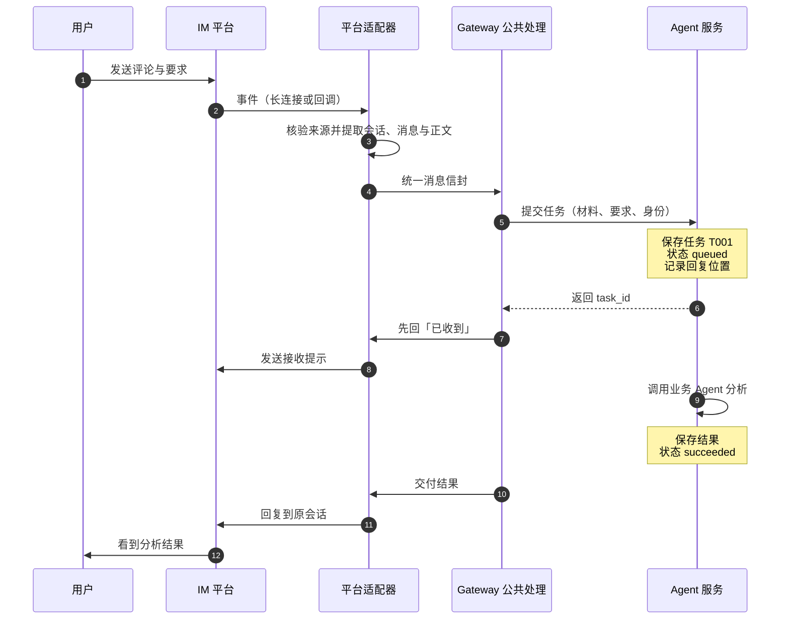

接收消息时要拿到用户材料、处理要求、发送人和所在会话；建立任务时要保存请求、分配任务编号（如 T001）、记录回复位置；处理任务时调用已有助手；保存结果让结果与编号绑定，回复失败时结果仍然可用；回复用户时把结果送回原来的单聊或群聊。

模型需要的是业务材料和处理要求。谁发来消息、结果存在哪里、回复到哪个会话，都由程序处理。换一个聊天平台时，只要业务材料和处理要求不变，原来的助手就能继续用。

### 1.3 三种职责，三条改动路径

平台适配器负责连接聊天平台，把平台消息转换成应用能处理的格式。Gateway（消息网关）是消息进入和离开服务的公共入口，包含平台适配器和公共处理逻辑：前者处理各平台的接口差异，后者把消息交给业务服务，并关联任务与回复位置。Agent 服务接受业务任务、检查业务权限与输入、运行分析、保存结果。

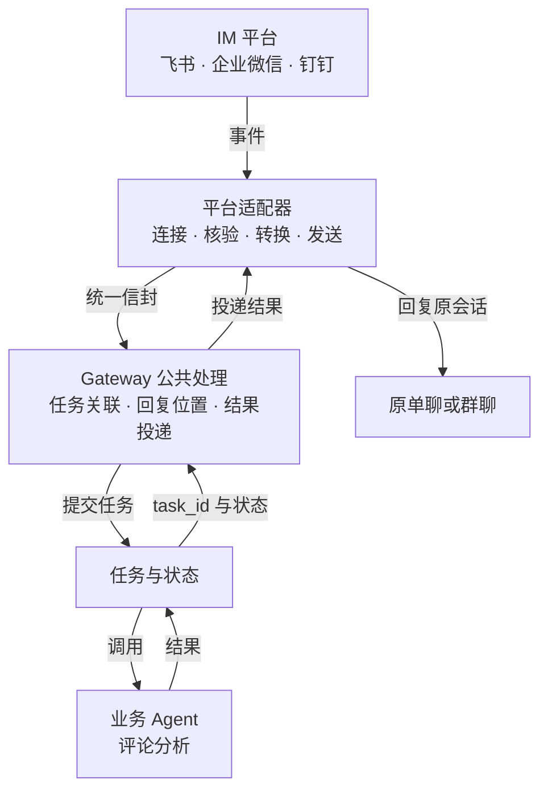

| 部分 | 负责什么 | 发生变化时主要改哪里 |
| --- | --- | --- |
| 平台适配器 | 连接平台、核验消息是否来自平台、提取消息、发送回复 | 平台 SDK、事件格式、卡片格式 |
| Gateway 公共处理 | 把消息交给服务，关联任务与回复位置，安排结果发送 | 会话规则、任务关联、反馈方式 |
| Agent 服务 | 接受业务任务、检查业务权限与输入、运行分析、保存结果 | 分析流程、业务规则、业务能力 |

分工首先体现在代码模块里。增加一个聊天平台时主要增加适配器，修改分析规则时主要修改业务服务，两类改动可以分别验证。SDK 是平台提供的开发工具包，适配器用它连接平台、收发消息。这些模块先放在一个持续运行的程序里，也就是一个进程中；分工清楚即可，不必一开始就拆成多个独立服务。

### 1.4 先约定输入、结果与失败

接口约定说明「提交什么、会得到什么、出错怎样提示」。每个任务都有编号，程序中可以用 `task_id` 表示。以评论分析为例，先保留完成业务和查找问题必需的几项：

| 对象 | 最小信息 | 含义 |
| --- | --- | --- |
| 分析输入 | 评论列表、分析要求 | 模型完成业务所需的材料 |
| 已验证身份 | 组织、用户、允许访问的数据范围 | 由服务根据接入凭证和平台身份建立，不能直接相信消息正文里自报的身份 |
| 提交结果 | task_id、当前状态 | 后续查询与定位的依据 |
| 成功结果 | 分析正文、使用的评论范围 | 用户能理解结论针对什么材料 |
| 失败结果 | 错误类别、用户提示、task_id | 用户知道发生了什么，维护者能够查找记录 |

第一版先提供「提交任务」和「查询任务」两个动作：提交成功后返回任务编号，查询时取得当前状态和已有结果。如果使用 HTTP，可以约定为 `POST /tasks` 与 `GET /tasks/{task_id}`。四种状态分别是等待处理（queued）、正在处理（running）、成功（succeeded）和失败（failed）。

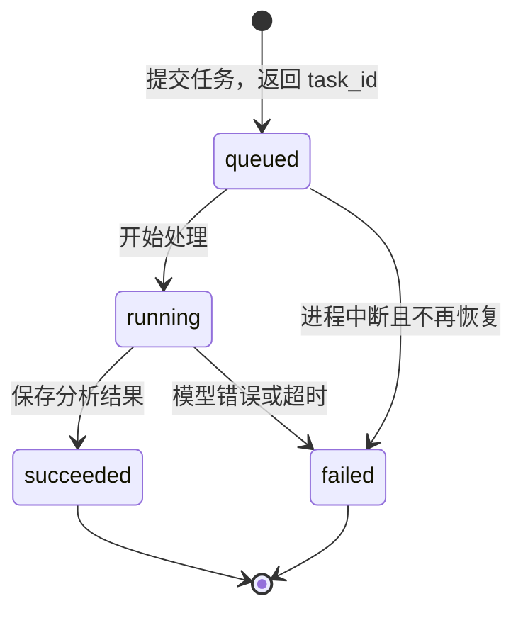

「任务已接收」意味着系统已经保存了任务记录。程序重启后，用户仍能查到任务，知道它已完成、等待处理，还是因中断而失败。小规模版本可以先把记录保存在本地；中断的任务明确标为失败，并说明如何重新提交。需要自动继续执行时，再增加恢复机制。

### 1.5 先确认现状，再做服务入口（D01 → D02）

动手时分两步：先让 Coding Agent 读项目、给出设计和分步计划（D01），确认哪些能力继续用、哪些需要新增；方案确认后再做服务入口（D02）。这一轮只确认方案、不急于实现，能避免边写边改需求。

第二步可以直接复用下面这段指令：

```text
请依据前面确认的设计，把已有业务能力封装成可提交、可查询的任务服务。
继续使用项目现有的模型调用，能区分处理中、成功和失败，并保留任务与结果。
请处理必要的输入检查、访问权限和重启后的任务查询。
提供我能照着执行的启动和本地测试方法，实际完成一次分析。
检查相关行为并记录结果，区分真实模型调用与模拟测试。
```

检查产出不看文件多少，而看一条完整链路：在终端按操作说明提交评论，取得任务编号，再查询到模型分析结果。只看到健康检查成功，还不能算分析已经可用。本地这条链路通了，再去配置平台，失败时才能分清是服务问题还是平台问题。

## 2. 选一个 IM：先分清消息从哪来

IM 是用户使用服务的入口。选择时先看团队在哪里工作、谁有配置权限、机器人要接收什么消息，最后才比较开发便利性。顺序反了，容易在拿到账号后才发现选错了入口。

### 2.1 三个方向，四种接收方式

「Webhook」会出现在不同方向的接口里，读文档时先确认谁向谁发送请求。

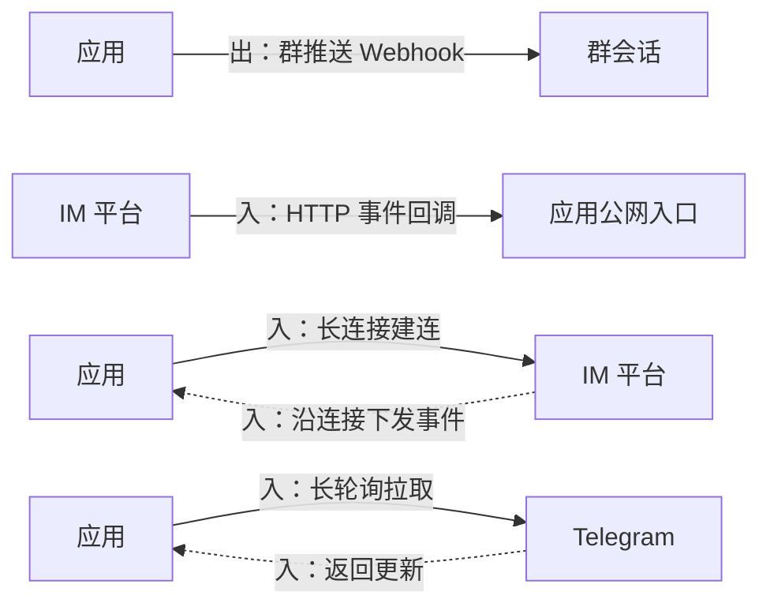

| 方式 | 怎样工作 | 需要准备什么 |
| --- | --- | --- |
| 群推送 Webhook | 应用调用平台给出的地址，向群发消息 | 群配置权限、推送地址；若要对话，另选支持收消息的产品能力 |
| HTTP 事件回调 | 平台向应用的回调 URL 发送事件 | 平台可访问的 HTTPS 地址、平台规定的校验与应答 |
| 长连接 / Stream / Socket Mode | 应用主动连到平台，平台沿连接下发事件 | 可访问平台的运行环境、应用凭证、持续运行的连接进程 |
| 长轮询 | 应用向平台请求更新，等待事件返回后继续拉取 | 运行进程、更新位置管理；Telegram 提供此方式 |

群推送地址只能「发」、不能「收」，这是最常见的误判：拿到一个群机器人地址，就以为可以做对话。真正的对话入口，要么是事件回调，要么是长连接或长轮询。

长连接能减少开发时配置公网入口的工作，但电脑休眠或进程退出，服务仍会中断。无人值守的服务需要放在持续运行的环境中。

### 2.2 五种 IM 的对照

以下比较面向「用户发消息、Agent 回复」的小范围内部使用。同一平台里也有不同类型的机器人，申请前先确认选的是哪一个入口。凭证是程序连接平台用的身份信息，页面常写成 ID、Secret 或 Token，按当前平台的字段名保存即可。

| IM 与产品入口 | 可选接收方式 | 凭证与主要准备 | 适合的起点 |
| --- | --- | --- | --- |
| 飞书自建应用机器人 | 长连接，或 HTTP 事件回调 | App ID、App Secret；机器人能力、接收事件、发送权限、发布范围 | 已有飞书团队，用长连接做本地实操 |
| 钉钉应用机器人 | Stream，或相应 HTTP 模式 | Client ID、Client Secret；应用内机器人、模式设置、版本发布 | 已有钉钉组织与应用开发权限 |
| 企业微信智能机器人 API 模式 | 长连接，或 URL 回调 | 长连接使用 Bot ID、Secret；确认组织允许创建及使用范围 | 已有企微智能机器人能力 |
| Slack App | Socket Mode，或 Events API 的 HTTP 入口 | Bot Token；Socket Mode 还需 App-level Token；事件、权限和工作区安装 | 已有 Slack 工作区与安装许可 |
| Telegram Bot | getUpdates 长轮询，或 webhook | BotFather 创建的 Bot Token；群隐私模式与网络可达性 | 能访问该平台的测试或海外使用场景 |

飞书长连接适合作为本地实操的起点：程序主动连接平台，不用准备公网回调地址，便于观察消息怎样进入服务。实际项目应优先考虑团队已有的 IM，再比较账号权限、开发条件与维护成本。

三个容易混淆的地方值得先记住：企业微信的 Bot ID、Secret 对应智能机器人长连接，自建应用使用的 CorpID、AgentID 不能直接互换；Slack 的 Socket Mode 涉及应用分发条件，面向公共 Marketplace 的产品要另行核对分发要求；Telegram 的长轮询与 webhook 互斥，切换时需要处理已有设置。

### 2.3 账号、额度与费用

先区分使用者与账号类型：一个人学习，也可以使用组织里的账号。飞书和钉钉这两条路径使用组织内应用，先创建或加入练习团队，再取得应用开发权限。

| 平台路径 | 个人怎样开始 | 开始前确认什么 |
| --- | --- | --- |
| 飞书自建应用 | 先取得企业或团队身份，在练习团队内创建应用 | 基础免费版可在现有额度内使用；需要更高调用权益再比较付费版本 |
| 钉钉应用机器人 | 在已有或按平台流程创建的组织内开发，必要时请管理员授权 | 标准版有开发额度；API 和 Webhook/Stream 用量分别受限 |
| 企业微信智能机器人 | 使用企业微信中的组织身份，确认工作台允许创建 API 模式机器人 | 先核对创建、长连接与人员范围；普通个人微信账号走不了这条路径 |
| Slack App | 个人可创建免费工作区并安装 App | 免费版允许有限数量的应用集成 |
| Telegram Bot | 普通个人账号通过 BotFather 创建 | 普通 Bot 基础收发免费，本课不需要 Premium |

免费额度是一定范围的使用权益，不能理解成无限收发。IM 接入、模型调用和程序运行分别产生费用：聊天软件免费不代表模型调用免费，本机运行也不等于可以关掉电脑。

### 2.4 飞书：六步打通第一条消息

飞书自建应用的准备可以拆成六个可观察的阶段，对应操作指南里的 F01～F12。每一步都有「完成标志」，没看到标志就继续下一步，往往会把问题留到联调。

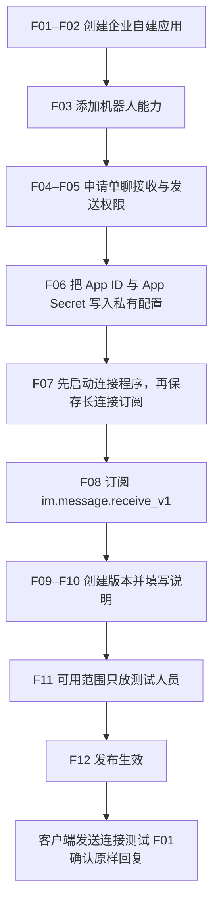

几个细节决定了成败。App ID 和 App Secret 只写进私有配置，供分享的示例只保留字段名和空值，真实值不要粘进开发对话或共享资料；权限先只申请单聊接收与发送（`im:message.p2p_msg:readonly`、`im:message:send_as_bot`），群聊等真正需要时再申请 `im:message.group_at_msg:readonly`；接口权限和事件订阅是两个地方——权限决定应用「被允许做什么」，订阅决定平台「发生什么事时通知程序」。

第一次测试先让机器人把收到的文字原样回复：发送「连接测试 F01」，在同一聊天收到相同文字，才算这次收发走通。然后才把消息交给评论分析服务。只看到「已连接」不够，只在网页选了长连接也不够——自己电脑上的程序必须真的在跑。

### 2.5 钉钉、企业微信与另外两条路径

| 平台 | 开通顺序 | 完成后检查 |
| --- | --- | --- |
| 钉钉 | 进入开发者后台与目标组织 → 创建应用 → 添加机器人能力 → 选 Stream → 获取凭证 → 创建并发布版本 | 开发与使用人员在范围内；机器人已加入测试会话；能接收消息并回复 |
| 企业微信 | 工作台确认智能机器人入口 → 创建机器人 → API 模式 → 选长连接 → 保存 Bot ID、Secret 和机器人配置 | 当前账号有创建与管理权限；机器人可被目标人员使用；同一连接能够收发 |
| Slack | 创建 App → 选择接收事件与消息权限 → 开启 Socket Mode → 生成所需凭证 → 安装到工作区 | 管理员安装策略允许；Bot 已加入目标频道；群提及与单聊按所选范围验证 |
| Telegram | 在 BotFather 创建 Bot → 私存 Token → 选长轮询或 webhook → 用户开启私聊或把 Bot 加入测试群 | 更新可以拉取；群消息接收范围符合预期；回复进入正确会话 |

三条国内路径的启动顺序并不一样，这一点最容易在照抄教程时踩坑。差异来自两个前置条件：平台是否要先看到连接，才允许保存订阅；以及是否要先发布版本，连接才生效。

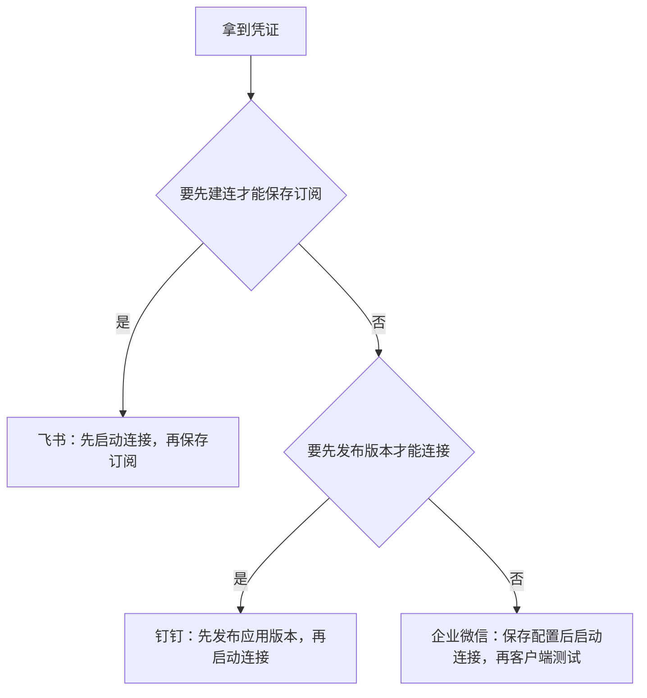

- 飞书必须先启动连接程序，再去网页保存长连接订阅，否则订阅时平台检测不到连接。
- 企业微信先保存机器人配置与凭证，再启动连接，最后到客户端测试；创建权限和使用范围是两件事。
- 钉钉先保存凭证、发布应用版本，再启动连接并测试；机器人页面的「发布」和应用版本的「发布」是两处，都要确认。

发送权限要按实际用到的接口申请，不同平台给的标识不同。钉钉用主动发送接口时搜索 `qyapi_robot_sendmsg`；卡片流式另需 `Card.Streaming.Write`，纯文本起点先不用。飞书则对应 `im:message:send_as_bot`。这些标识只用来在权限页搜索，不需要背；让 Coding Agent 在项目说明里写清用了哪个接口、要哪项权限，再照着申请即可。

## 3. 可插拔 Gateway：把变化关进适配器

如果每个 IM 都复制一份分析代码，修改分析规则时就得逐份维护。可插拔设计让平台收发模块可以替换，业务能力保持统一。

### 3.1 进入服务前统一，交付结果时再分化

收到平台消息后，适配器先提取信息，再由 Gateway 与服务完成任务关联和权限检查。

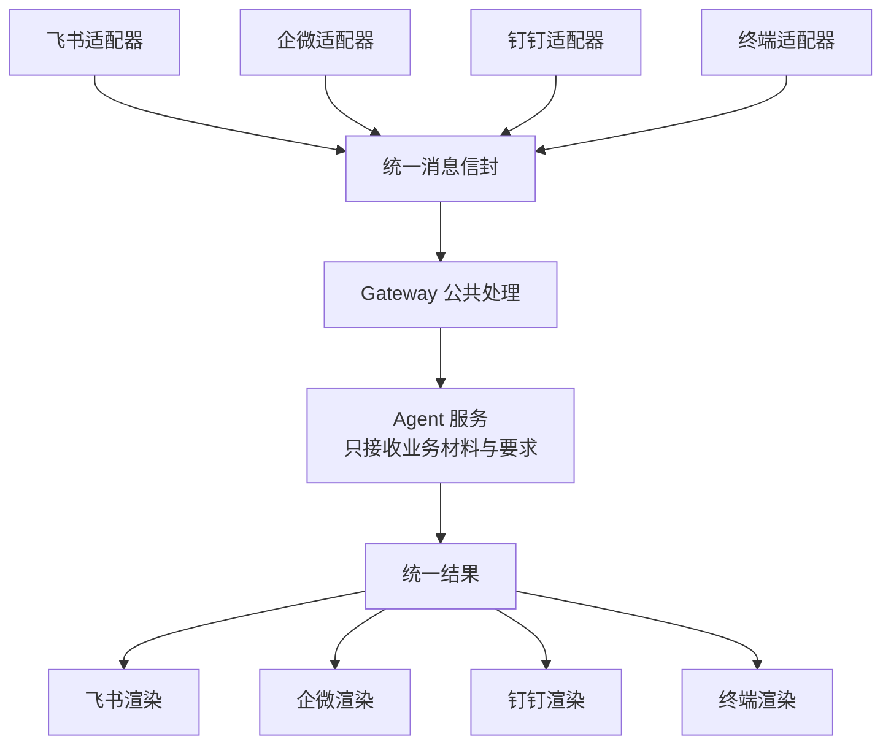

这里的关键不是抽象得多漂亮，而是「哪一层知道平台」：业务服务不应该导入任何平台 SDK，也不应该出现各平台专有的用户标识与会话标识。平台能力仍然可以不同——飞书能更新消息，终端只能打印文本——但差异只出现在适配器的渲染部分。

### 3.2 消息信封里放什么

适配器要提取的信息、以及每项信息由谁负责核对，可以列成一张固定的清单：

| 信息 | 用来解决什么问题 | 由谁提供或检查 |
| --- | --- | --- |
| 平台、组织、应用、用户 | 来自哪个平台和组织，由谁提出 | 适配器提供已验证的平台身份，服务映射业务权限 |
| 会话、回复分支 | 回复到哪里，同一段对话如何归属 | 适配器与 Gateway |
| 平台消息标识 | 辨认平台重复送来的同一条消息 | 适配器按平台文档选取消息或事件编号 |
| 消息正文、附件引用 | 业务要处理什么 | 适配器转换；服务核对附件访问范围 |
| 任务编号、回复位置 | 把业务任务与原回复位置关联 | 服务生成任务号，Gateway 保留回复位置 |

一个可用的内部信封大致如下。字段名可以变，语义不要丢：

```json
{
  "platform": "feishu",
  "tenant": "org_xxx",
  "app": "cli_xxx",
  "user": { "id": "ou_xxx", "verified": true },
  "conversation": { "id": "oc_xxx", "type": "p2p", "reply_to": "om_xxx" },
  "message": { "id": "om_xxx", "text": "...", "attachments": [] }
}
```

回复位置包括具体的单聊、群聊或被回复的消息。接入部分保存这些信息，结果才能回到正确位置；业务模型只接收评论和分析要求。

还要避免把不同人的任务混在一起：程序保存每个任务所属的平台、组织、会话和用户，查询时核对访问权限。第一版让每条请求独立分析；用户要继续处理旧结果时，明确提供原任务编号，这样就能知道使用的是哪一次材料，不依赖程序猜测上下文。

### 3.3 同一件事只做一次

平台有时会重复投递同一条消息。程序用平台提供的消息或事件标识辨认重复，由适配器按该平台规则选取；用户主动再发一次相同文字，则算新的请求。这两件事必须区分开。

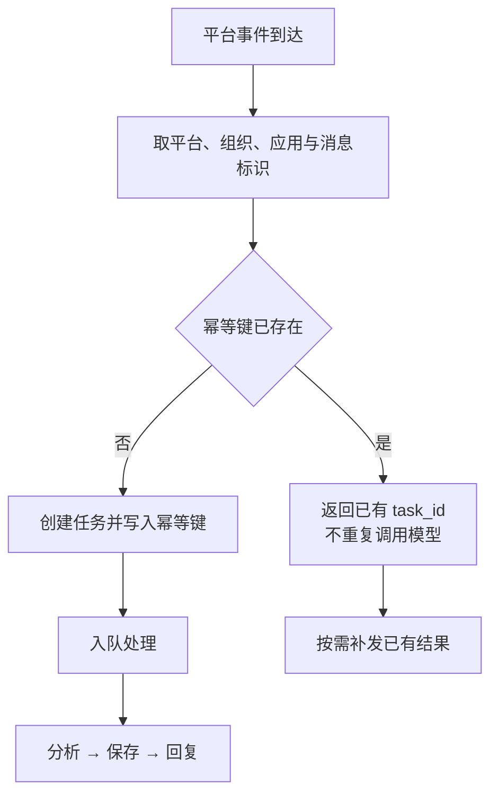

幂等键通常由「平台 + 组织 + 应用 + 平台消息标识」组成。只做去重还不够，还要想清楚重复事件到来时返回什么：返回已有的 `task_id`，而不是报错，否则用户会以为第一次提交失败了。

### 3.4 同一份结果，按平台能力呈现

先保证用户能看见「已收到请求」「最终分析结果」和「失败后怎样继续」三类反馈。各平台适配器根据平台能力，用普通消息、消息更新或卡片来呈现。

| 平台支持什么 | 怎样回复 | 不支持时怎么做 |
| --- | --- | --- |
| 普通文本 | 完整分析正文 | 按平台长度限制分段，保留任务号 |
| 更新消息或卡片 | 用新状态更新原消息 | 先给接收提示，完成后再发结果 |
| 流式显示 | 累积结果并控制更新频率 | 使用完整文本交付 |
| 文件 | 平台允许的附件或受控下载 | 提供摘要，说明可用的取得方式 |

流式显示就是文字分批出现，它能改善等待体验，但第一版先把完整文本收发做好。需要流式时，适配器可以积累一段文字再更新消息，减少发送次数；消息长度、更新频率和回复时限，交给 Coding Agent 按当前平台接口要求处理。

### 3.5 D03：接通消息，再接入分析

部分平台要先看到程序连接，才允许保存订阅设置，所以「全部平台设置做完再启动程序」的顺序是错的。下面以飞书单聊为例，使用其他平台时只替换指令首行：

| 选择的平台 | 指令首行填写什么 | 程序与平台设置的顺序 |
| --- | --- | --- |
| 飞书 | 平台：飞书自建应用机器人；会话：单聊；方式：长连接 | 保存凭证 → 启动连接 → 保存订阅 → 完成事件与发布 |
| 企业微信 | 平台：企业微信智能机器人 API 模式；会话：单聊；方式：长连接 | 保存机器人配置与凭证 → 启动连接 → 客户端测试 |
| 钉钉 | 平台：钉钉应用机器人；会话：单聊；方式：Stream | 保存凭证 → 发布应用 → 启动连接并测试 |

```text
平台：飞书自建应用机器人；会话：单聊；方式：长连接。
请结合当前项目和所选平台的官方接入方式，复用已有任务服务。
分三步完成：先准备连接程序，再验证原样回复，最后接入真实业务处理。
每步通过后再继续；需要我在平台操作时，说明操作位置和完成标志。
平台连接与消息格式留在适配器中，业务能力继续复用，结果回到原会话。
请妥善处理凭证，补充实际启动方法，并记录当前进度和验证结果。
```

检查产出分三层：已连接且平台配置生效、原样回复走通、提交真实评论后在同一聊天收到结果。三项依次通过，再记录完成。这一步的价值在于把「平台问题」和「业务问题」分开——原样回复能过，说明通道没问题；分析不出结果，就去看服务。

## 4. 插件与 vibe 指令

插件是按约定接入的功能模块。约定写清模块接收什么、返回什么、由谁调用，新增功能时就能沿用这个接入位置。

### 4.1 两类插件

渠道插件扩展「从哪里用」，业务插件扩展「能够做什么」。

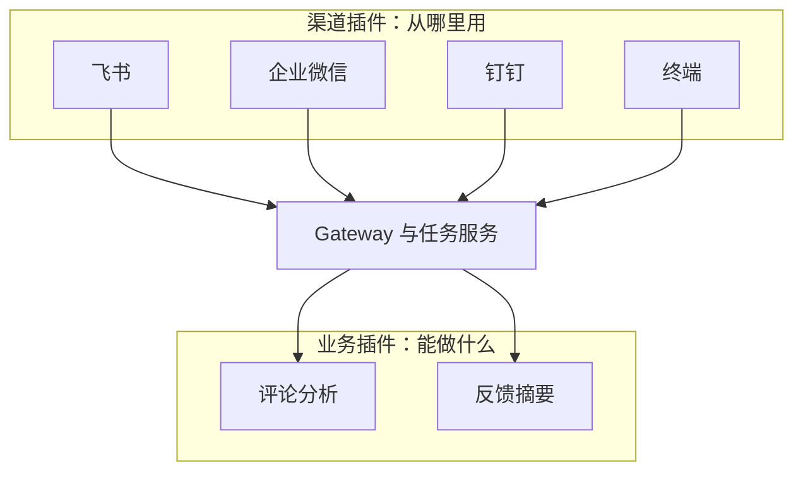

| 类别 | 例子 | 共同约定 |
| --- | --- | --- |
| 渠道插件 | 飞书、企微、钉钉、终端 | 建立与关闭连接、统一消息格式、回复、声明支持的展示能力 |
| 业务插件 | 评论分析、反馈摘要 | 名称与用途、输入输出、权限需求、超时、错误与版本 |

第一版可以在代码中维护一份「插件名称—模块」的对应表，启动时按配置选择模块，这叫显式注册。增加插件时，添加实现并补充登记即可。先用所选 IM 与终端这两个入口，检查能否按配置选择插件。

插件负责把模块接进当前应用。已有 SDK 可以继续使用；已有 MCP 工具或 Skill 也可以在插件内部复用。三者的区别是：MCP 约定怎样调用外部工具，Skill 提供任务做法，插件安排它们在本应用中怎样被使用。

### 4.2 一张插件说明卡

以「评论分析」业务插件为例：

| 项目 | 示例约定 |
| --- | --- |
| 标识与版本 | comment-analysis，版本按实际实现记录 |
| 用途 | 根据给定评论整理问题与建议 |
| 输入 | 评论列表、分析要求，以及程序核验后的数据访问范围 |
| 输出 | 分析正文、实际使用的评论范围 |
| 调用边界 | 只读本次授权材料；超时按配置终止或标记失败 |
| 失败处理 | 区分输入不足、模型不可用与服务内部错误，保留任务号 |
| 验收 | 从终端与 IM 提交相同评论和要求，分别检查结果与内容 |

这张卡不是文档摆设。它同时是开发约定和验收依据：写不清输入输出的插件，多半也没法验收；写明了调用边界，才知道超时该由谁处理。

### 4.3 显式注册

```python
CHANNEL_PLUGINS = {
    "feishu": "gateway.adapters.feishu:FeishuChannel",
    "console": "gateway.adapters.console:ConsoleChannel",
}

BUSINESS_PLUGINS = {
    "comment_analysis": "plugins.comment_analysis:CommentAnalysis",
}
```

显式注册的好处是「新入口只改入口」。改动文件本身就是分工是否清楚的证据：从飞书扩展到钉钉，应该动钉钉适配器、凭证配置、插件登记和钉钉收发测试，任务服务与评论分析流程不动；如果接入钉钉还要修改分析 Prompt，就说明平台差异漏进了业务层。

这次只有评论分析一种业务，直接调用即可。以后增加多种业务时，再决定怎样选择任务，并由程序检查用户能否调用对应能力。

### 4.4 把架构意图写成可验收的指令

有效的开发指令需要交代目标、已有能力、职责边界、观察方法和完成证据。模型擅长补充实现细节，开发者负责说明哪些行为可以改变，以及怎样判断改变有效。

| 含糊指令 | 更具体的表达 |
| --- | --- |
| 接入多个 IM，架构要优雅 | 先接一个 IM，再增加终端入口；两者复用同一服务，业务模块不导入平台 SDK |
| 做成插件化 | 约定连接、消息转换与回复三个边界，显式注册两个渠道，验证关停一方对另一方的影响 |
| 保证稳定 | 重复投递同一事件只创建一个任务；模型失败后有任务号和失败提示 |
| 看看程序有没有正常工作 | 启动后能看到已连接；每次请求能看到收到消息、开始分析、分析完成、回复发出的记录 |

新开 Coding Agent 会话时，先让它查看项目已有说明、设计约定和检查记录，确认已经做到哪一步。已通过的步骤继续沿用，未完成的接着做，比从头描述一遍更可靠。

### 4.5 D04：验证可插拔边界

增加一个终端渠道插件，不需要额外申请账号，却能检验第二个入口是否真正复用服务。检查产出是两组对照：用终端和 IM 分别提交同类评论，看是否使用同一分析服务、结果是否各自回到正确位置；关闭其中一个入口，看另一个是否仍可用。新增改动应该主要在入口、配置和插件登记里，这说明边界立住了。

## 5. 观察运行：一条消息，四条记录

机器人没有回复时，先找到哪一步停了。第一版用项目终端、一个运行记录文件和聊天窗口，就能做基本检查。

### 5.1 先确认「程序在运行、平台已连接」

启动后，终端应显示「服务已启动」「飞书已连接」这类容易理解的文字。测试期间保持电脑开机、程序运行；关闭终端或电脑休眠，都可能让机器人离线。

「已连接」说明程序连上了聊天平台，还要在聊天窗口发一条测试消息并看到回复，才能确认这次收发可用。单独打开健康检查页面，无法代替这次测试。

### 5.2 四条记录，一条任务

为每次分析分配一个任务编号，日志按阶段记录：

| 时间 | 任务编号 | 运行记录 | 能看懂什么 |
| --- | --- | --- | --- |
| 20:05:01 | T001 | 收到消息，已建立任务 | 这次消息进入了自己的程序 |
| 20:05:01 | T001 | 开始分析 | 程序已经调用评论分析能力 |
| 20:05:08 | T001 | 分析完成，结果已保存 | 已经得到一份分析结果 |
| 20:05:09 | T001 | 回复已发出 | 平台接收了发送请求，再到聊天窗口核对内容 |

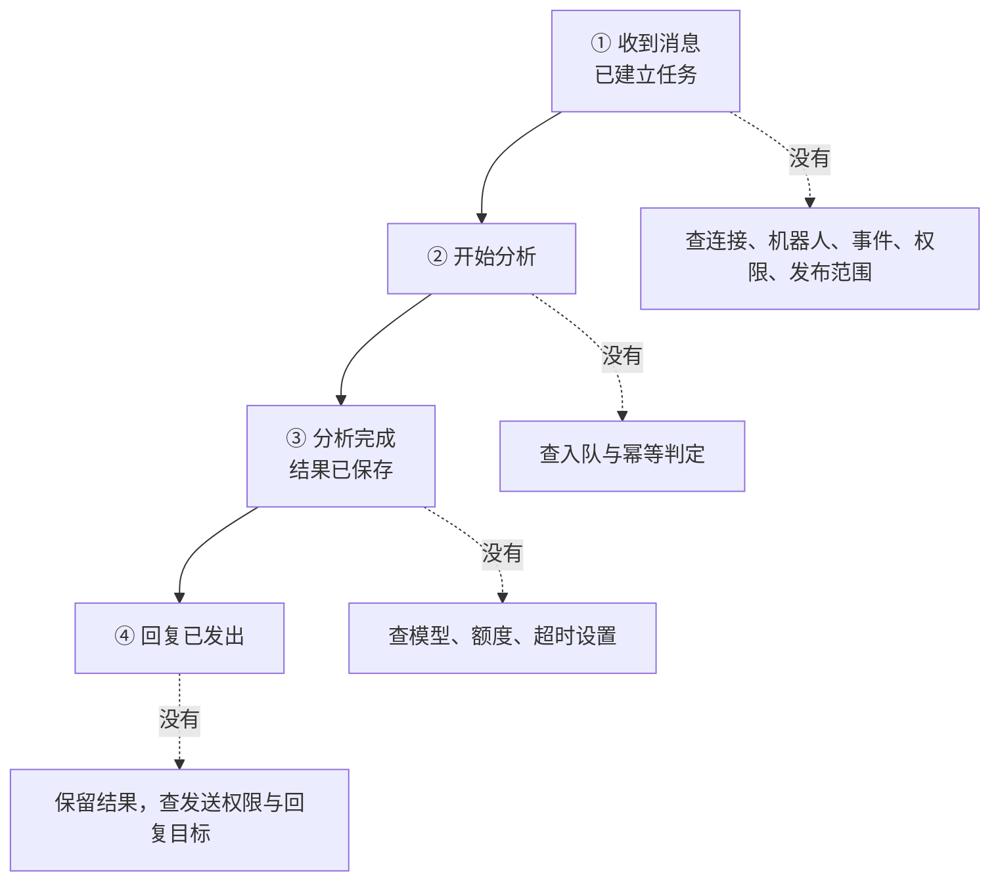

读法是打开同一次任务的记录，按时间往下读。最后停在「开始分析」，就先查模型调用；已经「分析完成」但随后「回复失败」，就先看平台发送错误；完全没有「收到消息」，就检查连接、机器人配置和使用范围。

把阶段、时间、任务编号和简短错误写进日志；真实密钥和无关的聊天原文不记录。把必要的脱敏记录交给 Coding Agent，它能据此定位问题，不需要先上专业监控工具。

### 5.3 按现象定位

日志停在哪个阶段，就把排查范围收到那一段，不必从平台配置一路查到模型：

| 看到的现象 | 先做什么 | 做完怎样确认 |
| --- | --- | --- |
| 没有启动或连接成功提示 | 检查是否启动；让 Coding Agent 查看启动错误和私有配置读取 | 终端出现启动与连接提示，再发测试消息 |
| 已连接，没有「收到消息」的记录 | 确认发给正确机器人，核对事件、权限、版本发布与测试人员范围 | 发一条新测试消息，记录中出现它对应的任务 |
| 开始分析后一直等，或提示分析失败 | 查看模型错误、余额与网络；确认等待多久会提示失败 | 用户能收到完成结果或明确失败提示 |
| 分析完成，回复失败 | 保留已保存结果，检查发送权限和回复位置 | 修复后发送已有结果，不重复调用模型 |
| 同一条平台消息处理了两遍 | 检查重复消息识别，并用测试验证 | 平台重复投递同一条消息时只分析一次 |

分析已有结果而回复失败时，要保留结果、优先检查发送环节。这个顺序能省下一次模型调用，也能避免同一份材料分析出两个不同结论。

### 5.4 D05：补上能读懂的记录

先发一条正常消息，再请 Coding Agent 在测试中模拟一次发送失败，观察两次记录有什么不同。要求是：启动时说明服务和平台的连接情况；每次任务能看到收到消息、开始分析、分析完成、回复发出或失败，并能按任务编号查到；用终端和本地日志文件即可，并说明怎样查看；日志不含密钥和无关聊天原文。

检查产出是能对一条任务回答三个问题：收到了吗、分析完成了吗、回复发了吗。这三个答案决定了下一步该看哪一段代码。

## 6. 联调与验收

这次开发沿「规格 → 业务服务 → 真实 IM → 插件边界 → 运行观察 → 验收」推进。每一步保留已确认的行为，再增加一类新变化。

### 6.1 用可观察行为检查结果

| 检查项 | 操作 | 期望结果 |
| --- | --- | --- |
| 正常请求 | 在允许的会话发送一组评论与要求 | 得到接收反馈、task_id 及真实分析结果 |
| 重复事件 | 重放同一平台事件 | 复用同一任务，分析只执行一次 |
| 输入不足 | 发送缺少评论的分析要求 | 明确指出缺失材料，不编造分析 |
| 身份与隔离 | 用另一用户或组织查询任务 | 按授权拒绝越界查询，不返回他人内容 |
| 业务失败 | 让测试模型调用失败 | 任务最终状态为失败，提示可理解且可定位 |
| 交付失败 | 在测试中阻断一次发送 | 保留结果，重试或查询不重复生成 |
| 重启 | 执行中停止并重启练习服务 | 任务可查，中断得到明确处理 |
| 插件替换 | 使用终端入口提交同类任务 | 同一业务接口约定生效，平台 SDK 留在适配器 |
| 少量同时使用 | 在测试范围内同时发两三条不同请求 | 能分清各自任务，等待时有提示，结果回复正确 |

能够收到回复，说明这次传输可用；分析是否依据评论、引用是否准确，还要单独检查内容。把传输验证和内容评估混在一起，很容易得出「接了 IM 之后效果变差了」这类错误结论。

### 6.2 分阶段推进与交接

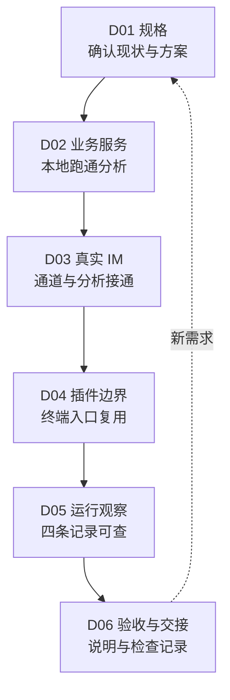

最后一步是整理交接：另一位开发者能按操作说明启动服务、找到一条任务记录、说明各平台差异在哪里，以及发送失败后如何继续处理。这比「功能都做完了」更能说明系统可维护。

需求真正增加时，再判断改哪里：同学改用另一种 IM，增加渠道插件，继续调用原分析服务；除评论分析外还想做别的任务，增加业务插件并说明新任务的输入与结果；少量同学一起用就明显变慢，先记录哪一步耗时、再限制同时处理的任务数量；希望关掉自己的电脑后仍可使用，则把程序放到持续开机的电脑或合适的托管环境。

### 6.3 六个可迁移的设计问题

- 这项 Agent 能力对外承诺什么，输入不足与失败如何表达？
- 用户在哪里发起请求，谁负责接收、执行与最终交付？
- 接入第二个渠道时，哪些变化能够留在渠道适配器？
- 新插件需要哪些输入、权限和验收依据？
- 用户没有拿到结果时，能否沿同一任务找到失败位置？
- 当前扩展需求来自实际使用、测量结果，还是尚未出现的设想？

## 7. 小结

把 Agent 接进 IM，看起来是加一个聊天入口，实际是把「跑一次」改造成「一直在」：接口约定说清输入、结果与失败，任务记录让每次请求可查，适配器吸收平台差异，插件让第二个入口复用同一份能力。

判断这套封装是否成立，不需要复杂的指标，三个问题就够了：新增一个 IM 时，业务代码有没有被改动？一次失败能否沿任务编号找到停在哪一步？关掉一个入口，另一个还能不能用？

做到一个程序、一种真实 IM、一个终端入口和可查询的任务记录，就已经验证了主要架构。更多机器、更多平台、更长时间的在线，是按真实需求再做的扩展，而不是第一版的前提。
